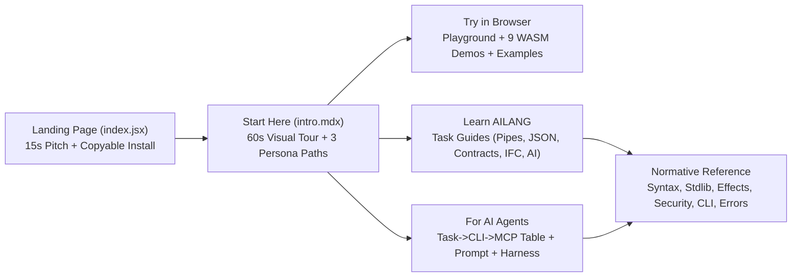

# M-DOCS-VISUAL-NAVIGATION-OVERHAUL: Website Docs Visual & Navigation Overhaul Swarm

**Status**: Planned
**Target**: `v0.64.2` → `v1.0.0`
**Priority**: P0 (User-facing & agent-facing website readiness before `v1.0.0` announcement)
**Estimated**: 1 swarm wave (~5–7 agent-hours wall time across 5 parallel content/visual slices + 1 IA/`llms.txt` integrator + 1 independent verifier)
**Planner-Lane**: `codex-ok` (scoped to `docs/`, `README.md`, `llms.txt`, `tools/generate-llms-txt.sh`, `scripts/check_llms_txt.sh`; zero `internal/` or `cmd/` code edits)
**Dependencies**:
- [m-v1-docs-for-1-0.md](m-v1-docs-for-1-0.md) (doc-sample gate, 1.0 promise pages, M4 fleet-runbook classification)
- [m-v1-closeout-swarm.md](m-v1-closeout-swarm.md) (shipped `v0.64.0` close-out: 16 deprecated aliases removed, initial 1.0 sync)
- [m-docs-mdx-autolink-fix.md](../v0_64_2/m-docs-mdx-autolink-fix.md) (MDX compilation hazard rules: no `<https://...>` autolinks or unescaped `{...}` in prose)
- [docs-mission.md](../../docs-mission.md) (Clauses 1–7, especially Clause 5 concision & nav-shrink invariants)
**Baseline Commit**: `988772ad` (`origin/dev`, post-`v0.64.1` + `#2474` + `#2476`)
**Created**: 2026-11-26

---

## Axiom Compliance

**Canonical reference:** [Design Axioms](/docs/references/axioms)

### Axiom Scoring

| Axiom | Score | Justification |
|-------|-------|---------------|
| A1: Determinism | +1 | Deterministic `llms.txt` / `llms-full.txt` generation and `@docusaurus/plugin-client-redirects` eliminate silent path-skip drift and URL breakage. |
| A2: Replayability | 0 | Runtime trace format unchanged; trace CLI examples (`--emit-trace jsonl`) verified against `cmd/ailang/main_run.go`. |
| A3: Effect Legibility | +1 | Bespoke capability/effect-row/IFC SVG + Mermaid diagrams and updated guides make `! {Effects}`, `--caps auto`, `--policy`, and `Declassify` visually explicit. |
| A4: Explicit Authority | +1 | Relocates 10 internal operator runbooks out of user guides into `docs/internal/` and renders explicit `tier: experimental \| internal` banners from frontmatter. |
| A5: Bounded Verification | +1 | Every `.ail` example passes `make check-doc-samples` (0 new baseline rows), every page passes Docusaurus MDX compilation (`npm run build`), and `check_doc_review.sh` reaches 0 overdue / 0 missing `reviewBy`. |
| A6: Safe Concurrency | 0 | No runtime concurrency changes. |
| A7: Machines First | +1 | Fixes the broken `llms.txt` generator (currently skipping 100% of `docs/docs/reference/*.md` except `reserved-keywords.md`), adds a zero-prose Task→CLI→MCP→Example routing table for agents, and unlists 58,539 lines of obsolete `v0.8`–`v0.16` prompts from site search. |
| A8: Minimal Syntax | 0 | No new language syntax; teaches shipped `v0.60`–`v0.64.1` constructs with verified idioms. |
| A9: Cost Visibility | 0 | Reduces LLM context waste when reading docs/`llms.txt` by cutting prose walls 35–50%. |
| A10: Composability | +1 | Pairwise-disjoint 5-slice + integrator + verifier swarm contract guarantees zero file-edit collisions. |
| A11: Structured Failure | 0 | Diagnostic error index (`reference/errors/index.md` + 8 error pages) is wired into the `Reference` sidebar instead of sitting orphaned. |
| A12: System Boundary | 0 | Compiler/runtime packages (`internal/`, `cmd/`) are untouched. |

**Net Score: +6** → **Decision: Proceed**

### Hard Violation Check

- [x] A1 (Determinism): No implicit nondeterminism introduced
- [x] A3 (Effects): No hidden side effects; `--caps auto` and `[bin]` shim authority explicitly shown in diagrams
- [x] A4 (Authority): Tightens boundary between Stable public docs, Experimental features, and Internal fleet runbooks
- [x] A7 (Machines First): Optimizes navigation and `llms.txt` / `for-ai-agents.mdx` for both autonomous agents and human developers

---

## Problem Statement & Measured Full-Site Audit

Human readers and AI agents arriving at `https://ailang.sunholo.com` encounter an overgrown, prose-heavy documentation tree (`184` files, `110,791` lines) accumulated across 64 minor releases. While `v0.64.0` landed initial 1.0 reference pages, a quantitative full-site audit of `origin/dev` (`988772ad`) via `/tmp/docs_audit.py` reveals four systemic problems:

### 1. Navigation & Information Architecture Audit (Humans + Agents)

- **Site composition (`docs/docs/`)**: **184 `.md`/`.mdx` files (`110,791` lines)** = **155 hand-authored pages (`46,186` lines**: `13,149` pure prose lines, `14,953` code-fence lines, `3,722` table lines) + **29 generated pages (`64,605` lines)**. Of the generated lines, **23 historical prompt snapshots (`docs/docs/prompts/v0.8.2.md`..`v0.16.18.md`) account for `58,539` lines (52.8% of the entire `docs/docs/` tree!)**, all indexed by site search and teaching obsolete syntax rules (e.g. `prompts/v0.4.8.md:950`: `"❌ NO tuple destructuring let (x, y) = pair"`).
- **Top Navbar (`docs/docusaurus.config.js:160-212`)**: **10 items** (`Why AILANG`, `Vision`, `Documentation`, `Examples`, `Playground`, `Benchmarks`, `Live Demos`, `Feedback`, `llms.txt`, `GitHub`) — crowded on laptop viewports, with overlapping conceptual links (`Why AILANG` vs `Vision`; `Playground` vs `Live Demos`), and `editUrl` still pointing to `tree/main/docs/` (`L139`).
- **Sidebar overload (`docs/sidebars.js`)**: **7 top-level sections**, **23 nested categories**, **134 entries**, **max nesting depth 4**, and **4 top-level sections forced `collapsed: false`** (`Start Here`, `Learn AILANG`, `For AI Agents`, `Reference`), exposing **43 links immediately on page load**.
- **24 Orphaned Hand-Authored Pages (missing from `docs/sidebars.js`)**:
  - **6 completely unreachable dead islands** (0 inbound links from any reachable page):
    1. `guides/maintenance-benchmark.md` (`99L`, 0 inbound, missing `reviewBy`)
    2. `guides/mission-role-dispatch.md` (`147L`, 0 inbound) + `guides/mission-iteration.md` (`215L`, linked only from `mission-role-dispatch.md`)
    3. `reference/std-package.md` (`186L`) + `reference/std-extension.md` (`158L`) — a closed 2-page mutual loop with 0 links from `stdlib.md` or `sidebars.js`
    4. `reference/option-vs-result.md` (`129L`, 0 inbound)
    5. `recipes/ai-tool-loop.md` (`203L`, 0 inbound)
  - **18 sidebar-hidden pages** (reachable only via inline prose links): `reference/errors/index.md` (`277L`) + 8 error-code pages (`bc001`, `mod007`, `mod013`, `mod015`, `rt001`, `tc_newtype_001`, `tc_nominal_001`, `typ_effect_row_mismatch`), `reference/std-{audio,xml,yaml}.md`, `guides/agent-tool-policy.md` (`355L`, `--policy` guide), `examples/ai-api-integration.mdx` (`372L`), `recipes/ai-token-streaming.md` (`309L`), and `legal/{privacy,terms}.md`.
  - Plus **2 legacy non-Docusaurus files** sitting outside `docs/docs/` at `docs/guides/{inline_tests,module-imports}.md`.
- **10 Internal Operator / Fleet Runbooks mixed into public docs**: The **7 M4 fleet runbooks** (`guides/mission-bootstrap` `389L`, `guides/mission-model-fleet` `159L`, `guides/claude-api-credits` `217L`, `guides/coordinator-workers` `280L`, `guides/notify-daemon` `176L`, `guides/database-architecture` `172L`, `guides/evaluation/local-ollama` `343L` = `1,736` lines, only **5** repo-internal inbound links) sit in public categories alongside 3 orphaned fleet docs (`461` lines). **41 site files (`291` hits)** leak internal rig/fleet names (`multivac`, `motoko`, `rig.lock`, `launchd`, `stapledon`, `daneel`) without an `Internal` tier banner.
- **Duplicate / Overlapping Pitch & Agent Pages**:
  - Value proposition repeated across 5 entry surfaces: `src/pages/index.jsx` (`1,396L`), `intro.mdx` (`153L`), `why-ailang.mdx` (`362L`), `why-1-0.mdx` (`60L`), and `vision.mdx` (`272L`).
  - Three-camps thesis split across `guides/three-camps-comparison.md` (`215L`) + `guides/three-camps-self-audit.md` (`277L`) = `492L` (`docs-14`).
  - Agent onboarding split across 6 pages (`start-here/for-ai-agents.mdx`, `guides/agent-integration.mdx`, `guides/ailang-vs-agents.mdx`, `guides/claude-code-integration.mdx`, `guides/agent-mcp.md`, `guides/ai-prompt-guide.mdx`), where `for-ai-agents.mdx` (`38L`) contains **zero CLI commands** and **zero task routing table**, and `agent-integration.mdx:47` has a **silent 404 link** (`<a href="/docs/prompts/v0.16.20">` — raw `<a>` bypasses Docusaurus broken-link checking, and `v0.16.20.md` is not in `docs/docs/prompts/`!).
- **CRITICAL Silent Failure in `llms.txt` (`tools/generate-llms-txt.sh`)**: `docs/llms.txt` (`173,183` bytes, `4,552` lines) claims to bundle the guides and language reference, but **6 of 9 path checks in `tools/generate-llms-txt.sh` point to nonexistent pre-Docusaurus paths** (`docs/index.md`, `getting-started.md` instead of `.mdx`, `ai-prompt-guide.md` instead of `.mdx`, `module_execution.md` instead of `.mdx`, `docs/reference/` instead of `docs/docs/reference/`, `docs/reference/implementation-status.md`). Consequently, `llms.txt` omits **100% of `language-syntax.md`, `stdlib.md`, `effects.md`, `modules.md`, `cli.md`, `stability.md`, `security-model.md`, and `getting-started.mdx`**, bundling only `README.md`, `wasm-integration.md` (`1,064` lines of nginx/CI config), `reserved-keywords.md`, `v0.16.20` prompt, and `examples/STATUS.md` — with no lightweight `/llms.txt` routing index vs `/llms-full.txt` corpus split!

### 2. Stale Info & Overdue Review Inventory

- **`scripts/check_doc_review.sh` (`2026-11-26`)**: **158 scanned pages → 24 overdue + 2 missing `reviewBy` (`26` total warnings), 0 malformed**:
  - **Missing `reviewBy` (2)**: `docs/docs/guides/maintenance-benchmark.md`, `docs/docs/reference/reserved-keywords.md`.
  - **Overdue since `2026-11-02` (6)**: `architecture/adding-operators.md`, `architecture/debug-tools.mdx`, `guides/ai-prompt-guide.mdx`, `playground.mdx`, `prompts/index.md`, `references/axioms.mdx`.
  - **Overdue since `2026-11-09` (5)**: `architecture/anf.md`, `guides/examples-search.mdx`, `guides/workspaces.md`, `references/design-lineage.mdx`, `references/philosophical-foundations.mdx`.
  - **Overdue since `2026-11-16` (6)**: `guides/go-interop.md`, `guides/testing.md`, `guides/traces.md`, `packages/explorer.mdx`, `packages/graph.mdx`, `reference/repl-commands.md`.
  - **Overdue since `2026-11-23` (7)**: `feedback.mdx`, `guides/autonomous-package-updates.md`, `guides/contracts.mdx`, `start-here/evaluating.mdx`, `start-here/for-ai-agents.mdx`, `docs/TESTING.md`, `docs/VISION.md`.
- **Concrete Factual Contradictions & Stale Claims**:
  - `vision.mdx:242`: asserts `"No LSP/IDE servers — AIs use CLI/API, not text editors"` — directly contradicting `ailang lsp --stdio`, `guides/lsp.md`, and `README.md:190`.
  - `intro.mdx:107-109`: lists `"Execution Profiles (v0.6.0)"`, `"Deterministic Tooling (v0.7.0)"`, and `"Shared Semantic State (v0.6.0)"` under Roadmap on a `v0.64.1` site (`SharedMem` already shipped!).
  - `intro.mdx:84`, `examples.mdx:209`, `getting-started.mdx:361`: claim **record subsumption** (false — closed records reject extra fields; AILANG uses row polymorphism `{name: string | r}`).
  - `reference/implementation-status.md:43`: instructs users to run `ailang prompt --compact` (broken/stale `v0.7.4` flag already purged from MCP `onboarding_guide` in `v0.62.1`) and stamps `Verification (v0.6.1+)` (`L47`).
  - `README.md:116`, `getting-started.mdx:75,84`: pin `VERSION=v0.33.1`, `VERSION=v0.9.0`, `v0.18.11`; `README.md:205` links dead `/docs/guides/development` (actual: `/docs/guides/development-workflow`); `README.md:235` directs external AI users to contributor `AGENTS.md`.
  - `README.md:169-178`, `getting-started.mdx:280`, `quick-start-examples.mdx:316`, `reference/repl-commands.md:53` (`24` hits across 4 files): show obsolete `λ>` REPL prompt and polymorphic `:type \x. x + x` output instead of `λ[Debug,IO]>` and defaulted `Int`.
  - `docs/LIMITATIONS.md` & `reference/limitations.md`: stamped `"live-verified at v0.33.1"` (`27` + `15` old version stamps).
  - **Version-narration clutter**: **83 non-generated site files (`750` hits)** contain historical `v0.1`–`v0.59` version stamps (`wasm-integration.md` 36, `limitations.md` 27, `coordinator.md` 23, `serve-api.md` 19, `evaluation/architecture.md` 18, `mcp-connectors.md` 16, `agent-messaging.md` 14, `debugging.md` 13, `ifc-labels.mdx` 10).
  - *Already clean post-`v0.64.0`*: Go codegen (`--emit-go` / `ailang compile`), `extern func`, and the 16 `@deprecated` stdlib names are accurately marked **Removed** in `go-interop.md`, `upgrading-to-1-0.md`, `stability.md`, `implementation-status.md`, and `cli.md` (note: `prompts/v0.16.20.md:790` remains intentionally frozen per `m-v1-closeout-swarm` `D2` until the next prompt bump).

### 3. Feature Coverage Matrix (`v0.60`–`v0.64.1`)

While `v0.64.0` added syntax entries to `reference/language-syntax.md` and bullet summaries in `intro.mdx`/`why-1-0.mdx`, **practical teaching in `start-here/*`, `guides/*`, and `llms.txt` (outside the raw prompt) is severely missing**:

| Feature (`v0.60`–`v0.64.1`) | `start-here/*` + Pitch | `guides/*` Teaching | `reference/*` | `llms.txt` (outside prompt) | Gap to Close |
|---|:---:|:---:|:---:|:---:|---|
| `\|>` pipe operator | 2 (`intro`, `why-1-0`) | **0** | 1 (`language-syntax`) | **No** | Teach in `getting-started`, `quick-start-examples`, `for-ai-agents` |
| Record / tuple / lambda destructuring | 1 (`why-1-0`) | 2 | 1 (`language-syntax`) | **No** | Show closed `{a, b}` vs open `{a, ...}` & `\(k, v).` in `getting-started` |
| `_?` / `?name` typed holes (`TC_HOLE`) | 2 (`intro`, `why-1-0`) | 1 (`lsp`) | 1 (`language-syntax`) | **No** | Add multi-hole agent loop to `for-ai-agents` & `debugging` |
| Unbraced multi-statement `match`/`if` | 2 (`intro`, `why-1-0`) | **0** | 1 (`language-syntax`) | **No** | Show in `quick-start-examples` & `getting-started` |
| `deriving (Json)` (`encode<T>`/`decode<T>`) | 2 (`intro`, `why-1-0`) | **0** | 2 (`language-syntax`, `impl-status`) | **No** | Teach in `getting-started`, `ai-effect`, `quick-start-examples` |
| `let x = expr?` error/option propagation | 2 (`intro`, `why-1-0`) | 1 (`upgrading-to-1-0`) | 3 | **No** | Teach in `getting-started`, `option-vs-result`, `quick-start-examples` |
| `ailang inspect` (`--format=agent`, `--json`) | 2 (`intro`, `why-1-0`) | **0** | 4 | **No** | Make primary agent X-ray tool in `for-ai-agents`, `module_execution`, `debugging` |
| `ailang check --fix` & LSP `codeAction` | 2 (`intro`, `why-1-0`) | 1 (`lsp`) | 2 | **No** | Teach `! {Effects}` stamping, `++`→`"${...}"`, `TC_MATCH_002` in `for-ai-agents` & `debugging` |
| `ailang verify` (Z3 `int64`, tuples, `()`, counterexamples) | 1 (`why-1-0`) | 9 (stale pre-`v0.64`) | 6 | **No** | Update `contracts.mdx` with `v0.64.0` `Tuple0`/`Tuple2..8`, `--int-model=int64`, opaque helpers & AILANG counterexamples |
| `--caps` (`auto` caveat) & `--policy` / `@limit=N` | 1 (`why-1-0`) | 5 (`agent-tool-policy` orphaned!) | 5 | **No** | Wire `agent-tool-policy.md` into sidebar; add visual capability/budget diagram |
| IFC taint labels (`T<label>`, `T{not L}`, `Declassify`) | 3 | 8 | 4 | **No** | Cut prose in `ifc-labels.mdx` + add visual taint-lattice diagram & `#1134` cross-module note |
| Bytecode VM (`--bytecode`, `--strict-bytecode`) | 3 | 6 | 10 | **No** | Add Two-Engines diagram & `--strict-bytecode` CI check recipe |
| Package `ailang.lock` / `pkg docs` / `export import` | **0** | 10 | 5 | **No** | Document atomic `ailang.lock`, v2 contract sigs, nested `ailang.toml`; keep `export import` marked unsupported (`PAR_EXPORT_REQUIRES_FUNC` until open PR `#2475` merges) |

### 4. Prose Walls vs Examples, Diagrams & Images Inventory

- **Severe visual deficit**:
  - Across **155 hand-authored pages**, only **16 pages (10.3%)** contain a Mermaid diagram (**22 Mermaid diagrams total**), despite `@docusaurus/theme-mermaid` + `@mermaid-js/layout-elk` being installed in `docs/package.json`.
  - Conversely, **29 hand-authored pages embed 52 brittle ASCII-art box diagrams (`889` lines of `┌───┐` / `+---+` text boxes)**!
  - Only **8 pages (5.2%)** display any image (`29` image refs total, `15` of which are OAuth screenshots on one page `mcp-connectors.md`).
  - `docs/static/img/` (`39` files): `25` OAuth connector screenshots (`5` unreferenced = `559 KB`), `9` logos/stickers, `2` LoCoBench paper figures, `3` old trace/dashboard PNGs (`1` unreferenced `aitana-dashboard-react.png` = `759 KB`), and **ZERO (`0`) conceptual SVG diagrams** for AILANG's kernel, effects, Z3 contracts, IFC taint lattice, two-engine VM, or agent toolchain!
  - `docs/src/components/` (`20` entries): `Icon` (16 pages), `AddToAgent` (home + `getting-started`), `AilangRepl` (2 pages), `BenchmarkMini` (home), `PackageExplorer` (2 pages), 10 benchmark chart components, and **5 completely dead/unused components** (`BenchmarkDashboard/`, `DataProvenance/`, `LocalCloudBadge/`, `ModelRadarComparison/`, `src/components/ailang-repl.js` duplicate of `static/js/ailang-repl.js`).

#### Top 25 Most Prose-Heavy Hand-Authored Pages (Measured Baseline)

| Rank | Page (`docs/docs/...`) | Total Lines | Prose Lines | Prose % | Code Lines | Table Lines | Mermaid | Images | ASCII Boxes |
|---:|---|---:|---:|---:|---:|---:|---:|---:|---:|
| 1 | `guides/serve-api.md` | 2,111 | **602** | 36% | 804 | 150 | 0 | 0 | 2 |
| 2 | `guides/mcp-connectors.md` | 878 | **470** | 65% | 164 | 56 | 0 | 15 | 0 |
| 3 | `guides/debugging.md` | 1,053 | **388** | 45% | 334 | 85 | 0 | 0 | 0 |
| 4 | `guides/coordinator.md` | 1,686 | **357** | 26% | 682 | 154 | 2 | 1 | 5 |
| 5 | `reference/limitations.md` | 701 | **355** | 64% | 159 | 9 | 0 | 0 | 0 |
| 6 | `guides/contracts.mdx` | 991 | **329** | 42% | 259 | 92 | 0 | 0 | 0 |
| 7 | `guides/ifc-labels.mdx` | 583 | **248** | 53% | 135 | 42 | 0 | 0 | 0 |
| 8 | `guides/agent-tool-policy.md` | 355 | **242** | 80% | 39 | 11 | 0 | 0 | 0 |
| 9 | `examples.mdx` | 832 | **241** | 38% | 100 | 167 | 0 | 1 | 0 |
| 10 | `reference/stability.md` | 597 | **224** | 44% | 20 | 231 | 0 | 0 | 0 |
| 11 | `guides/mission-bootstrap.md` *(move)* | 389 | **216** | 69% | 75 | 5 | 0 | 0 | 0 |
| 12 | `guides/package-publishing.md` | 484 | **206** | 56% | 120 | 17 | 0 | 0 | 1 |
| 13 | `guides/agent-messaging.md` | 971 | **198** | 25% | 444 | 76 | 0 | 0 | 1 |
| 14 | `guides/telemetry.md` | 957 | **187** | 25% | 310 | 141 | 1 | 0 | 9 |
| 15 | `reference/effects.md` | 804 | **185** | 28% | 325 | 100 | 0 | 0 | 0 |
| 16 | `guides/wasm-integration.md` | 1,059 | **180** | 21% | 500 | 96 | 0 | 0 | 0 |
| 17 | `guides/parameterised-effects.md` | 323 | **170** | 63% | 40 | 43 | 0 | 0 | 0 |
| 18 | `guides/evaluation/eval-loop.md` | 445 | **157** | 45% | 153 | 0 | 0 | 0 | 0 |
| 19 | `guides/cloud-messaging-integration.md` | 1,786 | **156** | 10% | 1,089 | 175 | 0 | 0 | 5 |
| 20 | `why-ailang.mdx` | 362 | **156** | 62% | 26 | 46 | 0 | 2 | 0 |
| 21 | `guides/ai-effect.mdx` | 502 | **145** | 36% | 152 | 65 | 0 | 0 | 0 |
| 22 | `guides/ai-routing.md` | 337 | **145** | 52% | 106 | 14 | 0 | 0 | 0 |
| 23 | `guides/development-workflow.md` | 411 | **136** | 43% | 118 | 8 | 1 | 0 | 1 |
| 24 | `guides/evaluation/local-ollama.md` *(move)* | 343 | **134** | 49% | 116 | 5 | 0 | 0 | 1 |
| 25 | `guides/evaluation/harness-setup.md` | 357 | **132** | 48% | 110 | 12 | 0 | 0 | 0 |

---

## Measured Verification Log

Every positive and negative-existence claim in this design was verified against `/tmp/docs-overhaul-plan` (`988772ad`) and `ailang v0.64.1` on 2026-11-26:

| ID | Premise / Claim | Command / File Inspected | Measured Result |
|----|-----------------|--------------------------|-----------------|
| **V1** | Overdue & missing `reviewBy` count | `bash scripts/check_doc_review.sh` | `doc review: 158 pages, 24 overdue, 2 without reviewBy, 0 malformed (today 2026-11-26)`. |
| **V2** | Site page, prose, Mermaid, image & ASCII counts | `python3 /tmp/docs_audit.py` → `/tmp/docs_audit_results.json` | `184` total `.md/.mdx` (`155` hand-authored = `46,186L` / `13,149` prose lines; `29` generated = `64,605L`). `22` Mermaid diagrams on `16` pages vs `52` ASCII-box blocks (`889L`) on `29` pages; `0` conceptual SVGs in `docs/static/img/`. |
| **V3** | Sidebar shape & orphaned pages | `node` AST walk over `docs/sidebars.js` vs `docs/docs/**/*.{md,mdx}` | `7` top sections, `23` categories, `134` entries, max depth `4`, `4` expanded top sections (`43` visible items on load). Exactly `24` hand-authored pages absent from `sidebars.js` (`6` with `0` external inbound links). |
| **V4** | No redirect plugin installed today (negative existence) | Read `docs/package.json` & `docs/docusaurus.config.js` | `@docusaurus/plugin-client-redirects` is **absent** from `docs/package.json` and `docusaurus.config.js:105`. Moving/merging public URLs requires adding it or leaving redirect stubs. |
| **V5** | `llms.txt` silent path-rot bug | Read `tools/generate-llms-txt.sh:53-134` + `grep "^# " docs/llms.txt` | `docs/index.md`, `getting-started.md`, `ai-prompt-guide.md`, `module_execution.md`, `docs/reference/`, and `docs/reference/implementation-status.md` do **not** exist (`False`). `llms.txt` (`173,183B`, `4,552L`) includes only `README.md`, `wasm-integration.md`, `reserved-keywords.md`, `v0.16.20` prompt, and `examples/STATUS.md`. |
| **V6** | `check-llms-txt` CI contract | Read `scripts/check_llms_txt.sh:26-37` | Asserts `llms.txt`, `docs/llms.txt`, and `docs/static/llms.txt` exist and contain the active `prompts/versions.json` prompt (`v0.16.20`) verbatim (`make check-llms-txt` in `ci-quick` and `ci`). |
| **V7** | Historical `prompts/v*.md` pollution & `v0.16.20` 404 | `git ls-files docs/docs/prompts/` + read `agent-integration.mdx:47` & `docs/package.json:10` | `23` old `v0.8.2`..`v0.16.18` files (`58,539L`) are tracked in git; `v0.16.20.md` is **not** (`sync-all` runs `sync-active-prompt.sh` → `current.md` only), making `<a href="/docs/prompts/v0.16.20">` in `agent-integration.mdx:47` a live 404. |
| **V8** | `export import` status on `v0.64.1` | `ailang check` on scratch `export import std/io (println)` + `design_docs/planned/v0_63_0/m-pkg-parallel-agents.md` | Fails with `PAR_EXPORT_REQUIRES_FUNC: export must be followed by 'func' or 'type', got 'import'`. Re-export syntax is open PR `#2475`; docs must NOT claim it works until `#2475` merges. |
| **V9** | Closed record destructuring & modern `v0.63` stack | `cd /tmp/docs-overhaul-plan && ailang check` + `ailang inspect` on `Item deriving (Eq, Json)` + `\|>` + `expr?` + unbraced `if` | `let { qty } = item` on a 3-field closed record fails (`record field mismatch`); `let { name: _, qty, note: _ } = decodeItem(j)?` (or `{ qty, ... }`) checks cleanly (`✓ No errors found!`) and `ailang inspect` prints 2-line X-ray. |
| **V10** | `--emit-trace` flag existence | `grep -rn "emit-trace" cmd/ailang/` | `cmd/ailang/main_run.go:127` defines `--emit-trace` (`jsonl, otel, auto`). Valid flag (omitted only from top-level `--help` summary). |
| **V11** | `vision.mdx:242` LSP contradiction | Read `docs/docs/vision.mdx:242` vs `ailang lsp --help` | `vision.mdx:242` claims `"No LSP/IDE servers"`, while `ailang lsp` is a shipped top-level command with `guides/lsp.md`. |
| **V12** | `stability.md` Go test coupling | Read `internal/iface/tier_test.go:233-254` & `m-v1-closeout-swarm.md` V3 | `TestStabilityDocListsEveryDeprecation` asserts `docs/docs/reference/stability.md` retains `### Deprecated stdlib names` with all 16 rows. Must not be deleted during prose trimming. |
| **V13** | Doc-sample baseline state | `cat scripts/doc_samples_baseline.txt` & `scripts/doc_samples_unchecked.txt` | Only **1** failing block remains in `doc_samples_baseline.txt` (`examples/runnable/secrets/sink_function_value.ail`); `28` `sketch`/`repl` blocks in `doc_samples_unchecked.txt`. Shrink-only ratchet in CI. |
| **V14** | MDX compilation hazard rules | Read `design_docs/planned/v0_64_2/m-docs-mdx-autolink-fix.md` | Docusaurus compiles both `.md` and `.mdx` as MDX (`format: 'mdx'`). Bare `<https://...>` autolinks and unescaped `{...}` in prose/headings break `docs-build`. |
| **V15** | Custom theme swizzle state (negative existence) | `ls docs/src/theme/` | Contains only `prism-ailang.js` and `prism-include-languages.js` — no existing `DocItem` wrapper exists, so swizzling `DocItem/Content` for `<TierBanner />` will not collide with existing theme overrides. |
| **V16** | Unused images & React components | `python3 /tmp/docs_audit.py` asset/component xref | `6` static images (`1,317,648` bytes: `aitana-dashboard-react.png` + 5 `connectors/*.png` + `ailang-logo.png`/`logo.png` duplicates) and `5` `src/components/` entries (`BenchmarkDashboard`, `DataProvenance`, `LocalCloudBadge`, `ModelRadarComparison`, `src/components/ailang-repl.js`) have `0` imports/references. |

---

## Goals

**Primary Goal:** Transform `ailang.sunholo.com` into a visual-first, zero-stale-info, easily navigable documentation site for both humans and autonomous AI agents — cutting prose walls by 35–50%, replacing all 52 ASCII diagrams with Mermaid + 8 bespoke SVG diagrams, teaching every `v0.60`–`v0.64.1` feature in guides, fixing `llms.txt`, and reaching **0 overdue reviews** and **0 orphaned pages**.

**Measurable Success Metrics:**
1. **Navigation simplicity**: Top navbar `10 → 6` items; sidebar `7 → 5` top-level sections, max depth `4 → 3`, initial visible items on load `43 → ≤18`; orphaned user-facing pages `22 → 0` (excluding `legal/{privacy,terms}.md` footer routes); 0 broken links or 404s.
2. **Zero staleness & review debt**: `bash scripts/check_doc_review.sh` reports **`0 overdue, 0 without reviewBy, 0 malformed`** (down from `24 overdue + 2 missing`); `0` occurrences of `"No LSP/IDE"`, `v0.6.0`/`v0.7.0` roadmap claims, false record subsumption, `ailang prompt --compact`, or `λ>` REPL prompts; historical `v0.1`–`v0.59` prose stamps cut by `≥80%`.
3. **100% `v0.60`–`v0.64.1` guide & `llms.txt` coverage**: Every row in the 13-feature coverage matrix (`|>`, destructuring, `_?`/`?name`, unbraced `match`/`if`, `deriving (Json)`, `let x = expr?`, `ailang inspect`, `check --fix` + LSP, Z3 `Tuple0`/`Tuple2..8`/`int64`/counterexamples, `--caps`/`--policy`, IFC, `--bytecode`, atomic `ailang.lock`) is taught in at least one guide + `for-ai-agents.mdx` + `llms-full.txt`, with `make check-doc-samples` green (`0` new baseline rows).
4. **Visual-first concision**: Hand-authored prose lines reduced by **≥25% site-wide** (`13,149 → ≤9,800` lines) and **35–50% on the Top 20 prose-wall pages**; **52 → 0** ASCII-art box diagrams; **22 → ≥55** Mermaid diagrams; **0 → 8** bespoke theme-adaptive SVG diagrams in `docs/static/img/diagrams/`.

---

## High-Impact Decisions (For Mark to Ratify)

| ID | Decision | Options & `(Recommended)` Default | Chosen By | Deadline | Change Cost |
|----|----------|-----------------------------------|-----------|----------|-------------|
| **D1** | **IA / Sidebar Restructuring & Zero-404 Redirect Policy** | **(Recommended `D1=a`)** Shrink navbar `10 → 6` (`Docs`, `Examples`, `Playground`, `Benchmarks`, `llms.txt`, `GitHub`); compress `sidebars.js` `7 → 5` top sections (`Start Here`, `Learn AILANG`, `For AI Agents`, `Reference`, `Operate & Internals`) with max depth `3` and only `Start Here` expanded by default (`≤18` visible items); wire `reference/errors/index`, `guides/agent-tool-policy`, `reference/option-vs-result`, and `reference/std-*`; merge `three-camps-self-audit.md` into `three-camps-comparison.md` and `recipes/ai-tool-loop.md` into `guides/ai-effect.mdx`; install `@docusaurus/plugin-client-redirects` so every moved/merged URL 301/client-redirects with **0 404s**. *(Alt `D1=b`: keep current 7 sidebar sections and only add missing orphan links.)* | human (Mark) | design | med |
| **D2** | **Pitch Page Roles & Historical `prompts/v*.md` Unlisting** | **(Recommended `D2=a`)** Keep `why-ailang.mdx`, `why-1-0.mdx`, and `vision.mdx` at their stable URLs with **strictly disjoint scope** (`why-ailang` = 2-min pitch & Python/Go/TS table; `why-1-0` = 1.x stability contract & honest limits; `vision` = symbolic kernel & trace architecture), cutting combined prose ≥35%; keep `pre-1.0` banner wording per `m-v1-closeout-swarm` `D5` until the `v1.0.0` tag commit; and remove the **23 superseded git-tracked `docs/docs/prompts/v0.8.2..v0.16.18.md` files (`58,539L`)** from site search/build (publishing `prompts/current.md` + `prompts/index.md` linking git tags, with client redirects from `/docs/prompts/v*` → `/docs/prompts/current`). *(Alt `D2=b`: keep all 23 `v*.md` files in `docs/docs/prompts/` with `unlisted: true` frontmatter.)* | human (Mark) | design | med |
| **D3** | **Internal Operator Runbooks & Tier Banner (`m-v1-docs-for-1-0.md` M4)** | **(Recommended `D3=a`)** Move the **7 M4 fleet runbooks + 3 orphaned fleet runbooks (`2,197L` total)**: `mission-bootstrap`, `mission-model-fleet`, `mission-iteration`, `mission-role-dispatch`, `maintenance-benchmark`, `claude-api-credits`, `coordinator-workers`, `notify-daemon`, `database-architecture`, and `evaluation/local-ollama` to `docs/internal/` (unpublished operator directory) with client redirects to `/docs/guides/coordinator` or `/docs/guides/development-workflow`; group remaining Internal/Research pages (`coordinator*`, `collaboration-hub`, `evaluation/*`, `finetuning/*`, `architecture/*`) under collapsed `Operate & Internals` with frontmatter `tier: internal` (and `tier: experimental` on `--policy`, IFC, `serve-api`, extensions) rendered automatically by a lightweight swizzled `DocItem/Content` `<TierBanner />`. *(Alt `D3=b`: leave all 10 runbooks published inside collapsed `Operate & Internals` with `tier: internal`.)* | human (Mark) | design | med |
| **D4** | **Agent `llms.txt` vs `llms-full.txt` Split & `check-llms-txt` Gate** | **(Recommended `D4=a`)** Fix all broken paths in `tools/generate-llms-txt.sh` and emit **two** standard files: (1) `/llms-full.txt` (`docs/static/llms-full.txt`, bundling fixed `for-ai-agents`, `getting-started`, `language-syntax`, `stdlib`, `effects`, `modules`, `security-model`, `stability`, `cli`, `limitations`, and the verbatim active prompt `v0.16.20`), and (2) `/llms.txt` (`llms.txt`, `docs/llms.txt`, `docs/static/llms.txt`): concise `<35 KB` `llmsstxt.org` structured index + Task→CLI→MCP→Example cheat-sheet linking `/llms-full.txt` + **update `scripts/check_llms_txt.sh` & `scripts/test_check_llms_txt.sh`** to check both files and verify the active prompt in `llms-full.txt`. *(Alt `D4=b`: keep `/llms.txt` embedding the full prompt + fixed core docs so `scripts/check_llms_txt.sh` stays untouched, and add `/llms-index.txt` for the lightweight index.)* | human (Mark) | design | low |
| **D5** | **Visual Diagram Style & `reviewBy` Refresh Policy** | **(Recommended `D5=a`)** Two-tier crisp technical visual system: (1) convert all **52 ASCII-art box diagrams** + prose process descriptions into **Mermaid** (`flowchart`/`sequenceDiagram`) styled with Sunholo variables; (2) author **8 clean, hand-crafted vector SVGs** in `docs/static/img/diagrams/` (`<15 KB` each, JetBrains Mono + Inter/Montserrat labels, dark/light safe, `#e73c17` red / `#2c7a7b` teal / `#6b46c1` purple accents — preferred over raster AI-generated PNG illustrations so text never blurs and diffs stay reviewable); delete the 6 unreferenced raster images (`1.31 MB`) and 5 dead React components; refresh `reviewed: 2026-11-26` + `reviewBy` (`+3m` `2027-02-26` for guides/start-here, `+6m` `2027-05-26` for reference/foundations) **only after** verifying every claim and code block on the page. *(Alt `D5=b`: also generate 3–4 raster hero illustrations via `image-generator` alongside the 8 SVGs.)* | human (Mark) | design | low |

### Design Freeze

Before swarm execution begins, Mark ratifies `D1..D5` (or says `"proceed with recommended defaults D1=a..D5=a"`):

- [ ] **D1** ratified: IA 5-section sidebar + 6-item navbar + `@docusaurus/plugin-client-redirects`
- [ ] **D2** ratified: Disjoint roles for `why-ailang`/`why-1-0`/`vision` + unlisting 23 historical `prompts/v*.md`
- [ ] **D3** ratified: Move 10 fleet runbooks to `docs/internal/` + `<TierBanner />` from `tier:` frontmatter
- [ ] **D4** ratified: `llms.txt` (concise index + routing table) + `llms-full.txt` (full reference + active prompt)
- [ ] **D5** ratified: Mermaid + 8 clean brand-palette SVGs in `docs/static/img/diagrams/` + audit-gated `reviewBy` refresh

---

## Deferred Decisions (Agent Latitude)

- Exact collapsible `<details>` grouping inside `guides/mcp-connectors.md` and `guides/serve-api.md` — slice owner may choose.
- Exact SVG viewBox dimensions (recommended `880×360` or `920×420` with `currentColor`/CSS-variable-friendly fills) — Slice 1 owner may choose.
- Whether `reference/errors/*.md` individual error pages appear as a collapsed sub-list under `Reference > Diagnostic Errors` or are navigated through `reference/errors/index.md` (with `index.md` in `sidebars.js`) — Integrator may choose (`index.md` single entry preferred to keep sidebar entry count low per Clause 5).
- Exact wording of prose cuts on individual guides, provided no `make check-doc-samples` block regresses and `stability.md` keeps all 16 deprecation rows (`V12`).

---

## Solution Design

### A. Target Information Architecture (Humans + Agents)

#### 1. Human Progressive Disclosure Funnel



- **Top Navbar (`6` items, down from `10`)**:
  1. `Docs` (`tutorialSidebar`)
  2. `Examples` (`/docs/examples`)
  3. `Playground` (`/docs/playground` — links prominently to the 9 Live Demos inside)
  4. `Benchmarks` (`/docs/benchmarks/performance`)
  5. `llms.txt` (`https://ailang.sunholo.com/llms.txt`, right)
  6. `GitHub` (`https://github.com/sunholo-data/ailang`, right)
- **Compressed `docs/sidebars.js` (`5` top-level sections, max depth `3`, only `Start Here` expanded by default)**:
  1. **`Start Here`** (`collapsed: false`, 9 items): `intro`, `why-ailang`, `why-1-0`, `start-here/quick-start`, `start-here/for-ai-agents`, `start-here/evaluating`, `examples`, `playground`, `demos`.
  2. **`Learn AILANG`** (`collapsed: true`):
     - Core workflow: `guides/getting-started`, `guides/quick-start-examples`, `guides/upgrading-to-1-0`, `guides/module_execution`, `guides/editor-setup`, `guides/lsp`, `guides/testing`, `reference/no-loops`
     - `Verification & Security`: `guides/contracts`, `guides/ifc-labels`, `guides/agent-tool-policy`, `guides/strict-fallbacks`
     - `AI, Streaming & Memory`: `guides/ai-effect`, `guides/ai-routing`, `guides/custom-ai-providers`, `guides/streaming`, `examples/ai-api-integration`, `recipes/ai-token-streaming`, `guides/semantic-search`, `guides/semantic-caching-how-to`, `guides/semantic-caching-vs-vectordb`
  3. **`For AI Agents`** (`collapsed: true`):
     - `guides/agent-integration`, `prompts/current`, `prompts/index`, `guides/ai-prompt-guide`, `guides/agent-mcp`, `guides/claude-code-integration`, `guides/hooks-setup`, `guides/ai-stdlib-discovery`, `guides/examples-search`, `guides/brain-cache`, `guides/microrag`, `guides/ailang-vs-agents`, `guides/three-camps-comparison`
  4. **`Reference`** (`collapsed: true`):
     - `reference/language-syntax`, `reference/stdlib`, `reference/effects`, `guides/parameterised-effects`, `reference/capability-budgets`, `reference/modules`, `reference/arrays`, `reference/option-vs-result`, `reference/formatter`, `reference/reserved-keywords`, `reference/cli`, `reference/repl-commands`, `reference/errors/index`, `reference/stability`, `reference/security-model`, `reference/implementation-status`, `reference/limitations`, `reference/env-vars`
     - `Packages & Extensions`: `guides/packages`, `guides/package-publishing`, `guides/autonomous-package-updates`, `guides/extension-packages`, `guides/build-a-motoko-extension`, `guides/motoko-extension-development`, `packages/index`, `packages/explorer`, `packages/graph`, `...packagesSidebar`
  5. **`Operate & Internals`** (`collapsed: true`):
     - `Deploy, Embed & Debug`: `guides/debugging`, `guides/traces`, `guides/telemetry`, `guides/go-interop`, `guides/wasm-integration`, `guides/wasm-ai-step-byo-key`, `guides/serve-api`, `guides/mcp-connectors`, `guides/hosted-executor`
     - `Benchmarks & Evals`: `benchmarks/overview`, `benchmarks/performance`, `benchmarks/elo`, `benchmarks/value`, `benchmarks/os-model-leaderboard`, `benchmarks/explorer`, `benchmarks/gallery`, `benchmarks/codebase-stats`, `guides/benchmarking`, `guides/evaluation/README` (+ evaluation subpages)
     - `Internal, Research & Foundations` (`tier: internal` where applicable): `vision`, `roadmap/index`, `finetuning/index` (+ pilots), `guides/coordinator`, `guides/coordinator-setup`, `guides/collaboration-hub`, `guides/agent-messaging`, `guides/cloud-messaging-integration`, `guides/agent-workflows`, `guides/state-system-workflow`, `guides/workspaces`, `guides/secret-approvals`, `guides/development-workflow`, `guides/notification-channels`, `architecture/index` (+ architecture subpages), `references/index` (+ axioms/lineage/foundations), `design-docs`, `feedback`.

#### 2. Agent-First Routing Surface (`start-here/for-ai-agents.mdx` + `/llms.txt`)

Both `start-here/for-ai-agents.mdx` and the top of `/llms.txt` open with the **Zero-Prose Agent Task Routing Table**:

| Agent Task | Local CLI Command | Hosted MCP Tool (`mcp.ailang.sunholo.com/mcp/`) | Reference / Example |
|---|---|---|---|
| **1. Load current syntax before coding** | `ailang prompt` | `prompt_get(part="core")` + `prompt_get(part="reference")` | `/docs/prompts/current` |
| **2. X-ray an existing `.ail` file/dir (`<100ms`)** | `ailang inspect --format=agent <path>` | — (local CLI) | `/docs/guides/debugging#inspect` |
| **3. Type + effect check (compact agent output)** | `ailang check --format=agent <file.ail>` | `ailang_check` (executor MCP) | `/docs/reference/language-syntax` |
| **4. Auto-repair missing `! {Effects}`, `++`, `TC_MATCH_002`** | `ailang check --fix <file.ail>` | — (local CLI / `ailang lsp`) | `/docs/guides/lsp` |
| **5. Query expected type & bindings at expression** | Put `_?` or `?goal` in code → `ailang check --format=agent` | `ailang_check` | `/docs/guides/lsp#typed-holes` |
| **6. Prove `requires`/`ensures` contracts via Z3** | `ailang verify --json <file.ail>` (add `--int-model=int64` for overflow) | — (local CLI) | `/docs/guides/contracts` |
| **7. Run inline `tests [...]` & property checks** | `ailang test <file.ail>` (or `--package`) | — (local CLI) | `/docs/guides/testing` |
| **8. Execute deterministically (interpreter or VM)** | `ailang run --caps IO,FS --bytecode <file.ail>` | `ailang_run` (sandboxed) | `/docs/reference/effects` |
| **9. Look up stdlib module exports & signatures** | `ailang docs --list` / `ailang docs std/json` | `stdlib_modules`, `stdlib_module` | `/docs/reference/stdlib` |
| **10. Find working runnable `.ail` examples** | `ailang examples search "<query>"` | `example_for_concept`, `example_get` | `/docs/examples` |
| **11. Inspect JSON module interface & lock packages** | `ailang iface <mod>` / `ailang pkg docs <pkg>` | `docs_search` | `/docs/guides/packages` |
| **12. Capture JSONL execution trace for repair** | `ailang run --emit-trace jsonl --quiet --caps IO <file.ail>` | — (local CLI) | `/docs/guides/traces` |

---

### B. Visual-First Rewrite Rules & Prose-Cutting Budget

1. **Measurable Prose-Cutting Budget**:
   - **Top 20 prose-wall pages**: cut pure prose lines by **35–50%** (`serve-api.md` `602 → ≤330` prose lines; `mcp-connectors.md` `470 → ≤240`; `debugging.md` `388 → ≤220`; `coordinator.md` `357 → ≤210`; `limitations.md` `355 → ≤190`; `contracts.mdx` `329 → ≤195`; `ifc-labels.mdx` `248 → ≤150`; `agent-tool-policy.md` `242 → ≤130`; `package-publishing.md` `206 → ≤125`).
   - **Paragraph ceiling**: No prose paragraph longer than **4 lines**; any sequence of 3+ paragraphs explaining a flow, state machine, or comparison **must** become a Mermaid diagram, comparison table, or annotated `ailang` code snippet.
   - **Zero changelog history in guides**: Delete `"New in v0.6.3"`, `"Added in v0.15.1"`, and design war stories from guides/reference (Clause 5).
2. **Zero ASCII-Art Box Diagrams (`52 → 0`)**:
   - Every `┌───┐` / `+---+` / `│ ▼ │` block across the 29 affected pages is replaced with a Docusaurus-native ```` ```mermaid ```` diagram (`flowchart LR/TD` or `sequenceDiagram`, quoting labels with special characters like `["! {IO, FS}"]`).
3. **8 Bespoke Brand-Palette Vector SVGs (`docs/static/img/diagrams/*.svg`)**:
   - Clean geometric SVGs (`viewBox="0 0 880 360"`, `<15 KB`, dark/light transparent backgrounds, `#e73c17` Sunholo red, `#2c7a7b` teal, `#6b46c1` purple, `#2b6cb0` blue, `#dd6b20` orange):
     1. `ailang-kernel-loop.svg` — Neural Synthesis → AILANG Symbolic Kernel → Constrained Execution → Structured Trace (`vision.mdx`, `intro.mdx`)
     2. `progressive-learning-map.svg` — Human & Agent 4-stage onboarding map (`intro.mdx`)
     3. `effect-capability-gate.svg` — Static `! {IO, FS, Net @limit=3}` vs Runtime `--caps` / `--policy` boundary (`reference/effects.md`, `security-model.md`)
     4. `ifc-taint-lattice.svg` — `string<email>` source → `Declassify` sanitizer vs blocked `string{not email}` sink (`why-ailang.mdx`, `guides/ifc-labels.mdx`)
     5. `z3-contract-pipeline.svg` — `requires`/`ensures` → Z3 SMT (`Tuple0..8`, `int64`) → Verified vs AILANG Counterexample Replay (`guides/contracts.mdx`)
     6. `two-engines-architecture.svg` — Surface AST → Core ANF → Reference Evaluator vs 40× Bytecode VM + Browser WASM (`why-ailang.mdx`, `architecture/index.md`)
     7. `agent-knowledge-stack.svg` — `ailang prompt` + `inspect` + `check --fix` + Hosted MCP + `llms.txt`/`llms-full.txt` (`start-here/for-ai-agents.mdx`)
     8. `package-lock-cascade.svg` — `ailang.toml` + atomic `ailang.lock` + v2 contract signatures → Class A/B/C cascade (`guides/packages.md`)
4. **MDX & Doc-Sample Safety Invariants**:
   - **MDX rule (`m-docs-mdx-autolink-fix.md`)**: Never write bare `<https://...>` autolinks or unescaped `{...}` / `<label>` outside backticks in `.md` or `.mdx` prose (`T<label>` MUST always be inside backticks: `` `T<label>` ``!).
   - **Doc-sample gate (`make check-doc-samples`)**: Every ```` ```ailang ```` block must pass `ailang check` (or carry a valid `parse` / `error=CODE` / `file=...` tag); `scripts/doc_samples_baseline.txt` and `scripts/doc_samples_unchecked.txt` must **not** grow.

---

## Swarm Execution Contract (Pairwise-Disjoint Ownership)

All **5 author slices** execute in **parallel** in isolated working copies (`workspace: "share"`). Their write sets are **strictly pairwise-disjoint (`Slice_i ∩ Slice_j = ∅`)**. Shared navigation, landing, redirects, and `llms.txt` belong exclusively to the **Integrator**.

| Role | Responsibility | Exclusive Write Set | Must NOT Touch | Acceptance Gate |
|------|----------------|---------------------|----------------|-----------------|
| **Slice 1** (`visual-diagrams-and-start-here`) | Author all 8 bespoke SVGs in `docs/static/img/diagrams/`; delete 6 unreferenced raster images; rewrite/de-duplicate `intro.mdx`, `why-ailang.mdx`, `why-1-0.mdx`, `vision.mdx`, `start-here/{quick-start,evaluating}.mdx`, `{examples,playground,demos,feedback}.mdx`, `docs/VISION.md` | `docs/static/img/diagrams/*.svg` (new), `docs/static/img/{aitana-dashboard-react.png,ailang-logo.png,logo.png}`, `docs/static/img/connectors/{ailang-icon-256,chatgpt-web-04-personal-plugins,gemini-enterprise-datastore-03-oauth-config-blank,gemini-enterprise-datastore-05-connector-name,gemini-enterprise-datastore-09-agents-list}.png`, `docs/docs/{intro,why-ailang,why-1-0,vision,examples,playground,demos,feedback}.mdx`, `docs/docs/start-here/{quick-start,evaluating}.mdx`, `docs/VISION.md` | `start-here/for-ai-agents.mdx` (Slice 3), `docs/docs/guides/**`, `docs/docs/reference/**`, `docs/sidebars.js`, `docs/src/**` | 8 SVGs valid XML & `<15KB` each; `0` hits for `No **LSP/IDE`, `(v0.6.0)`, `(v0.7.0)`, or record `subsumption` in touched files; `make check-doc-samples` exits `0`; overdue `reviewBy` updated |
| **Slice 2** (`core-guides-modern-idioms`) | Teach all `v0.60`–`v0.64.1` features (`\|>`, destructuring, unbraced `match`/`if`, `deriving (Json)`, `expr?`, `inspect`, `check --fix`, Z3 `Tuple0..8`/`int64`/counterexamples, atomic `ailang.lock`) across core guides; cut `contracts.mdx`, `ifc-labels.mdx`, `package-publishing.md` prose 35–45%; convert ASCII boxes to Mermaid; fold & delete legacy `docs/guides/*.md` | `docs/docs/guides/{getting-started.mdx,quick-start-examples.mdx,module_execution.mdx,editor-setup.md,lsp.md,testing.md,streaming.md,contracts.mdx,ifc-labels.mdx,strict-fallbacks.md,parameterised-effects.md,packages.md,package-publishing.md,autonomous-package-updates.md,extension-packages.md,build-a-motoko-extension.md,motoko-extension-development.md}`, `docs/TESTING.md`, `docs/guides/{inline_tests.md,module-imports.md}` | `docs/docs/start-here/**`, `docs/docs/reference/**`, other `docs/docs/guides/*` (Slices 3 & 5), `docs/sidebars.js` | `make check-doc-samples` exits `0`; `0` `λ>` legacy prompts in touched files; `0` ASCII diagrams in touched files; `contracts.mdx` ≤620L & `ifc-labels.mdx` ≤380L; overdue `reviewBy` updated |
| **Slice 3** (`agent-surface-and-ai-guides`) | Rewrite `start-here/for-ai-agents.mdx` & `guides/agent-integration.mdx` with Task→CLI→MCP→Example table & fix `/docs/prompts/v0.16.20` 404; merge `three-camps-self-audit.md` into `three-camps-comparison.md` & `recipes/ai-tool-loop.md` into `guides/ai-effect.mdx`; rewrite `agent-tool-policy.md` (80% prose → schema table + Mermaid); clean AI/Harness/Memory guides; remove 23 stale `docs/docs/prompts/v*.md` per `D2` | `docs/docs/start-here/for-ai-agents.mdx`, `docs/docs/prompts/{index.md,v*.md}`, `docs/scripts/sync-prompts.sh`, `docs/docs/guides/{agent-integration.mdx,ailang-vs-agents.mdx,three-camps-comparison.md,three-camps-self-audit.md,ai-prompt-guide.mdx,claude-code-integration.mdx,agent-mcp.md,hooks-setup.mdx,brain-cache.md,microrag.md,ai-stdlib-discovery.md,examples-search.mdx,agent-tool-policy.md,ai-effect.mdx,ai-routing.md,custom-ai-providers.md,semantic-search.md,semantic-caching-how-to.mdx,semantic-caching-vs-vectordb.md}`, `docs/docs/examples/ai-api-integration.mdx`, `docs/docs/recipes/{ai-token-streaming.md,ai-tool-loop.md}` | `docs/docs/prompts/current.md` (generated), Slices 1/2/4/5 files, `docs/sidebars.js`, `tools/generate-llms-txt.sh` | `make check-doc-samples` exits `0`; `three-camps` combined lines `492 → ≤180`; `agent-tool-policy.md` prose `242 → ≤130`; `0` `404` prompt links; overdue `reviewBy` updated |
| **Slice 4** (`reference-and-foundations`) | Rewrite `reference/limitations.md` & `docs/LIMITATIONS.md` (`v0.33.1` → live `v0.64.1` cliff matrix, `-45%` prose); fix `implementation-status.md` (`--compact`), `repl-commands.md` (`λ>`), `reserved-keywords.md` (missing `reviewBy`); add Mermaid + SVG embeds to `effects.md`, `capability-budgets.mdx`, `modules.md`; link orphaned `std-*` & `option-vs-result.md` from `stdlib.md`; refresh overdue `architecture/*`, `references/*`, `packages/{explorer,graph}.mdx` | `docs/docs/reference/**` *(excluding generated `reference/cli.md` and `reference/env-vars.md`)*, `docs/docs/architecture/**`, `docs/docs/references/**`, `docs/docs/packages/{index.mdx,explorer.mdx,graph.mdx}`, `docs/LIMITATIONS.md` | `reference/{cli,env-vars}.md` (generated), `docs/docs/guides/**`, `docs/sidebars.js` | `make check-doc-samples` exits `0`; `go test ./internal/iface -run TestStabilityDocListsEveryDeprecation` exits `0`; `0` `λ>` or `prompt --compact` or `v0.33.1` hits; overdue & missing `reviewBy` = `0` in slice |
| **Slice 5** (`operate-deploy-and-internal-split`) | Cut prose walls 35–50% & convert all 27 ASCII diagrams to Mermaid across `serve-api.md`, `cloud-messaging-integration.md`, `coordinator.md`, `wasm-integration.md`, `debugging.md`, `telemetry.md`, `mcp-connectors.md`, `agent-messaging.md`; teach `inspect`/`check --fix` in `debugging.md`; relocate 10 fleet runbooks to `docs/internal/` per `D3`; add `tier: internal \| experimental` frontmatter across Operate/Eval/Finetuning pages | `docs/docs/guides/{serve-api.md,mcp-connectors.md,wasm-integration.md,wasm-ai-step-byo-key.md,go-interop.md,hosted-executor.md,debugging.md,traces.md,telemetry.md,coordinator.md,coordinator-setup.md,coordinator-workers.md,claude-api-credits.md,collaboration-hub.md,agent-messaging.md,cloud-messaging-integration.md,workspaces.md,secret-approvals.md,notify-daemon.md,agent-workflows.mdx,state-system-workflow.mdx,mission-bootstrap.md,mission-model-fleet.md,mission-iteration.md,mission-role-dispatch.md,maintenance-benchmark.md,development-workflow.md,database-architecture.md,notification-channels.md,benchmarking.md}`, `docs/docs/guides/evaluation/**`, `docs/docs/benchmarks/**`, `docs/docs/finetuning/**`, `docs/internal/**` | Slices 1–4 files, `docs/sidebars.js`, `docs/docusaurus.config.js` | `make check-doc-samples` exits `0`; `0` ASCII diagrams remain in slice; `serve-api.md` prose `≤330L`, `mcp-connectors.md` prose `≤240L`, `debugging.md` prose `≤220L`; 10 runbooks cleanly in `docs/internal/` |
| **Integrator** (`ia-nav-llms-integrator`) | Merge Slices 1–5; wire 5-section `docs/sidebars.js`, 6-item `docusaurus.config.js` navbar + `@docusaurus/plugin-client-redirects` (0 404s); add swizzled `DocItem/Content` `<TierBanner />`; update `src/pages/index.jsx` & `README.md`; remove 5 dead `src/components/*`; fix `tools/generate-llms-txt.sh` + `scripts/check_llms_txt.sh` (`llms.txt` + `llms-full.txt`) per `D4` | `docs/sidebars.js`, `docs/docusaurus.config.js`, `docs/package.json`, `docs/package-lock.json`, `docs/src/pages/index.jsx`, `docs/src/theme/DocItem/**` (new), `docs/src/components/{BenchmarkDashboard,DataProvenance,LocalCloudBadge,ModelRadarComparison,ailang-repl.js}`, `README.md`, `tools/generate-llms-txt.sh`, `scripts/check_llms_txt.sh`, `scripts/test_check_llms_txt.sh`, `llms.txt`, `docs/llms.txt`, `docs/static/llms.txt`, `docs/static/llms-full.txt` | Content pages owned by Slices 1–5 (except link fixups if a redirect requires one) | `cd docs && npm run build` exits `0`; `make check-llms-txt && make test-check-llms-txt` exit `0`; `make check-doc-samples` exits `0`; `bash scripts/check_doc_review.sh` reports `0 overdue, 0 without reviewBy` |
| **Verifier** (`docs-verifier`) | Independent read-only verification of full site build, sample gate, review gate, `llms.txt` gate, redirect map, `stability.md` Go test, and post-overhaul `/tmp/docs_audit.py` metrics delta | Read-only (no edits; reports any defect to `@ia-nav-llms-integrator` or slice owner) | All files (read-only) | All 12 `TST-DOCOV-*` checks pass cleanly |

### Pairwise-Disjoint Verification Proof

- `Slice 1 ∩ Slice 2..5 = ∅`: Slice 1 owns root `docs/docs/*.mdx`, `start-here/{quick-start,evaluating}.mdx`, `docs/VISION.md`, and `docs/static/img/`; Slice 3 owns `start-here/for-ai-agents.mdx`; Slices 2, 3, 5 partition `docs/docs/guides/` into three mutually exclusive explicit filename lists (`17` + `19` + `30` + `evaluation/**` = all `78` hand-authored guide files, verified 0 overlap); Slice 4 owns `reference/**`, `architecture/**`, `references/**`, `packages/{index,explorer,graph}.mdx`, and `docs/LIMITATIONS.md`.
- `Slices 1..5 ∩ Integrator = ∅`: Only `ia-nav-llms-integrator` touches `docs/sidebars.js`, `docs/docusaurus.config.js`, `docs/package*.json`, `docs/src/**`, `README.md`, `tools/generate-llms-txt.sh`, `scripts/*llms*`, and `*llms*.txt`.

---

## Testing Strategy (`TST-DOCOV-01..12`)

| Test ID | Level | Verification Command / Check | Pass Criterion |
|---------|-------|------------------------------|----------------|
| `TST-DOCOV-01` | Production MDX + Link Build | `cd docs && npm run build` | Exits `0` (`onBrokenLinks: 'throw'`, all MDX, raw-loader `.ail` imports, and Mermaid blocks compile cleanly). |
| `TST-DOCOV-02` | Compiler Doc-Sample Gate | `make check-doc-samples && make test-check-doc-samples` | Exits `0`; `wc -l scripts/doc_samples_baseline.txt` unchanged or smaller (`≤13` lines = 12 header + 1 legacy entry). |
| `TST-DOCOV-03` | Review-Date Gate | `bash scripts/check_doc_review.sh` | Prints `0 overdue, 0 without reviewBy, 0 malformed` and exits `0`. |
| `TST-DOCOV-04` | `llms.txt` & `llms-full.txt` Gate | `make generate-llms-txt && make check-llms-txt && make test-check-llms-txt` | Exits `0`; `llms-full.txt` contains `language-syntax.md`, `stdlib.md`, `effects.md`, `security-model.md`, and active prompt `v0.16.20`; `llms.txt` `<35 KB` with Task→CLI→MCP table. |
| `TST-DOCOV-05` | Stability Deprecation Coupling | `go test ./internal/iface -run TestStabilityDocListsEveryDeprecation` | Exits `0` (all 16 deprecated stdlib rows preserved in `stability.md`). |
| `TST-DOCOV-06` | Benchmark UI Component Tests | `cd docs && npm run test:benchmarks` | Exits `0` (deleting unused components does not break active benchmark pages). |
| `TST-DOCOV-07` | Zero Orphaned User Pages | Re-run `/tmp/docs_audit.py` sidebar orphan check | `orphaned_hand_pages` contains only `legal/{privacy,terms}.md` (and any intentionally unlisted redirect/archive pages). |
| `TST-DOCOV-08` | Sidebar & Navbar Compression | Node AST check on `docs/sidebars.js` & `docusaurus.config.js` | Navbar items `≤6`; sidebar top sections `≤5`, max depth `≤3`, initial visible items `≤18`. |
| `TST-DOCOV-09` | Zero Stale Blockers | `git grep -n -E "No \*\*LSP/IDE|\(v0\.[67]\.0\)|prompt --compact|AILANG_RECORDS_V2|^\s*λ> " docs/docs README.md` | Returns empty (`0` hits). |
| `TST-DOCOV-10` | Zero ASCII-Art Diagrams | Re-run `/tmp/docs_audit.py` `ascii_diagram_blocks_total` | `ascii_diagram_blocks_total == 0` (down from `52`); `mermaid_diagrams_total >= 55`. |
| `TST-DOCOV-11` | SVG Asset Integrity | XML parse + size check on `docs/static/img/diagrams/*.svg` | All `8` SVG files parse via `python3 -c "import xml.etree.ElementTree as ET..."`, `<15 KB` each, referenced on ≥1 page. |
| `TST-DOCOV-12` | Prose Reduction Budget | Re-run `/tmp/docs_audit.py` prose line totals | Total hand-authored prose lines `≤9,800` (`≥25%` cut from `13,149`) and Top-20 prose-wall pages down `35–50%`. |

---

## Non-Goals

- Modifying any Go compiler, runtime, stdlib, or CLI source files (`internal/`, `cmd/`, `std/`).
- Editing the frozen active teaching prompt `prompts/v0.16.20.md` (requires a versioned prompt bump + eval baseline run via `prompt-manager`).
- Documenting `export import` as working syntax before PR `#2475` merges on `dev` (`V8`).
- Re-running or re-banking model evaluation benchmarks (`docs/static/benchmarks/*.json` data files are untouched).
- Prematurely removing `"pre-1.0"` from `intro.mdx` / `why-ailang.mdx` before the actual `v1.0.0` tag commit (`m-v1-closeout-swarm` `D5`).

---

## Risks & Mitigations

| Risk | Impact | Mitigation |
|------|--------|------------|
| MDX syntax error (`<label>` or `{expr}` in prose) introduced during bulk guide rewrites | High (breaks `docs-build`) | Every slice author follows the `m-docs-mdx-autolink-fix` rule (backtick all `T<label>` and `{Effects}` in prose), and Integrator + Verifier run `cd docs && npm run build` (`TST-DOCOV-01`). |
| Moving 10 fleet runbooks or merging `three-camps-self-audit` breaks external bookmarks | Med | `@docusaurus/plugin-client-redirects` maps every moved/merged URL to its canonical replacement (`D1`, `D3`), verified in build output `docs/build/`. |
| New/edited `.ail` code snippets fail type/effect checking | High | Every slice runs `make check-doc-samples` before reporting `[done]`; `doc_samples_baseline.txt` is shrink-only (`TST-DOCOV-02`). |
| Splitting `llms.txt` vs `llms-full.txt` trips `make check-llms-txt` in `ci-quick` | Med | Integrator updates `tools/generate-llms-txt.sh`, `scripts/check_llms_txt.sh`, and `scripts/test_check_llms_txt.sh` together in Slice 6 and runs `make test-check-llms-txt` (`TST-DOCOV-04`). |
| Trimming `stability.md` accidentally deletes a row required by `TestStabilityDocListsEveryDeprecation` | Med | Slice 4 explicitly preserves `### Deprecated stdlib names` (all 16 rows) and runs `go test ./internal/iface -run TestStabilityDocListsEveryDeprecation` (`TST-DOCOV-05`). |

---

## Related Documents

- [m-v1-docs-for-1-0.md](m-v1-docs-for-1-0.md) — 1.0 docs truthfulness baseline, `check-doc-samples` spec, and M4 Internal/Experimental classification
- [m-v1-closeout-swarm.md](m-v1-closeout-swarm.md) — `v0.64.0` pre-soak close-out (initial 1.0 pages + stdlib alias removal)
- [m-docs-mdx-autolink-fix.md](../v0_64_2/m-docs-mdx-autolink-fix.md) — fast MDX compilation gate (`make check-mdx`) for site pages
- [docs-mission.md](../../docs-mission.md) — Clauses 1–7 (`docs-14` three-camps, `docs-15` historical prompts, `docs-16..18` verbose guides, `docs-22` navigation simplification — this swarm executes the backlog in one coordinated wave)
