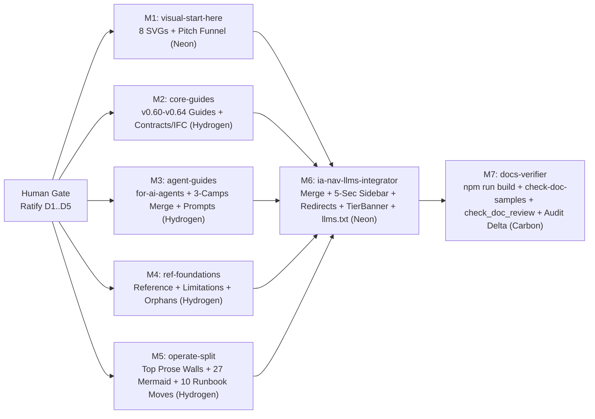

# Sprint Plan: M-DOCS-VISUAL-NAVIGATION-OVERHAUL (Website Docs Visual & Navigation Overhaul Swarm)

**Design Doc**: [m-docs-visual-navigation-overhaul.md](m-docs-visual-navigation-overhaul.md)
**Target**: `v0.64.2` → `v1.0.0`
**Baseline Commit**: `988772ad` (`origin/dev`, post-`v0.64.1` + `#2474` + `#2476`)
**Duration**: 1 swarm wave (~5–7 agent-hours wall time; 5 parallel content/visual slices + 1 IA/`llms.txt` integrator + 1 independent verifier)
**Risk Level**: Medium (broad markdown/MDX surface across `docs/`, mitigated by pairwise-disjoint ownership, `npm run build` MDX/link gate, `make check-doc-samples`, and `@docusaurus/plugin-client-redirects`)
**Created**: 2026-11-26

---

## Placement and Human-Decision Gates

Stored in `design_docs/planned/v1_0_0/sprint-plan-m-docs-visual-navigation-overhaul.md` alongside [m-docs-visual-navigation-overhaul.md](m-docs-visual-navigation-overhaul.md).

**Open Human-Decision Gate (`D1..D5` in [m-docs-visual-navigation-overhaul.md §High-Impact Decisions](m-docs-visual-navigation-overhaul.md#high-impact-decisions-for-mark-to-ratify)):**
- Decisions `D1` (5-section sidebar + 6-item navbar + client redirects), `D2` (disjoint `why-ailang`/`why-1-0`/`vision` + removing 23 git-tracked `docs/docs/prompts/v*.md` from site search), `D3` (relocating 10 fleet runbooks to `docs/internal/` + `<TierBanner />`), `D4` (`llms.txt` concise index + `llms-full.txt` full corpus & `check_llms_txt.sh` update), and `D5` (Mermaid + 8 clean brand-palette SVGs + audit-gated `reviewBy` refresh) are currently **OPEN** awaiting Mark's ratification.
- If an unattended executor starts before `D1..D5` are marked ratified in the design doc's Design Freeze checklist: **STOP: commit current work, report `BLOCKED: D1..D5 ratification required in m-docs-visual-navigation-overhaul.md`, and end the run**.

---

## Summary

Overhaul the entire AILANG Docusaurus website (`docs/`) in one coordinated, conflict-free `/swarm` wave so humans and AI agents can navigate effortlessly, zero stale or overdue pages remain (`24 overdue + 2 missing reviewBy → 0`), every `v0.60`–`v0.64.1` feature is taught in user-facing guides and `llms.txt`/`llms-full.txt`, all `52` brittle ASCII-art box diagrams are replaced by Mermaid + `8` bespoke brand-palette SVGs, and prose walls are cut by `35–50%` (`≥3,350` pure prose lines removed site-wide).

---

## Current Status & Velocity Analysis

### Completed Recently (on `origin/dev`)
- ✅ `M-V1-CLOSEOUT-SWARM` (`v0.64.0`, 2026-11-26): Removed 16 `@deprecated` stdlib aliases, hardened RC pipeline, added `upgrading-to-1-0.md`, `security-model.md`, `why-1-0.mdx`, and synced `language-syntax.md`/`stdlib.md` (~`+860 / -80` LOC in 1 swarm wave).
- ✅ `v0.64.1` + `#2474` + `#2476` (`988772ad`, 2026-11-26): Fixed `security-model.md:110` MDX autolink, rescued Pilot 5d finetuning notes, and planned `m-docs-mdx-autolink-fix`.

### Measured Baseline (`2026-11-26`, `/tmp/docs_audit.py`)
- **Total site files**: `184` (`155` hand-authored = `46,186` lines / `13,149` pure prose lines; `29` generated = `64,605` lines incl. `23` historical `prompts/v*.md` = `58,539` lines).
- **Navigation**: `10` navbar items; `7` top sections / `23` categories / `134` entries / depth `4` / `43` visible items on load; `24` hand-authored pages orphaned from `sidebars.js` (`6` unreachable dead islands).
- **Review & staleness**: `24` overdue + `2` missing `reviewBy`; `llms.txt` (`173 KB`) silently skips `6/9` path checks in `tools/generate-llms-txt.sh` (missing `100%` of `language-syntax`, `stdlib`, `effects`, `modules`, `cli`, `security-model`, `getting-started`).
- **Visual ratio**: `22` Mermaid diagrams (`16` pages) vs `52` ASCII-art box diagrams (`889` lines across `29` pages) and `0` conceptual SVGs in `docs/static/img/`.

---

## Registry Reuse Audit

Per `sprint-planner` mandatory reuse gate (`resources/registry_reuse_gate.md`):

| Milestone | Package-like capability? | `ailang pkg search` / Inspection | `registry_reuse` | Rationale |
|-----------|--------------------------|----------------------------------|------------------|-----------|
| M1 (`visual-diagrams-and-start-here`) | No (SVG assets + Docusaurus MDX pitch pages) | Inspected `docs/static/img/` & `docs/src/components/Icon.jsx` | `none` | Static SVG diagrams and Docusaurus MDX content; reuses existing `@site/src/components/Icon` and `@theme/CodeBlock`. |
| M2 (`core-guides-modern-idioms`) | No (Docusaurus markdown/MDX guides) | Inspected `examples/runnable/*.ail` for raw-loader reuse | `none` | Documentation guides only; reuses existing `examples/runnable/` programs and `make check-doc-samples`. |
| M3 (`agent-surface-and-ai-guides`) | No (Docusaurus agent guides + `sync-prompts.sh`) | Inspected `docs/scripts/sync-prompts.sh` & `AddToAgent.jsx` | `none` | Documentation and shell sync script; reuses existing `AddToAgent` React component. |
| M4 (`reference-and-foundations`) | No (Docusaurus reference/architecture/foundations pages) | Inspected `docs/docs/reference/*` & `PackageExplorer` | `none` | Reference markdown pages; reuses existing `PackageExplorer` component on `packages/{explorer,graph}.mdx`. |
| M5 (`operate-deploy-and-internal-split`) | No (Operate guides + moving 10 fleet runbooks to `docs/internal/`) | Inspected `docs/internal/` & benchmark chart components | `none` | Markdown concision, Mermaid diagrams, and `git mv` to `docs/internal/`. |
| M6 (`ia-nav-llms-integrator`) | No (`sidebars.js`, `docusaurus.config.js`, `generate-llms-txt.sh`) | Inspected `docs/package.json` (`@docusaurus/*` `3.10.2`) | `none` | Uses standard `@docusaurus/plugin-client-redirects` (`3.10.2`) npm plugin and bash generator script. |
| M7 (`docs-verifier`) | No (Read-only build, sample, review, and metrics verification) | Inspected `make/docs.mk`, `make/ci.mk` | `none` | Runs existing repo verification gates (`npm run build`, `make check-doc-samples`, `check_doc_review.sh`). |

---

## AILANG Syntax Gate (`sprint-planner` §5.1)

- **AILANG CLI version verified**: `AILANG v0.64.1` (`f43d12e3`)
- **AILANG prompt version loaded**: `v0.16.20` (`prompts/v0.16.20.md`, active in `prompts/versions.json` and `docs/src/constants/version.js`)
- **Showcase snippet checklist** (for modern `v0.60`–`v0.64.1` examples added in M1/M2/M3/M6):
  - **Contracts (`requires`/`ensures`)**: `include` — `export pure func clampScore(n: int) -> int requires { n >= 0 } ensures { result <= 100 }` verified in `contracts.mdx` and landing/quick-start showcase (`ailang verify`).
  - **Effects (`! {IO, ...}`)**: `include` — explicit effect rows (`! {IO}`, `! {IO, FS}`, `! {Net @limit=3}`) on every non-pure showcase entrypoint; pure helpers marked `pure func` (`! {}`).
  - **Inline tests (`tests [...]`)**: `include` — `tests [((input), expected)]` shown in `getting-started.mdx`, `testing.md`, and `language-syntax.md` cross-links; fragment/pipeline snippets that omit `tests` use `skip: focused single-construct syntax snippet checked by make check-doc-samples`.
  - **Verified pitfalls from `V8`/`V9`**: Closed record destructuring requires all fields or `{ field, ... }` rest syntax; `export import` is `PAR_EXPORT_REQUIRES_FUNC` until `#2475` merges; every `T<label>` or `{Effects}` in prose MUST be inside backticks so MDX does not parse it as JSX.

---

## Deterministic ELO Model Routing Table

Every score below was computed directly by `.agents/skills/sprint-planner/scripts/estimate_task_elo.sh --json` against `/tmp/docs-overhaul-plan` (`988772ad`) using `internal/modelreg/models.yml`-calibrated `Carbon` / `Neon` / `Hydrogen` tiers (**zero** `gemini-3.8-flash`):

| Worker / Role | Milestone | Workspace | Target Paths Passed to `estimate_task_elo.sh` | Base ELO (Rule) | Modifiers | Total ELO | Script Band | Assigned Model (`models.yml`) | Rationale |
|---|---|---|---|---:|---|---:|---|---|---|
| `visual-start-here` | **M1** (Slice 1) | `share` | `docs/static/img`, `docs/docs/{intro,why-ailang,why-1-0,vision,examples,playground,demos,feedback}.mdx`, `docs/docs/start-here/{quick-start,evaluating}.mdx`, `docs/VISION.md` | `2100` (`docs/`) | `+50` (`large_file_near_800l`: `examples.mdx` 832L) | **2150** | Routine | `gemini-4-neon-medium` *(or `gemini-4-hydrogen-high`)* | Routine ELO `2150`; `Neon` optional upgrade recommended for crafting crisp multi-node geometric SVGs + pitch prose. |
| `core-guides` | **M2** (Slice 2) | `share` | `docs/docs/guides/{getting-started.mdx,quick-start-examples.mdx,module_execution.mdx,contracts.mdx,ifc-labels.mdx,testing.md,lsp.md,packages.md,package-publishing.md}`, `docs/TESTING.md` | `2100` (`docs/`) | `+50` (`large_file_near_800l`: `contracts.mdx` 991L, `testing.md` 740L, `TESTING.md` 646L) | **2150** | Routine | `gemini-4-hydrogen-high` | Well-scoped guide rewrites + `check-doc-samples`-verified `.ail` idioms (`Hydrogen` 76/81 ELO `2178.9`, 23/23 core). |
| `agent-guides` | **M3** (Slice 3) | `share` | `docs/docs/start-here/for-ai-agents.mdx`, `docs/docs/prompts/index.md`, `docs/scripts/sync-prompts.sh`, `docs/docs/guides/{agent-integration.mdx,ailang-vs-agents.mdx,three-camps-comparison.md,three-camps-self-audit.md,agent-tool-policy.md,ai-effect.mdx,semantic-search.md}` | `2100` (`docs/`) | `+0` | **2100** | Routine | `gemini-4-hydrogen-high` | Structured Task→CLI→MCP tables, three-camps merge, prompt unlisting, and Mermaid diagrams. |
| `ref-foundations` | **M4** (Slice 4) | `share` | `docs/docs/reference/{limitations,effects,modules,implementation-status,repl-commands,reserved-keywords}.md`, `docs/docs/architecture/anf.md`, `docs/docs/references/axioms.mdx`, `docs/docs/packages/explorer.mdx`, `docs/LIMITATIONS.md` | `2100` (`docs/`) | `+50` (`large_file_near_800l`: `limitations.md` 701L, `effects.md` 804L) | **2150** | Routine | `gemini-4-hydrogen-high` | Reference tables, `v0.64.1` cliff matrix, `λ[Debug,IO]>` prompt fixes, and `reviewBy` refresh. |
| `operate-split` | **M5** (Slice 5) | `share` | `docs/docs/guides/{serve-api,cloud-messaging-integration,coordinator,wasm-integration,debugging,telemetry,mcp-connectors,agent-messaging}.md`, `docs/docs/guides/evaluation/README.mdx`, `docs/docs/finetuning/index.md`, `docs/internal` | `2100` (`docs/`) | `+50` (`large_file_near_800l`: 8 files `878L–2111L`) | **2150** | Routine | `gemini-4-hydrogen-high` | High-volume prose cutting (35–50%), 27 ASCII→Mermaid conversions, and `git mv` of 10 fleet runbooks. |
| `ia-nav-llms-integrator` | **M6** (Slice 6) | `share` / main | `docs/sidebars.js`, `docs/docusaurus.config.js`, `docs/package.json`, `docs/src/pages/index.jsx`, `README.md`, `tools/generate-llms-txt.sh`, `scripts/check_llms_txt.sh`, `llms.txt` | `2100` (`docs/`) | `+50` (`index.jsx` 1396L, `llms.txt` 4552L) + `+75` (`cross_package_span`: 5 top dirs) | **2225** | Routine → **Core SWE** | `gemini-4-neon-medium` | Escalated 1 band (`2225` → `Neon` ELO `2735.4`) because it integrates 5 branches, wires `@docusaurus/plugin-client-redirects` + React `DocItem` swizzle, and updates CI-gated `llms.txt` scripts. |
| `docs-verifier` | **M7** (Verify) | `inherit` (read-only) | `docs/sidebars.js`, `docs/docusaurus.config.js`, `docs/docs/reference/language-syntax.md`, `tools/generate-llms-txt.sh`, `scripts/check_doc_review.sh`, `internal/iface/tier_test.go` | `2350` (`internal/*`) | `+50` (`internal/iface`: 10 importers) + `+75` (`cross_package_span`: 4 pkgs) | **2475** | Core SWE | `gemini-4-carbon-high` *(alt: `claude-sonnet-5-5-medium` / `gemini-4-neon-high`)* | Independent high-rigor verification (`generator ≠ judge`) across `npm run build`, `check-doc-samples`, `check_doc_review.sh`, and audit metrics. |

---

## Execution Phases & Dependency DAG

---

## Proposed Milestones

### Milestone 1 (`M1`): Bespoke SVG Diagrams & Entry Funnel Overhaul (`visual-start-here`)
**Goal:** Create the 8 clean Sunholo-branded vector diagrams in `docs/static/img/diagrams/`, prune 6 unreferenced raster images (`1.31 MB`), and rewrite/de-duplicate the entry funnel (`intro`, `why-ailang`, `why-1-0`, `vision`, `start-here/{quick-start,evaluating}`, `examples`, `playground`, `demos`, `feedback`, `docs/VISION.md`).
**Estimated Delta:** `+8` SVG files (`~900` lines clean XML), `-280 / +160` markdown lines (`net -120L` prose), `-6` unused PNGs (`-1.31 MB`).
**Duration:** ~1.5 agent-hours (parallel Wave 1).

**Tasks:**
1. Author all 8 dark/light-compatible SVGs in `docs/static/img/diagrams/`: `ailang-kernel-loop.svg`, `progressive-learning-map.svg`, `effect-capability-gate.svg`, `ifc-taint-lattice.svg`, `z3-contract-pipeline.svg`, `two-engines-architecture.svg`, `agent-knowledge-stack.svg`, `package-lock-cascade.svg` (`<15 KB` each, valid XML).
2. Delete the 6 unreferenced image files (`aitana-dashboard-react.png`, `ailang-logo.png`, `logo.png`, and 5 unreferenced `connectors/*.png` screenshots verified in `V16`).
3. Rewrite `intro.mdx`: remove stale `v0.6.0`/`v0.7.0` Roadmap bullets (`L107-109`), replace false `"record subsumption"` (`L84`) with row polymorphism `{name: string | r}`, embed `progressive-learning-map.svg` and `ailang-kernel-loop.svg`.
4. De-duplicate `why-ailang.mdx` (`362L → ≤230L`), `why-1-0.mdx` (`60L`), and `vision.mdx` (`272L → ≤185L`): delete false `"No LSP/IDE servers"` (`vision.mdx:242`), replace `vision.mdx:17-35` ASCII box with `ailang-kernel-loop.svg`, embed `ifc-taint-lattice.svg` & `two-engines-architecture.svg` in `why-ailang.mdx`, fix `examples.mdx:209` `"Records & Subsumption"` heading.
5. Refresh `reviewed: 2026-11-26` + `reviewBy` on overdue pages in scope (`start-here/evaluating.mdx`, `playground.mdx`, `feedback.mdx`, `docs/VISION.md`) after full code verification.

**Acceptance Criteria:**
- [x] All 8 SVG files exist in `docs/static/img/diagrams/`, parse cleanly as XML, and are `<15 KB` each — `TST-DOCOV-11`
- [x] `git grep -n -E "No \*\*LSP/IDE|\(v0\.[67]\.0\)|subsumption" docs/docs/{intro,why-ailang,vision,examples}.mdx` returns empty — `TST-DOCOV-09`
- [x] `make check-doc-samples` exits `0` with `0` new baseline entries — `TST-DOCOV-02`
- [x] `0` overdue `reviewBy` warnings remain on M1 files — `TST-DOCOV-03`

---

### Milestone 2 (`M2`): Core Language, Verification & Package Guides (`core-guides`)
**Goal:** Teach every `v0.60`–`v0.64.1` language, Z3 verification, quick-fix, and package feature across `Learn AILANG` guides while cutting prose walls (`contracts.mdx`, `ifc-labels.mdx`, `package-publishing.md`) by `35–45%` and converting all ASCII diagrams to Mermaid.
**Estimated Delta:** `~-950 / +480` markdown lines (`net -470L`), `-2` legacy outside-site files (`docs/guides/{inline_tests,module-imports}.md`).
**Duration:** ~2 agent-hours (parallel Wave 1).

**Tasks:**
1. Update `getting-started.mdx` & `quick-start-examples.mdx`: remove stale `VERSION=v0.9.0`/`v0.18.11` pins, fix `λ>` → `λ[Debug,IO]>` REPL transcripts, remove `test_record_subsumption.ail` reference, replace ASCII diagram with Mermaid, and add runnable `check-doc-samples`-verified examples of `|>` pipes, closed/open record & tuple destructuring, unbraced `match`/`if`, `deriving (Json)`, `let x = expr?`, `ailang inspect`, and `ailang check --fix`.
2. Rewrite `contracts.mdx` (`991L → ≤600L`, overdue `2026-11-23`): cut prose ≥40%, embed `/img/diagrams/z3-contract-pipeline.svg` + Mermaid verification flowchart, and document `v0.64.0` `()` unit (`Tuple0`), tuples (`Tuple2..Tuple8`), `--int-model=int64` overflow mode, opaque helpers (`helpers_not_checked`), and canonical AILANG-syntax Z3 counterexamples.
3. Trim `ifc-labels.mdx` (`583L → ≤360L`) with `/img/diagrams/ifc-taint-lattice.svg` + cross-module `#1134` rules + explicit-flow-only caveat; trim `module_execution.mdx` (`488L → ≤310L`) adding `ailang inspect` and honest `export import` unsupported note (`PAR_EXPORT_REQUIRES_FUNC`).
4. Update `lsp.md` (multi-hole `_?`/`?name` `TC_HOLE` + `check --fix` Phase 2 `! {Effects}` stamping, `++`→`"${...}"`, `TC_MATCH_002` stubs); convert 2 ASCII blocks in `testing.md` (`740L`, overdue) to Mermaid; refresh `docs/TESTING.md` (overdue); fold any unique content from `docs/guides/{inline_tests,module-imports}.md` and `git rm` those 2 legacy files.
5. Update `packages.md`, `package-publishing.md` (`484L → ≤300L`, ASCII→Mermaid), `autonomous-package-updates.md` (overdue, 2 ASCII→Mermaid), and mark `extension-packages.md`, `build-a-motoko-extension.md`, `motoko-extension-development.md` with `tier: experimental`, embedding `/img/diagrams/package-lock-cascade.svg` and documenting atomic `ailang.lock`, v2 contract signatures, nested `ailang.toml`, and `ailang pkg docs`.

**Acceptance Criteria:**
- [x] Every `v0.60`–`v0.64.1` construct (`|>`, destructuring, `_?`, unbraced `match`/`if`, `deriving (Json)`, `expr?`, `inspect`, `check --fix`, Z3 `Tuple0`/`Tuple2..8`/`int64`, atomic `ailang.lock`) has a checked guide example — `TST-DOCOV-02`
- [x] `contracts.mdx` ≤600L, `ifc-labels.mdx` ≤360L, `package-publishing.md` ≤300L, and `0` ASCII-box blocks remain in M2 files — `TST-DOCOV-10`, `TST-DOCOV-12`
- [x] `0` `λ>` legacy prompts and `0` overdue `reviewBy` warnings remain in M2 files — `TST-DOCOV-03`, `TST-DOCOV-09`

---

### Milestone 3 (`M3`): Agent Hub, Three-Camps Consolidation & AI/Memory Guides (`agent-guides`)
**Goal:** Turn `start-here/for-ai-agents.mdx` + `guides/agent-integration.mdx` into a zero-fluff Agent Command & MCP Routing Hub, merge `three-camps-self-audit.md` and `recipes/ai-tool-loop.md`, rewrite 80%-prose `agent-tool-policy.md`, and remove the 23 historical `prompts/v*.md` files (`58,539L`) from site search per `D2`.
**Estimated Delta:** `-58,539L` historical prompt snapshots, `~-750 / +320` hand-authored lines (`net -430L` hand-authored).
**Duration:** ~1.5 agent-hours (parallel Wave 1).

**Tasks:**
1. Rewrite `start-here/for-ai-agents.mdx` (overdue `2026-11-23`) and `guides/agent-integration.mdx`: embed `/img/diagrams/agent-knowledge-stack.svg`, add the 12-row **Task → CLI Command → MCP Tool → Example** routing table, and fix the broken `<a href="/docs/prompts/v0.16.20">` 404 (`V7`) to point to `/docs/prompts/current`.
2. Merge `guides/three-camps-self-audit.md` (`277L`) into a crisp `## Self-Audit Results` table (`≤55L`) inside `guides/three-camps-comparison.md` and `git rm docs/docs/guides/three-camps-self-audit.md` (`492L → ≤180L` combined; redirect wired in M6).
3. Merge `recipes/ai-tool-loop.md` (`203L`, orphaned) into `guides/ai-effect.mdx` (adding `deriving (Json)` + `callJson` tool-loop pattern) and `git rm docs/docs/recipes/ai-tool-loop.md` (redirect wired in M6).
4. Rewrite `guides/agent-tool-policy.md` (`355L`, 80% prose → `≤200L`, `tier: experimental`) using a policy YAML schema table + Mermaid confinement diagram; trim `ailang-vs-agents.mdx` (`312L → ≤185L`).
5. Convert ASCII diagrams to Mermaid in `hooks-setup.mdx` and `semantic-caching-vs-vectordb.md`; remove `v0.6.0` stamp in `semantic-search.md:107`; refresh overdue `ai-prompt-guide.mdx`, `examples-search.mdx`, and `prompts/index.md`.
6. Per `D2=a`, `git rm docs/docs/prompts/v*.md` (the 23 stale historical prompt copies) and update `docs/scripts/sync-prompts.sh` + `prompts/index.md` so only `current.md` (and `python.md` if needed for benchmark reference, marked `unlisted: true`) builds on the site while linking `prompts/versions.json` on GitHub for historical prompt archaeology (redirects `/docs/prompts/v*` → `/docs/prompts/current` wired in M6).

**Acceptance Criteria:**
- [x] `start-here/for-ai-agents.mdx` contains the full 12-task CLI + MCP routing table and embeds `agent-knowledge-stack.svg` — `TST-DOCOV-01`
- [x] `three-camps-comparison.md` ≤180L (with `three-camps-self-audit.md` removed) and `agent-tool-policy.md` prose ≤130L — `TST-DOCOV-12`
- [x] `make check-doc-samples` exits `0`; `0` ASCII diagrams and `0` overdue `reviewBy` warnings remain in M3 files — `TST-DOCOV-02`, `TST-DOCOV-03`, `TST-DOCOV-10`

---

### Milestone 4 (`M4`): Reference, Limitations Matrix, Orphaned Stdlib/Error Pages & Foundations (`ref-foundations`)
**Goal:** Eliminate all staleness, missing/overdue `reviewBy` dates, ASCII diagrams, and prose walls across `reference/`, `architecture/`, `references/`, and `packages/{explorer,graph}.mdx`, while linking all orphaned `std-*` and `option-vs-result` pages cleanly.
**Estimated Delta:** `~-620 / +290` lines (`net -330L`).
**Duration:** ~1.5 agent-hours (parallel Wave 1).

**Tasks:**
1. Rewrite `reference/limitations.md` (`701L`, `355` prose lines, stamped `v0.33.1`) and `docs/LIMITATIONS.md` into a concise, live-verified (`v0.64.1`) **Capability & Cliff Matrix Table** (covering integer wrap vs `verify --int-model=int64`, ~5 KB/frame non-tail recursion, bounded Z3 unrolling, explicit-flow IFC, `--bytecode` coverage, `export import` pending `#2475`), cutting prose ≥45%.
2. Fix `reference/implementation-status.md` (delete broken `ailang prompt --compact` on `L43`, remove `v0.6.1+` stamp on `L47`, add `v0.64.0` Z3 `Tuple0`/`Tuple2..8` status) and `architecture/types.md` (`--compact` flag check).
3. Fix all 10 legacy `λ>` REPL prompts in `reference/repl-commands.md` (overdue `2026-11-16`) → `λ[Debug,IO]>`; add missing `reviewBy: 2027-05-26` + `reviewed: 2026-11-26` to `reference/reserved-keywords.md`.
4. Embed `/img/diagrams/effect-capability-gate.svg` + Mermaid budget-charging flowchart in `reference/effects.md` (`804L → ≤580L`) and `reference/capability-budgets.mdx`; convert ASCII diagram in `reference/modules.md` to Mermaid; preserve all 16 deprecation rows in `reference/stability.md` (`V12`) while tightening surrounding prose.
5. Link `reference/std-{audio,xml,yaml,package,extension}.md` and `reference/option-vs-result.md` (adding `let x = expr?` spine propagation section!) from `reference/stdlib.md`; add `tier: experimental` to `std-extension.md`; verify `reference/errors/index.md` + 8 error pages have valid `reviewBy` dates.
6. Refresh overdue `architecture/{adding-operators.md,anf.md,debug-tools.mdx}`, `references/{axioms.mdx,design-lineage.mdx,philosophical-foundations.mdx}`, and `packages/{explorer.mdx,graph.mdx}` after reading against current code (and embed `two-engines-architecture.svg` in `architecture/index.md`).

**Acceptance Criteria:**
- [x] `go test ./internal/iface -run TestStabilityDocListsEveryDeprecation` exits `0` — `TST-DOCOV-05`
- [x] `make check-doc-samples` exits `0`; `0` hits for `prompt --compact`, `v0.33.1`, or `λ>` in M4 files — `TST-DOCOV-02`, `TST-DOCOV-09`
- [x] `limitations.md` prose lines `≤190` (`-46%` from `355`) and `0` overdue/missing `reviewBy` warnings in M4 files — `TST-DOCOV-03`, `TST-DOCOV-12`

---

### Milestone 5 (`M5`): Prose-Wall Overhaul of Operate/Deploy Guides & Fleet Runbook Split (`operate-split`)
**Goal:** Cut prose walls by `35–50%` and replace all `27` ASCII-art box diagrams with Mermaid across the site's longest guides (`serve-api`, `cloud-messaging-integration`, `coordinator`, `wasm-integration`, `debugging`, `telemetry`, `mcp-connectors`, `agent-messaging`), relocate the 10 operator fleet runbooks to `docs/internal/` (`D3`), and tag Internal/Experimental frontmatter.
**Estimated Delta:** `-2,197L` relocated from `docs/docs/` to `docs/internal/`, plus `~-1,800 / +650` lines (`net -1,150L`) on remaining public/internal guides.
**Duration:** ~2 agent-hours (parallel Wave 1).

**Tasks:**
1. Per `D3=a`, `git mv` the **10 fleet runbooks** (`guides/mission-bootstrap.md`, `guides/mission-model-fleet.md`, `guides/mission-iteration.md`, `guides/mission-role-dispatch.md`, `guides/maintenance-benchmark.md`, `guides/claude-api-credits.md`, `guides/coordinator-workers.md`, `guides/notify-daemon.md`, `guides/database-architecture.md`, `guides/evaluation/local-ollama.md`) to `docs/internal/runbooks/` and update the 5 inbound links in `agent-messaging.md`, `cloud-messaging-integration.md`, and `benchmarks/os-model-leaderboard.md`.
2. Overhaul the **8 largest prose/ASCII walls**:
   - `serve-api.md` (`2,111L`, `602` prose → `≤330` prose, 2 ASCII→Mermaid, `tier: experimental`, scrub `v0.3`/`v0.7`/`v0.45` narration).
   - `mcp-connectors.md` (`878L`, `470` prose → `≤240` prose using a top Connector Matrix table + collapsible `
` per vendor setup).
   - `debugging.md` (`1,053L`, `388` prose → `≤220` prose; add `ailang inspect`, `ailang check --fix`, `--format=agent`, and `--emit-trace jsonl` workflow diagram) & `traces.md` (overdue `2026-11-16`).
   - `coordinator.md` (`1,686L`, 5 ASCII→Mermaid, `tier: internal`, cut prose `357 → ≤210`), `coordinator-setup.md` (2 ASCII→Mermaid, `tier: internal`), `cloud-messaging-integration.md` (`1,786L`, 5 ASCII→Mermaid, `tier: experimental`, cut repeated setup blocks), `agent-messaging.md` (`971L`, 1 ASCII→Mermaid, `tier: experimental`).
   - `telemetry.md` (`957L`, **9 ASCII→Mermaid**, `tier: internal`), `wasm-integration.md` (`1,059L`, scrub 36 `v0.7.x` stamps), `go-interop.md` (overdue `2026-11-16`), `state-system-workflow.mdx` (3 ASCII→Mermaid, `tier: internal`), `workspaces.md` (overdue, 2 ASCII→Mermaid, `tier: internal`), `collaboration-hub.md` (1 ASCII→Mermaid, `tier: internal`), `secret-approvals.md` (1 ASCII→Mermaid, `tier: internal`), `development-workflow.md` (1 ASCII→Mermaid, `tier: internal`).
3. Add `tier: internal` frontmatter + scrub stale `v0.3`/`v0.15` stamps across `guides/evaluation/*.md(x)` (converting 2 ASCII diagrams in `architecture.md` & `browser-auth-profiles.md` to Mermaid) and `finetuning/*.md`.

**Acceptance Criteria:**
- [x] `0` ASCII-art box diagrams remain across all M5 files — `TST-DOCOV-10`
- [x] `serve-api.md` prose `≤330L`, `mcp-connectors.md` prose `≤240L`, `debugging.md` prose `≤220L`, `coordinator.md` prose `≤210L` — `TST-DOCOV-12`
- [x] All 10 fleet runbooks reside under `docs/internal/runbooks/`, `make check-doc-samples` exits `0`, and `0` overdue `reviewBy` warnings remain in M5 files — `TST-DOCOV-02`, `TST-DOCOV-03`

---

### Milestone 6 (`M6`): IA, Redirects, `<TierBanner />`, Landing Page & `llms.txt` Integration (`ia-nav-llms-integrator`)
**Goal:** Merge M1–M5 cleanly, wire the 5-section `sidebars.js` + 6-item navbar + `@docusaurus/plugin-client-redirects` (0 404s), add automatic `<TierBanner />` rendering from `tier:` frontmatter, polish `index.jsx` & `README.md`, delete 5 unused React components, and fix `tools/generate-llms-txt.sh` + `scripts/check_llms_txt.sh`.
**Estimated Delta:** `~+280 / -420` LOC across config, theme wrapper, `README.md`, and `llms.txt` scripts (plus `-5` unused React component dirs/files).
**Duration:** ~1.5 agent-hours (Wave 2, after M1–M5 complete).

**Tasks:**
1. Merge branches from M1–M5 (confirming 0 merge conflicts per pairwise-disjoint contract).
2. Install `@docusaurus/plugin-client-redirects` (`3.10.2`, matching `@docusaurus/core`) in `docs/package.json` and configure `docs/docusaurus.config.js`:
   - Shrink navbar `10 → 6` items (`Docs`, `Examples`, `Playground`, `Benchmarks`, `llms.txt`, `GitHub`); fix `editUrl` to `https://github.com/sunholo-data/ailang/tree/dev/docs/`; add `llms-full.txt` to footer `More`.
   - Configure client redirects for `/docs/guides/three-camps-self-audit` → `/docs/guides/three-camps-comparison#self-audit-results`, `/docs/recipes/ai-tool-loop` → `/docs/guides/ai-effect`, `/docs/prompts/v0.8.2`..`v0.16.20` → `/docs/prompts/current`, and all 10 relocated fleet runbook URLs → `/docs/guides/coordinator` or `/docs/guides/development-workflow`.
3. Rewrite `docs/sidebars.js` into the 5-section, depth-`≤3` hierarchy (`Start Here`, `Learn AILANG`, `For AI Agents`, `Reference`, `Operate & Internals`) with only `Start Here` `collapsed: false`, wiring `reference/errors/index`, `guides/agent-tool-policy`, `reference/option-vs-result`, `reference/std-{audio,xml,yaml,package,extension}`, `examples/ai-api-integration`, and `recipes/ai-token-streaming` so **0 user-facing pages are orphaned**.
4. Create `docs/src/theme/DocItem/Content/index.js` wrapping `@theme-original/DocItem/Content` to render a concise callout banner whenever `frontMatter.tier === 'experimental'` or `'internal'`.
5. Update `docs/src/pages/index.jsx` (modernize Hero `.ail` snippet with `println` + pipe/contract clarity; keep `make check-doc-samples` green on embedded `{`...`}` literals!), delete the 5 unreferenced components (`BenchmarkDashboard/`, `DataProvenance/`, `LocalCloudBadge/`, `ModelRadarComparison/`, `src/components/ailang-repl.js`), and fix `README.md` (`v0.33.1` pin → `v0.64.1`, `/docs/guides/development` → `/docs/guides/development-workflow`, `λ>` → `λ[Debug,IO]>`, external agent line → `/docs/start-here/for-ai-agents` + `ailang prompt`).
6. Fix `tools/generate-llms-txt.sh`, `scripts/check_llms_txt.sh`, and `scripts/test_check_llms_txt.sh` per `D4=a`: generate concise `/llms.txt` (`<35 KB` with the 12-row Task→CLI→MCP table + curated doc URL directory + pointer to `/llms-full.txt`) and complete `/llms-full.txt` (`docs/static/llms-full.txt` bundling fixed `for-ai-agents.mdx`, `getting-started.mdx`, `language-syntax.md`, `stdlib.md`, `effects.md`, `modules.md`, `security-model.md`, `stability.md`, `cli.md`, `reserved-keywords.md`, `limitations.md`, and the active prompt `v0.16.20`). Run `make generate-llms-txt`.

**Acceptance Criteria:**
- [x] `cd docs && npm run build` exits `0` and `cd docs && npm run test:benchmarks` exits `0` — `TST-DOCOV-01`, `TST-DOCOV-06`
- [x] `make check-llms-txt && make test-check-llms-txt` exit `0` — `TST-DOCOV-04`
- [x] `make check-doc-samples` and `bash scripts/check_doc_review.sh` (`0 overdue, 0 without reviewBy`) exit `0` — `TST-DOCOV-02`, `TST-DOCOV-03`
- [x] Navbar `≤6` items, sidebar `≤5` top sections, depth `≤3`, visible items `≤18`, `0` orphaned user pages — `TST-DOCOV-07`, `TST-DOCOV-08`

---

### Milestone 7 (`M7`): Independent Full-Site Verification (`docs-verifier`)
**Goal:** Read-only verification of all `TST-DOCOV-01..12` acceptance gates, planted negative controls, and before/after `/tmp/docs_audit.py` metrics comparison.
**Estimated Delta:** `0` LOC (read-only verifier; bounces any defect to `@ia-nav-llms-integrator`).
**Duration:** ~0.75 agent-hours (Wave 3).

**Tasks:**
1. Run `cd docs && npm run build` and `cd docs && npm run test:benchmarks`; verify generated redirect HTML files exist in `docs/build/` for moved/merged routes (`three-camps-self-audit`, `mission-bootstrap`, `prompts/v0.16.18`, etc.).
2. Run `make check-doc-samples && make test-check-doc-samples`, `bash scripts/check_doc_review.sh`, `make check-llms-txt && make test-check-llms-txt`, and `go test ./internal/iface -run TestStabilityDocListsEveryDeprecation`.
3. Re-run `python3 /tmp/docs_audit.py` and verify every metric in `TST-DOCOV-07..12` (0 orphaned user pages, 0 stale blockers, 0 ASCII-art diagrams, `≥55` Mermaid diagrams, 8 valid SVGs `<15 KB`, `≥25%` site-wide prose reduction and `35–50%` on Top-20 prose walls).
4. Post final measured before→after scorecard to `@coordinator [done]`.

**Acceptance Criteria:**
- [x] All 12 `TST-DOCOV-01..12` checks pass with zero open blocking findings.

---

## Success Metrics Summary

| Metric | Baseline (`988772ad`) | Post-Sprint Target | Gate |
|--------|----------------------:|-------------------:|------|
| Overdue + missing `reviewBy` pages | `24 + 2 = 26` | **`0`** | `TST-DOCOV-03` |
| Orphaned user-facing pages in `docs/docs/` | `22` (+2 legal) | **`0`** (+2 legal) | `TST-DOCOV-07` |
| Top navbar items | `10` | **`6`** | `TST-DOCOV-08` |
| Sidebar top sections / max depth / visible on load | `7 / 4 / 43` | **`5 / ≤3 / ≤18`** | `TST-DOCOV-08` |
| ASCII-art box diagrams (`┌───┐`) | `52` (`889L`) | **`0`** | `TST-DOCOV-10` |
| Mermaid diagrams | `22` | **`≥55`** | `TST-DOCOV-10` |
| Bespoke conceptual SVGs in `docs/static/img/diagrams/` | `0` | **`8`** | `TST-DOCOV-11` |
| Hand-authored pure prose lines | `13,149` | **`≤9,800` (`≥-25%`)** | `TST-DOCOV-12` |
| Historical `prompts/v*.md` search clutter | `23` files (`58,539L`) | **`0` indexed** (redirected) | `TST-DOCOV-01` |
| Reference files bundled in `llms-full.txt` | `1` (`reserved-keywords` only) | **`9` core ref + guides + prompt** | `TST-DOCOV-04` |
| Failing unclassified `.ail` doc samples | `0` new (`1` legacy baseline) | **`0` new (`≤1` baseline)** | `TST-DOCOV-02` |

---

## Dependencies & Open Questions

- **Dependencies**: Node `>=20` and existing `docs/node_modules` (or `npm install --prefix docs` when adding `@docusaurus/plugin-client-redirects@3.10.2`), `ailang v0.64.1+` binary for `make check-doc-samples`.
- **Open Questions**: Only `D1..D5` in [m-docs-visual-navigation-overhaul.md](m-docs-visual-navigation-overhaul.md) (each has a concrete `(Recommended)` default `a` ready for one-line ratification).
