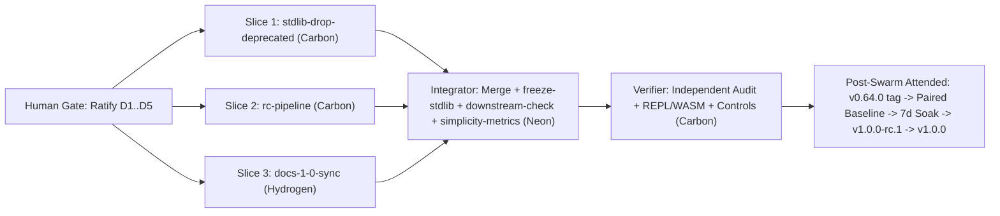

# Sprint Plan: M-V1-CLOSEOUT-SWARM (`v1.0.0` Pre-Soak Close-Out)

**Design Doc**: [m-v1-closeout-swarm.md](m-v1-closeout-swarm.md)
**Target**: `v0.64.0` (final pre-soak 0.x release) → `v1.0.0-rc.1` → `v1.0.0`
**Baseline Commit**: `cc58e9a8a` (`v0.63.0`, branch `release-v063`)
**Duration**: 1 swarm wave (~4–6 agent-hours wall time; 3 parallel slices + integrator + verifier)
**Created**: 2026-11-26

---

## Registry Reuse Gate

Per `sprint-planner` mandatory reuse gate (`resources/registry_reuse_gate.md`):

| Milestone | Package-like capability? | `registry_reuse` | Rationale |
|-----------|--------------------------|------------------|-----------|
| Slice 1 (`stdlib-drop-deprecated`) | No (deleting 16 `@deprecated` stdlib aliases & updating compiler tests) | `none` | Pure removal in `std/` + Go test updates; reuses existing `importhint.StdlibRenames`. |
| Slice 2 (`rc-pipeline`) | No (CI workflow YAML, bash version script, Go semver comparator) | `none` | Infrastructure & Go runtime helper (`internal/effects/pkg.go`). |
| Slice 3 (`docs-1-0-sync`) | No (Docusaurus markdown pages, `SECURITY.md`, Bar G5 fragment) | `none` | Documentation & release-notes fragment only. |
| Integrator + Verifier | No (merge, `make freeze-stdlib`, `make downstream-check`, independent audit) | `none` | Uses existing repo Make targets and `tools/downstream`. |

---

## Deterministic ELO Model Routing Table

Every score below was computed directly by `.agents/skills/sprint-planner/scripts/estimate_task_elo.sh --json` against `/tmp/v1-closeout-plan` (`cc58e9a8a`) using `models.yml`-calibrated bands (`Carbon` / `Neon` / `Hydrogen`; **zero** `3.8-flash`).

| Role | Target Paths Passed to `estimate_task_elo.sh` | Base ELO (Rule) | Modifiers | Total ELO | Band | Assigned Model (`models.yml`) |
|------|-----------------------------------------------|-----------------|-----------|-----------|------|-------------------------------|
| **Slice 1** (`stdlib-drop-deprecated`) | `std/{math,string,bytes,array,io,rand,list,fs}.ail`, `internal/pipeline/warn_deprecated_test.go`, `internal/runner/show_nominal_test.go`, `internal/smt/testdata/stdlib/list_defaulted.ail` | `2650` (`internal/smt/`) | `+50` high fan-in (`internal/pipeline`: 17 importers), `+75` cross-pkg (4 pkgs), `+25` churn | **2800** | Deep Frontier | `gemini-4-carbon-high` (alt: `claude-opus-5-5-high`) |
| **Slice 2** (`rc-pipeline`) | `.github/workflows/release.yml`, `.github/workflows/docusaurus-deploy.yml`, `docs/scripts/generate-version-constants.sh`, `internal/effects/pkg.go`, `internal/effects/pkg_semver_test.go`, `internal/pkg/version_compat_test.go` | `2650` (`internal/effects/`) | `+50` high fan-in (`internal/effects`: 19, `internal/pkg`: 12), `+75` cross-pkg (4 pkgs), `+25` churn | **2800** | Deep Frontier | `gemini-4-carbon-high` (alt: `claude-opus-5-5-high`) |
| **Slice 3** (`docs-1-0-sync`) | `docs/docs/reference/{language-syntax,stdlib,stability,security-model}.md`, `docs/docs/guides/upgrading-to-1-0.md`, `docs/docs/why-1-0.mdx`, `docs/sidebars.js`, `SECURITY.md` | `2100` (`docs/`) | `+25` churn (`stability.md`: 22, `stdlib.md`: 8, `sidebars.js`: 6) | **2125** | Routine | `gemini-4-hydrogen-high` (or `gemini-4-hydrogen-medium`; optional `gemini-4-neon-medium` for normative 1.0 prose) |
| **Integrator** (`integrator`) | Merges Slices 1–3 + `.stdlib-golden/*.json` + `make downstream-check` | `2400` (Core SWE integration) | — | **2400** | Core SWE | `gemini-4-neon-medium` |
| **Verifier** (`verifier`) | `std/list.ail`, `internal/pipeline/warn_deprecated_test.go`, `internal/effects/pkg.go`, `.github/workflows/release.yml`, `docs/docs/reference/language-syntax.md` | `2650` (`internal/effects/`) | `+50` high fan-in, `+75` cross-pkg (5 pkgs), `+25` churn | **2800** | Deep Frontier | `gemini-4-carbon-high` (alt: `claude-opus-5-5-high`) |

---

## Execution Phases & Dependency DAG

---

## Milestone Breakdown

### Milestone 1 — `stdlib-drop-deprecated` (Slice 1, ~1.5h, ~-80 / +90 LOC)

- **Owner**: `stdlib-drop-deprecated` (`gemini-4-carbon-high`, `workspace: "share"`)
- **Tasks**:
  1. Delete all 16 `@deprecated` exports across `std/{math,string,bytes,array,io,rand,list,fs}.ail`.
  2. Update `internal/pipeline/warn_deprecated_test.go`:
     - Switch `targetDeprecatedStd` (L265) to a synthetic local deprecated module.
     - Replace `TestStdlibRenamesMatchDeprecatedAnnotations` with `TestStdlibHasNoDeprecatedAliases` (asserting 0 `@deprecated` exports in `std/`, 16 rows in `importhint.StdlibRenames`, and none of the 16 exported by `std/`).
     - Replace `TestDeprecatedAliasesForwardToTheirReplacement` with `TestRemovedStdlibAliasesEmitIMP010Hint` (asserting importing any of the 16 yields `IMP010` naming its replacement + note).
  3. Update `internal/runner/show_nominal_test.go` (`head_or` → `headOr`) and `internal/smt/testdata/stdlib/list_defaulted.ail` (`nth_or` → `nthOr`).
  4. Verify `internal/importhint/renames.go` is untouched.
- **Verification**:
  - `grep -rn "@deprecated" std/` returns empty (exit 1).
  - `go test ./internal/pipeline/... ./internal/runner/... ./internal/smt/... ./internal/importhint/... ./internal/iface/...`
  - `make test-core`
  - `make verify-examples`

### Milestone 2 — `rc-pipeline` (Slice 2, ~1.5h, ~+120 LOC)

- **Owner**: `rc-pipeline` (`gemini-4-carbon-high`, `workspace: "share"`)
- **Tasks**:
  1. Update `.github/workflows/release.yml`:
     - Allow `v*.*.*-rc.*` tags alongside `v*.*.*` finals; reject other hyphenated pre-releases (`alpha`, `beta`) in `ci-gate`.
     - Explicitly set `make_latest: ${{ !contains(steps.get_version.outputs.VERSION, '-') && 'true' || 'false' }}` on `softprops/action-gh-release`.
     - Diff release notes from previous **final** tag (`git describe --tags --abbrev=0 --exclude='*-*' HEAD^`).
     - Guard `mcp-registry` job with `if: github.event_name == 'push' && !contains(github.ref_name, '-')`.
  2. Update `docs/scripts/generate-version-constants.sh` (L18) and `.github/workflows/docusaurus-deploy.yml` (L242) to exclude `-` tags from `STABLE_RELEASE` / `AILANG_VERSION`.
  3. Add `tools/ci/test_rc_version_filter.sh` verifying `v1.0.0-rc.1` / `v1.0.0-rc.2` never overwrite `STABLE_RELEASE` in a temp git repo.
  4. Fix `semverLess` in `internal/effects/pkg.go` to compare dot-separated numeric pre-release identifiers as integers per SemVer 2.0.0 §11.4, and add tests in `internal/effects/pkg_semver_test.go` (`rc.2 < rc.10 < 1.0.0`).
  5. Add RC compatibility test cases in `internal/pkg/version_compat_test.go` (`v1.0.0-rc.1`, `v1.0.0-rc.10`).
- **Verification**:
  - `go test -v ./internal/effects -run 'TestAssetVersionOrdering|TestSemver'`
  - `go test -v ./internal/pkg -run 'TestParseSemver|TestSatisfiesAILANGVersion'`
  - `bash tools/ci/test_rc_version_filter.sh`
  - YAML lint / parse check on `.github/workflows/release.yml` and `.github/workflows/docusaurus-deploy.yml`.

### Milestone 3 — `docs-1-0-sync` (Slice 3, ~2h, ~+650 LOC markdown)

- **Owner**: `docs-1-0-sync` (`gemini-4-hydrogen-high`, `workspace: "share"`)
- **Tasks**:
  1. Sync `docs/docs/reference/language-syntax.md` with `|>`, `_?`/`?name`, unbraced multi-statement arms/branches, `deriving (Json)`, `let x = expr?`, destructuring, and `ailang inspect` / `check --fix` pointers.
  2. Sync `docs/docs/reference/stdlib.md` with `v0.62`–`v0.63` stdlib combinators & scripting batteries, and update L18 deprecation tense.
  3. Update `docs/docs/reference/stability.md` (`### Deprecated stdlib names` prose → past tense while keeping all 16 table rows; add `## Support Window` per `D-67`).
  4. Create `docs/docs/guides/upgrading-to-1-0.md`, `docs/docs/reference/security-model.md`, and `docs/docs/why-1-0.mdx`; wire into `docs/sidebars.js` without adding top-level categories.
  5. Update `SECURITY.md` (`D-67` support window, `stdlib/` → `std/`, reporting channel per `D3`).
  6. Draft `design_docs/planned/v1_0_0/g5-simplicity-metrics-fragment.md` (Bar `G5` Phase 0 → current metrics diff + `D4` waiver table).
- **Verification**:
  - `make check-doc-samples` exits `0` (0 new entries in `scripts/doc_samples_baseline.txt`).
  - `go test ./internal/iface -run TestStabilityDocListsEveryDeprecation` exits `0`.
  - `git grep -n "SIBLING:" docs/docs/` returns empty.

### Milestone 4 — Integration & Downstream Gate (~1h)

- **Owner**: `integrator` (`gemini-4-neon-medium`)
- **Tasks**:
  1. Merge Slices 1, 2, 3 cleanly (verify 0 merge conflicts).
  2. Run `make build && make freeze-stdlib && make verify-stdlib` (updates the 8 `.stdlib-golden/*.json` files).
  3. Run `make simplicity-metrics-fast` and refresh `design_docs/planned/v1_0_0/g5-simplicity-metrics-fragment.md` with exact post-merge numbers.
  4. Run `make downstream-check CANDIDATE=bin/ailang BASELINE=v0.63.0` and report any remaining downstream alias callers (per `D1`).
  5. Run full pre-review suite: `make test-core`, `make check-doc-samples`, `bash tools/ci/test_rc_version_filter.sh`.

### Milestone 5 — Independent Verification (~1h)

- **Owner**: `verifier` (`gemini-4-carbon-high`, read-only)
- **Tasks**:
  1. Diff-audit all merged changes against `m-v1-closeout-swarm.md` (confirming `importhint.StdlibRenames` intact, `prompts/v0.16.20.md` untouched per `D2`, no `pre-1.0` premature flip in `intro.mdx`/`why-ailang.mdx` per `D5`, no banned claims in `why-1-0.mdx`).
  2. Drive REPL smoke test + WASM build (`make build-wasm` or `GOOS=js GOARCH=wasm go build ./cmd/wasm`) per `ROADMAP.md` §7 review process rule.
  3. Run planted-failure negative controls: confirm importing `std/list (head_or)` fails with `IMP010` naming `headOr`, and confirm `test_rc_version_filter.sh` rejects `v1.0.0-rc.1` as `STABLE_RELEASE`.
  4. Post `@coordinator [done]` sign-off or actionable defect list back to `@integrator`.

---

## Risks & Mitigations

| Risk | Likelihood | Mitigation |
|------|------------|------------|
| Downstream repo still calls one of the 16 removed aliases | Med | `make downstream-check CANDIDATE=bin/ailang BASELINE=v0.63.0` catches every break before `v0.64.0` is tagged (`D1`). |
| New doc samples in Slice 3 fail `ailang check` | Med | Slice 3 MUST run `make check-doc-samples` before reporting done; baseline file is shrink-only and cannot be edited. |
| GitHub Actions `tags:` negation ordering behaves unexpectedly for `v*-rc.*` | Med | Pair `tags:` with an explicit regex check (`^v[0-9]+\.[0-9]+\.[0-9]+(-rc\.[0-9]+)?$`) in `ci-gate` so non-RC hyphenated tags fail closed. |
| Editing `stability.md` breaks `TestStabilityDocListsEveryDeprecation` | Low | Slice 3 explicitly preserves the 16-row table and runs `go test ./internal/iface -run TestStabilityDocListsEveryDeprecation`. |
