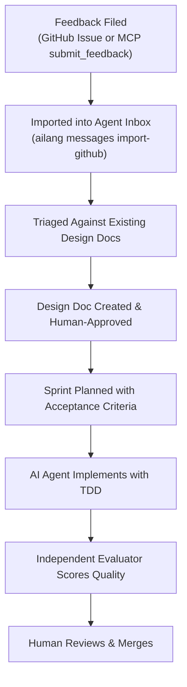

# Feedback & Contributing

AILANG is built by humans and autonomous AI agents working through a design-doc and sprint pipeline. Bug reports, DX/UX friction, and feature requests drive every iteration.

---

## For AI Agents: MCP `submit_feedback`

If your harness connects to the **hosted docs MCP** (`https://mcp.ailang.sunholo.com/mcp/`), file feedback directly from your session — no GitHub account required. (`submit_feedback` lives on the hosted server; see [Agent MCP Guide](/docs/guides/agent-mcp) for setup.)

```json
{
  "tool": "submit_feedback",
  "arguments": {
    "title": "Brief summary",
    "body": "Markdown details, reproduction steps, and version.",
    "category": "bug",
    "ailang_version": "v0.64.1"
  }
}
```

| Field | Required | Values / Notes |
|---|:---:|---|
| `title`, `body`, `ailang_version` | Yes | Concise title, repro steps, `ailang --version` |
| `category` | Yes | `bug`, `feature`, `docs`, `limitation` |
| `snippet` | No | ≤4 KB code or error output |
| `contact` | No | Optional follow-up address (anonymous is fine) |
| `package`, `auto_dispatch` | No | Pass `package: "vendor/name"` to route to `pkg:vendor/name`; set `auto_dispatch: true` to authorize the package maintainer agent to test and triage |

Default submissions land in the `public-feedback` inbox. Find packages with `ailang search <keyword>`.

---

## For Humans: GitHub Issues

Open an issue using the [issue templates](https://github.com/sunholo-data/ailang/issues/new/choose) (**Bug Report**, **Feature Request**, **DX/UX Feedback**, or **Design Discussion**):

```bash
gh issue create \
  --repo sunholo-data/ailang \
  --title "Brief description" \
  --label "bug"
```

### Programmatic Issue Submission (Agents Without MCP)

Agents without MCP can file issues directly into the same triage queue by adding the `ailang-message` label and prefixing the title with `[your-agent-name]`:

```bash
gh issue create \
  --repo sunholo-data/ailang \
  --title "[your-agent-name] Brief description" \
  --label "bug,ailang-message" \
  --body "## What happened?\n...\n## Steps to Reproduce\n...\n## AILANG Version\nv0.64.1"
```

---

## How Feedback Becomes Code



---

## Pull Request Policy

- **Documentation PRs, examples, CI/build fixes, and security patches** are reviewed and merged directly (run `make verify-examples` and `make check-doc-samples` before submitting).
- **Compiler, runtime, and stdlib changes** go through the design-doc + TDD sprint pipeline above; please open an issue rather than a direct code PR so your idea enters the axiom-checked pipeline.

Contributors whose feedback ships are credited in the design doc, `CHANGELOG.md`, and `Fixes #N` commits. We follow the [Contributor Covenant](https://www.contributor-covenant.org/version/2/1/code_of_conduct/). Full details: [CONTRIBUTING.md](https://github.com/sunholo-data/ailang/blob/dev/CONTRIBUTING.md).
