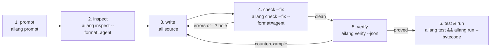

import Icon, { CheckIcon } from '@site/src/components/Icon';
import { ACTIVE_PROMPT } from '@site/src/constants/version';

# AILANG for AI Agents - Quick Integration Guide

This guide is the operational onboarding path for AI coding agents (Claude, GPT, Gemini, Codex) and the humans configuring them. Syntax lives in one canonical place — `ailang prompt` — so it never drifts from the compiler.


## Agent Task Routing Table

| Agent Task | Local CLI Command | Hosted MCP Tool (`mcp.ailang.sunholo.com/mcp/`) | Reference / Example |
|---|---|---|---|
| **1. Load current syntax before coding** | `ailang prompt` | `prompt_get(part="core")` + `prompt_get(part="reference")` | [Current Prompt](/docs/prompts/current) |
| **2. X-ray an existing `.ail` file/dir (`<100ms`)** | `ailang inspect --format=agent <path>` | — (local CLI) | [Debugging Guide](/docs/guides/debugging) |
| **3. Type + effect check (compact agent output)** | `ailang check --format=agent <file.ail>` | `ailang_check` (executor MCP) | [Language Syntax](/docs/reference/language-syntax) |
| **4. Auto-repair missing `! {Effects}`, `++`, `TC_MATCH_002`** | `ailang check --fix <file.ail>` | — (local CLI / `ailang lsp`) | [LSP & Quick-Fix](/docs/guides/lsp) |
| **5. Query expected type & bindings at expression** | Put `_?` or `?goal` in code → `ailang check --format=agent` | `ailang_check` | [LSP Typed Holes](/docs/guides/lsp) |
| **6. Prove `requires`/`ensures` contracts via Z3** | `ailang verify --json <file.ail>` (add `--int-model=int64` for overflow) | — (local CLI) | [Contracts & Z3](/docs/guides/contracts) |
| **7. Run inline `tests [...]` & property checks** | `ailang test <file.ail>` (or `--package`) | — (local CLI) | [Testing Guide](/docs/guides/testing) |
| **8. Execute deterministically (interpreter or VM)** | `ailang run --caps IO,FS --bytecode <file.ail>` | `ailang_run` (sandboxed) | [Effects Reference](/docs/reference/effects) |
| **9. Look up stdlib module exports & signatures** | `ailang docs --list` / `ailang docs std/json` | `stdlib_modules`, `stdlib_module` | [Stdlib Reference](/docs/reference/stdlib) |
| **10. Find working runnable `.ail` examples** | `ailang examples search "<query>"` | `example_for_concept`, `example_get` | [Examples](/docs/examples) |
| **11. Inspect JSON module interface & lock packages** | `ailang iface <mod>` / `ailang pkg docs <pkg>` | `docs_search` | [Packages Guide](/docs/guides/packages) |
| **12. Capture JSONL execution trace for repair** | `ailang run --emit-trace jsonl --quiet --caps IO <file.ail>` | — (local CLI) | [Execution Traces](/docs/guides/traces) |

## Agent Repair Loop



---

## Quick Start (4 Steps)

### Step 1: Verify AILANG is Installed

```bash
ailang --version
```

If missing, install the latest binary (see [Getting Started](/docs/guides/getting-started) for source builds):

```bash
curl -fsSL https://ailang.sunholo.com/install.sh | bash
```

### Step 2: Load the Canonical Teaching Prompt

**CRITICAL**: Never write AILANG from memory. Load the active syntax guide first:

```bash
ailang prompt
```

The web mirror is always at the [Current Teaching Prompt](/docs/prompts/current) (`{ACTIVE_PROMPT}`), and version-scoped via the [Hosted Docs MCP](/docs/guides/agent-mcp).

### Step 3: Write AILANG Code

Every executable AILANG program has an explicit `module` header and `! {Effects}` row:

```ailang
module benchmark/solution

import std/io (println)

export func main() -> () ! {IO} {
  println("Hello, AILANG!")
}
```

### Step 4: Inspect, Check, Verify, Run

```bash
ailang inspect --format=agent solution.ail      # <100ms semantic X-ray
ailang check --fix solution.ail                 # auto-fix safe mechanical issues
ailang check --format=agent solution.ail        # compact agent type + effect check
ailang test solution.ail                        # run inline tests [...]
ailang run --caps IO --entry main solution.ail  # flags BEFORE filename
```

---

## <CheckIcon inline size={14} /> Pre-Flight Checklist

- [ ] Loaded `ailang prompt` (or [Current Teaching Prompt](/docs/prompts/current)) in this session
- [ ] Inspected existing code with `ailang inspect --format=agent` instead of guessing signatures
- [ ] Started every file with `module` and declared explicit `! {Effects}`
- [ ] Verified edits with `ailang check --fix`, `ailang verify --json`, and `ailang test`

## Getting Help

- Report issues: [github.com/sunholo-data/ailang/issues](https://github.com/sunholo-data/ailang/issues)
- Known limits: [Known Limitations](/docs/reference/limitations)
- Live pass rates: [Benchmarks Dashboard](/docs/benchmarks/performance)
