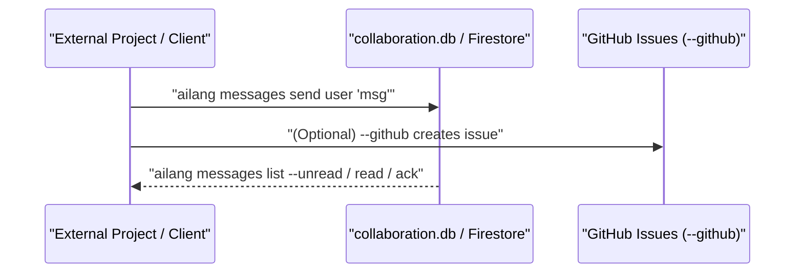

# Agent Messaging Guide

Unified messaging between interactive sessions, autonomous coordinator agents, GitHub issues, and cloud inboxes (`ailang messages` / `ailang msg`).

## Architecture



## Quick Reference

```bash
ailang messages list --unread                         # All unread messages
ailang messages list --inbox pkg:sunholo/ailang-parse # Filter by inbox
ailang messages read MSG_ID --peek                    # Read without marking read
ailang messages ack MSG_ID                            # Mark read (or --all)
ailang messages send user "Msg" --title "T" --github  # Send + open GitHub issue
ailang messages search "parser error" --neural        # Semantic search (SimHash or Ollama)
ailang messages dedupe --apply                        # Collapse duplicate messages
```

## Storage Backends (Local SQLite vs Canonical Cloud)

| Store | Selected By | Holds |
|---|---|---|
| **Canonical cloud** (prod Firestore, `ailang-multivac`) | `AILANG_STORAGE_MESSAGING=gcp` + `AILANG_MESSAGES_PROJECT=ailang-multivac` | Public/package feedback, coordinator completions, cross-machine traffic |
| **Local SQLite** (`~/.ailang/state/collaboration.db`) | Default (`AILANG_STORAGE_MESSAGING=local`) | Local agent inboxes and sprint state |

```bash
export AILANG_STORAGE_MESSAGING=gcp
export AILANG_MESSAGES_PROJECT=ailang-multivac
ailang storage status   # Verify active store per plane (messaging/coordinator/observatory)
```

**Cloud triage rules:**
- `AILANG_STORAGE_MESSAGING` moves messaging alone without switching coordinator/observatory (`AILANG_MESSAGES_STORE` is removed and errors loudly).
- Cross-inbox `ailang messages list --unread` catches `public-feedback` and `pkg:<vendor>/<name>` inboxes in one pass; use `--json` for full IDs (default table truncates IDs) and `--peek` or `--json` to inspect without marking read.
- Non-local listings print `store: gcp (Firestore, project ...)` in the header; test stale binaries with `AILANG_STORAGE_MESSAGING=not-a-real-store ailang messages list --unread` (must error).

## Cloud Task Inputs & Tag Routing

- **Cloud task inputs (`--inputs-file`)**: Pass external repo attachments (`repo`, `ref`, `path`, optional `sha256` / `manifest.sha256`, max 16 inputs / 256 MiB) to cloud agents whose `inputs_allow` grants the repo. Delivered read-only under `.incoming/<N>/` as untrusted data (see [`examples/task_inputs`](https://github.com/sunholo-data/ailang/tree/dev/examples/task_inputs)).
- **Tag-routed sends (`--requires`)**: Stamp Pub/Sub attributes (`ailang messages send eval-rig "..." --requires "gpu:m4-max-40core,ollama:gemma4-26b-ailang"`) so only workers advertising matching `worker_tags` claim the task (requires local HTTP listener via `make coord-install`; see [Coordinator Workers runbook](https://github.com/sunholo-data/ailang/blob/dev/docs/internal/runbooks/coordinator-workers.md)).

## GitHub Integration & Semantic Search

Configure `github.expected_user` (must match `gh auth status`), `default_repo`, and `auto_import: true` in `~/.ailang/config.yaml`:

- **Outbound (`--github`)**: `bug` and `feature` messages create GitHub issues (`[from] Title`); `ailang messages reply MSG_ID "..."` comments on the linked thread.
- **Inbound (`ailang messages import-github`)**: Imports issues into the configured inbox (`--labels`, `--dry-run`).

| Search / Triage Feature | Command | Notes |
|---|---|---|
| **SimHash** (default, free) | `ailang messages search "query" --threshold 0.7` | 64-bit locality-sensitive fingerprint |
| **Neural embeddings** | `ailang messages search "query" --neural` | Uses Ollama (`nomic-embed-text`), OpenAI, or Gemini (`~/.ailang/config.yaml` `embeddings:`) |
| **Semantic envelope** | `--envelope-code <files>` / `--envelope-context "..."` + `--space intent\|code\|context\|resolution` | Multi-space search across 5 envelope slots (`resolution` auto-populated on task completion) |
| **Triage clustering** | `ailang messages triage --cluster-by intent\|code --top 5` | Groups unread messages by similarity |

## Package Coordination Messages (`ailang.package-message/v1`)

`ailang publish` automatically emits typed notices (`upgrade-available`, `interface-change-notice`, `effect-widening-warning`) to `pkg:<vendor>/<name>`, `workspace:<name>`, and `team:<name>` inboxes and marks older notices `superseded`:

```bash
ailang pkg notify-upgrade sunholo/auth@0.2.0 --summary "Tightened validation"
ailang pkg affected-by sunholo/auth
ailang messages list --inbox pkg:sunholo/auth --unread
```

State lifecycle: `open` → `acknowledged` → `in_progress` → `completed` (or `blocked` / `rejected` / `superseded`).

## See Also

- [Cloud Messaging Integration](./cloud-messaging-integration) · [Collaboration Hub](./collaboration-hub) · [Coordinator Guide](./coordinator) · [Agent Workflows](./agent-workflows) · [State System](./state-system-workflow)
