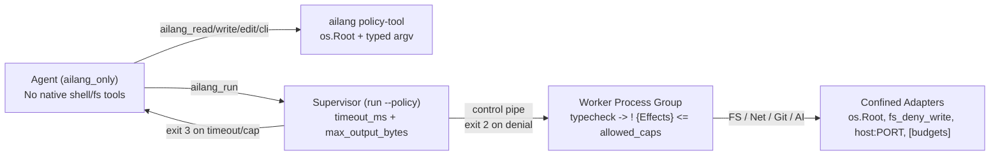

# Agent tool policy — the `ailang_only` lane

An agent on `tool_policy: ailang_only` has **no shell**: it edits files inside an operator-chosen sandbox and executes programs only through `ailang run --policy <agent-policy.toml> prog.ail` using a read-only policy file it cannot edit.



## The Three Pieces

| Piece | Mechanism | Source |
|---|---|---|
| **Gate** | `ailang run --policy <toml> prog.ail` arms `timeout_ms` + allowlisted env, verifies program `! {Effects}` ⊆ `allowed_caps`, refuses widening flags (`--caps`, `--entry`, `--ai*`, `--net-*`), exits `2` on denial or `3` on timeout/output cap | `cmd/ailang/run_policy.go`, `run_policy_supervise.go` |
| **Tools** | `ailang policy-tool` serves `ailang_read` (ranged `offset`/`limit` ≤2000), `ailang_write`, `ailang_edit`, `delete` (refuses dirs/`.git/`), and schema-validated `ailang_cli` (`run`/`exec`/`repl` unreachable); default-deny if policy unset | `internal/policytool`, `.pi/extensions/ailang-exec.ts` |
| **Profile** | `ailang pi tool-profile ailang_only` emits `--no-builtin-tools --tools ailang_read,ailang_edit,ailang_write,ailang_check,ailang_run,builtins_search,examples_search,ailang_cli` | `internal/executor/toolpolicy.go` |

## Policy TOML Schema

```toml
security_mode = "restricted"              # default; "trusted_host" rejected by ailang_only
allowed_caps  = ["IO", "FS"]              # full authority ceiling for submitted code
fs_sandbox    = "/workspace"              # must NOT contain the policy file itself
fs_deny_write = [".github/**", ".pi/**", "Makefile", "*.yml"]
# net_allow    = ["api.example.com", "127.0.0.1:7655"]
# net_allow_http = true
# process_allow  = ["git:status", "git:diff", "git:log"]
# cli_allow      = ["iface", "docs:search"]
# ai_provider    = "gemini-3-5-flash-lite" # requires [budgets] AI in restricted mode
timeout_ms    = 5000                      # positive, <= 24h
entry         = "main"

# [budgets]
# FS = 100
# AI = 50
```

| Field | Required / Default | Confinement Rule (`restricted` mode) |
|---|---|---|
| `security_mode` | `"restricted"` (default) | Admits `IO`, `FS`, `Net`, `Clock`, `Rand`, `Stream`, `Declassify`, confined `Process` (`git:status\|diff\|log`), and `AI` (pinned). `trusted_host` fails `ailang_only` dispatch. |
| `allowed_caps` | Required list | Every program effect must be in this set (`missing_from_policy` -> exit `2`). |
| `fs_sandbox` | Required if `FS` or `Process` | Confined via one `os.Root` handle; `..`, outside paths, and escaping/absolute symlinks fail in syscall. Entry file must live inside `fs_sandbox`. |
| `fs_deny_write` | `.git/**` always implied | Case- and Unicode-normalization-insensitive globs protecting supply-chain files, symlinks, hard-linked files, and matching ancestor dirs (`E_FS_PROTECTED`). |
| `net_allow` | Required if `Net` or `Stream` | `host` or `host:PORT` (checked on dial and every redirect hop); strips auth cross-origin; blocks private/metadata IPs and bare loopback; port-qualified literal loopback (`127.0.0.1:7655`) never follows redirects. |
| `net_allow_http` | `false` | Allows `http`/`ws` in addition to `https`/`wss`. |
| `process_allow` | `[]` | Only `git:status`, `git:diff`, `git:log` admitted in `restricted` mode (`GIT_CEILING_DIRECTORIES` bounded at `fs_sandbox`; hooks/pagers/ext-diff disabled; `spawnProcess` refused). |
| `cli_allow` | Read-only safe set | Typed schemas in `internal/policytool/cli_ops.go`; `run`, `exec`, `repl`, `replay`, `watch`, `select-best` never reachable. |
| `ai_provider` + `[budgets] AI` | Both required for `AI` | Pins provider & injects only that provider's credential; `--ai`/`--ai-stub` refused. `std/web` requires `Net` + `net_allow = ["ollama.com"]`. |
| `timeout_ms` & byte caps | `1 MiB` src / `16 MiB` graph / `8 MiB` out & xfer | Supervisor kills worker process group at `timeout_ms` or `max_output_bytes` (exit `3`); `[budgets]` caps aggregate ops (`0` = none). |

## Runtime Enforcement & Compile Cache

- **Authority freeze**: Policy is decoded once into an immutable value (`policy_digest`); worker freezes source reads so the typechecked module graph (`module_graph.digest`) is identical to what executes.
- **Compile cache**: Unset `AILANG_CACHE_DIR` cold-compiles into a private temp dir outside `fs_sandbox` (removed on exit; refuses if `TMPDIR` resolves inside sandbox).
- **Supervisor line provenance**: Only the supervisor emits unprefixed `policy:` and `policy-result:` lines on stderr; worker lines starting with either token are prefixed `worker: `. A worker exiting `3` without a supervisor limit becomes exit `1` (`worker_reserved_exit`).
- **Residual trust limits**: Documented in [LIMITATIONS](/docs/reference/limitations) (no CPU/RAM cgroup isolation; same-UID defense in depth; restricted mode refused on Windows/`GOOS=js`).

## Delivering & Reading Back

| Surface | How Policy Is Supplied |
|---|---|
| **Coordinator** | `tool_policy: ailang_only` + `policy_path` (`AILANG_AGENT_POLICY` locally; `AILANG_AGENT_POLICY_TOML` materialized read-only under `~/.ailang/agent-policy/` on Cloud Run) |
| **Local `pi` session** | `AILANG_AGENT_POLICY=/tmp/dev-policy.toml pi $(ailang pi tool-profile ailang_only)` (`messages`/`publish`/`install` stay refused) |
| **Eval suite / Manual** | `ailang eval-suite --agent --tool-policy ailang_only --policy-file ...` or `echo '{"op":"summary"}' \| ailang policy-tool --policy p.toml` |

Every agent run banks `tool_policy`, `policy_digest`, `env_names_digest` (from `executor.BuildEnvironment`'s default-deny allowlist that withholds `*_KEY`/`*_TOKEN`/`*SECRET*` except the active inference credential), and `module_graph`. Denials bank as `error_category: policy_violation`; supervisor limits exit `3` with `policy-result: {"version":1,"stage",...}`.
