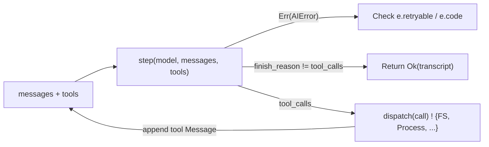

import CodeBlock from '@theme/CodeBlock';
import AIEffectExample from '!!raw-loader!@site/../examples/runnable/ai_effect.ail';
import NPCDialogueExample from '!!raw-loader!@site/../examples/docs/npc_dialogue.ail';
import AICallResultExample from '!!raw-loader!@site/../examples/runnable/ai_call_result.ail';
import AIToolLoopExample from '!!raw-loader!@site/../examples/runnable/ai_tool_loop.ail';
import AIImageExample from '!!raw-loader!@site/../examples/runnable/ai_image_generation.ail';

# AI Effect: Calling LLMs & Tool Loops from AILANG

`std/ai` is AILANG's effect-typed interface (`! {AI}`) for single-shot text/JSON/media/speech generation and multi-turn tool-use loops (`step`, `runTools`).

:::tip Live Demos
- **[Claude Chat](https://www.sunholo.com/ailang-demos/streaming/claude_chat/)** · **[Gemini Live Audio](https://www.sunholo.com/ailang-demos/streaming/gemini_live/)** · **[Safe Agent](https://www.sunholo.com/ailang-demos/streaming/safe_agent/)**
:::

## Quick Start & Providers

<CodeBlock language="ailang" title="examples/runnable/ai_effect.ail">
  {AIEffectExample}
</CodeBlock>

```bash
ailang run --caps IO,AI --ai claude-haiku-4-5 --entry main my_app.ail   # Anthropic
ailang run --caps IO,AI --ai gpt5-mini --entry main my_app.ail           # OpenAI
ailang run --caps IO,AI --ai gemini-2-5-flash --entry main my_app.ail    # Google (API key or ADC)
ailang run --caps IO,AI --ai-stub --entry main my_app.ail                # Deterministic offline stub
```

| Provider | Auth / Env | Key Flags |
|---|---|---|
| **Anthropic / OpenAI** | `ANTHROPIC_API_KEY` / `OPENAI_API_KEY` | `--ai <model>`, `--ai-key-file PATH` |
| **Google (AI Studio / Vertex)** | `GOOGLE_API_KEY` or `gcloud` ADC | `--ai-no-adc` (`AILANG_AI_NO_ADC=1`) blocks silent ADC billing fallback; key sent in `x-goog-api-key` header |
| **OpenRouter / Custom** | `OPENROUTER_API_KEY` / `ailang.toml` | `--ai openrouter/auto`; see [AI Routing](./ai-routing.md) & [Custom Providers](./custom-ai-providers.md) |
| **Offline Stub / Fixtures** | None | `--ai-stub` returns `{"kind":"Wait"}`; `--ai-stub-fixtures file.json` replays canonical sha256 fixtures (miss -> `E_AI_STUB_FIXTURE_MISS`) |

## Structured `deriving (Json)` + `callJsonResult` + `runTools`

Combine `deriving (Json)` (auto-synthesizing `decode<Type>`) with schema-enforced `callJsonResult` and multi-turn `runTools` for end-to-end typed agent loops:

```ailang
module docs/ai_structured_tool_loop

import std/ai (callJsonResult, runTools, ToolSchema, ToolCall, Message, AIError)
import std/io (println)
import std/json (Json, decode)
import std/list (length)
import std/result (Result, Ok, Err)

type ReadDocArgs = { path: string } deriving (Json)
type Summary = { topic: string, bullets: [string] } deriving (Json)

export pure func dispatch(call: ToolCall) -> string {
  if call.name == "read_doc" then
    match decode(call.arguments) {
      Ok(j) => match decodeReadDocArgs(j) {
        Ok(args) => "Read ${args.path}: [NDA 2-year term, Delaware law]",
        Err(err) => "invalid args: ${err}"
      },
      Err(err) => "invalid json: ${err}"
    }
  else "unknown tool: ${call.name}"
}

export func summarizeTyped(text: string) -> Result[Summary, string] ! {AI} {
  let schema = "{\"type\":\"object\",\"properties\":{\"topic\":{\"type\":\"string\"},\"bullets\":{\"type\":\"array\",\"items\":{\"type\":\"string\"}}},\"required\":[\"topic\",\"bullets\"]}";
  match callJsonResult("Summarize:\n${text}", schema) {
    Err(e) => Err(e.message),
    Ok(raw) => match decode(raw) {
      Ok(j) => decodeSummary(j),
      Err(e) => Err(e)
    }
  }
}

export func main() -> () ! {AI, IO} {
  let tools: [ToolSchema] = [{
    name: "read_doc",
    description: "Read a document by path",
    parameters: "{\"type\":\"object\",\"properties\":{\"path\":{\"type\":\"string\"}},\"required\":[\"path\"]}"
  }];
  let msgs: [Message] = [{
    role: "user", content: "Read nda.docx and summarize it.",
    tool_calls: [], tool_call_id: "", media: []
  }];
  match runTools("", msgs, tools, dispatch, 6) {
    Ok(transcript) => println("Completed in ${show(length(transcript))} messages"),
    Err(e) => println("[${e.code}] retryable=${show(e.retryable)}: ${e.message}")
  }
}
```

## Multi-Turn Tool Dispatch (`step` and `runTools`)



`runTools(model, messages, tools, dispatch, step_budget)` drives `step` until completion or `step_budget <= 0`. Because `dispatch` is effect-polymorphic (`ToolCall -> string`), passing a handler with `! {FS, Process}` automatically propagates `! {AI, FS, Process}` to the caller via row polymorphism. Drop down to `step` directly when you need per-turn approval gates or custom token caps.

| Provider | Tool Calling | Notes |
|---|---|---|
| **Anthropic / Gemini / OpenAI / OpenRouter** | Supported | Normalized into `ToolSchema` / `ToolCall` / `Message` across wire formats |
| **Ollama / Configdriven** | Typed reject | Returns `Err(AIError{code: "ToolsNotSupported"})`; use chat/JSON calls without tools |

<CodeBlock language="ailang" title="examples/runnable/ai_tool_loop.ail">
  {AIToolLoopExample}
</CodeBlock>

## Typed Errors (`callResult` / `callJsonResult`)

Prefer `callResult`, `callJsonResult`, and `callJsonSimpleResult` over legacy crashing `call`/`callJson`: failures return `Err(AIError { code, message, retryable })` — the same shape used by `std/ai/streaming`.

| Code | Retryable | Typical Cause |
|---|---|---|
| `RateLimit`, `Timeout`, `ConnectionFailed`, `Internal` | `true` | Transient 429/5xx, network, or context deadline |
| `AuthFailed`, `ContextLength`, `SchemaValidation`, `ToolsNotSupported`, `ModelNotFound`, `BudgetExhausted` | `false` | Bad key, window exceeded, schema mismatch, unsupported tools, or budget cap hit |

<CodeBlock language="ailang" title="examples/runnable/ai_call_result.ail">
  {AICallResultExample}
</CodeBlock>

## Effect System Integration

```ailang sketch
-- Effect declared in signature
func my_ai_func() -> string ! {AI} = ...

-- Requires --caps AI at runtime
ailang run --caps IO,AI --ai <model> --entry main file.ail
```

## Speech (`callSpeech`) & Image Generation

- **`callSpeech(text, voice, style, options)`**: Gemini TTS returning raw s16le mono 24 kHz PCM (`speechSampleRate()`), ready for `std/audio.wavFromPcm`. `--ai-stub` emits a deterministic 250 ms 400 Hz tone. See `examples/runnable/ai_call_speech.ail`.
- **Image generation**: `callImage` / `callImageBase64` (plus `*WithRefs` taking `[ImagePart]`) support Gemini image models and OpenRouter image-output models.

<CodeBlock language="ailang" title="examples/runnable/ai_image_generation.ail">
  {AIImageExample}
</CodeBlock>

## NPC Dialogue Example & Fixture Replay

<CodeBlock language="ailang" title="examples/docs/npc_dialogue.ail">
  {NPCDialogueExample}
</CodeBlock>

For deterministic offline testing with `--ai-stub --ai-stub-fixtures fixtures.json`, requests are matched by `sha256` of canonical request bytes (`text` prompt, last `step` message content, or compact sorted JSON for `speech`), with `version: 1` entries (`text`, `image`, `speech`, `tool_calls`, or `error`).

## Choosing the Right Surface

| Goal | Use |
|---|---|
| One-shot text or JSON with typed errors | `callResult` / `callJsonResult` / `callJsonSimpleResult` |
| Token-by-token streaming | [AI Token Streaming](/docs/recipes/ai-token-streaming) (`callStream` / `stepWithStream`) |
| Single turn or full tool-use agent loop | `step` / `runTools` |
| Custom HTTP headers or non-LLM REST APIs | [AI API Integration (`std/net`)](/docs/examples/ai-api-integration) |
| Multi-vendor fallback & cost routing | [AI Provider Routing](./ai-routing.md) |
