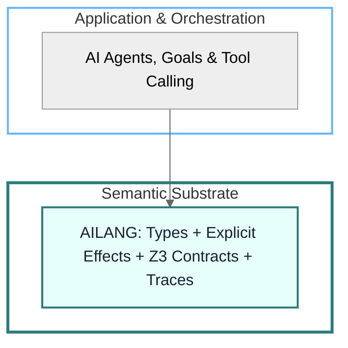
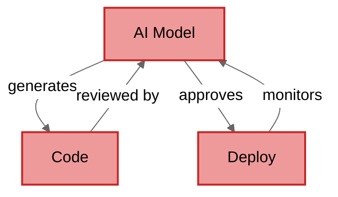
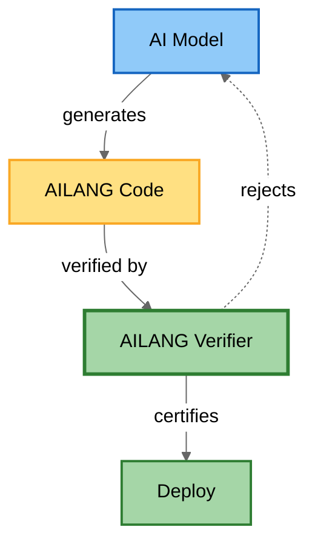

import Icon, { CheckIcon, CrossIcon } from '@site/src/components/Icon';

# <Icon name="scale" inline /> AILANG vs Agent Frameworks

**AILANG is not an agent framework or workflow engine — it sits below them as a deterministic semantic substrate.** Agent frameworks act; AILANG evaluates, verifies, and bounds.

## The Key Distinction

| Dimension | <Icon name="bot" inline size={14} /> Agent Frameworks | <Icon name="code" inline size={14} /> AILANG |
|---|---|---|
| **Primary unit** | Agent / open-ended loop | Program / closed evaluation |
| **State** | Mutable, long-lived | Immutable, value-based |
| **Control** | Scheduler / prompts | Semantics / HM types / `! {Effects}` |
| **Safety** | Heuristics & runtime guards | Decidable type, effect & Z3 checks |
| **Failure mode** | Silent drift | Explicit compile/verify mismatch |

Unconstrained self-modifying agent systems accumulate hidden mutable state, non-replayable paths, and prompt drift — losing **provenance**, **equivalence**, and **verification**.

## Below Agents in the Stack

- <CheckIcon inline size={14} /> **Agents** choose goals, orchestrate tools, and decide when to act.
- <CheckIcon inline size={14} /> **AILANG** defines what a valid action is, guarantees replayable equivalence, and verifies outputs before execution.

## Not "A Better Python" — A Semantic Control Surface

| Python Is | AILANG Is |
|---|---|
| A human productivity language | A machine reasoning substrate |
| Implicit control & ambient effects | Explicit `! {Effects}` & budgets |
| Debugged interactively | Checked & Z3-verified structurally |

Without external ground truth, an LLM generating, reviewing, and deploying code becomes a **self-legitimizing loop**. AILANG inserts a deterministic verifier between synthesis and deployment:

**Without AILANG (Self-Legitimizing):**

**With AILANG (Semantic Ground Truth):**

> **AILANG doesn't create intelligence. It makes intelligence go somewhere predictable.**

## Learn More

- <Icon name="bot" inline size={14} /> [Agent Integration](/docs/guides/agent-integration) — CLI + MCP routing table and repair loop
- <Icon name="shield" inline size={14} /> [Agent Tool Policy (`ailang_only`)](/docs/guides/agent-tool-policy) — no-shell capability sandboxing
- <Icon name="book" inline size={14} /> [Three Camps Comparison](/docs/guides/three-camps-comparison) — how AILANG compares to ~20 AI-native languages
- <Icon name="play" inline size={14} /> [AI Effect System](/docs/guides/ai-effect) — `std/ai` structured tool loops
