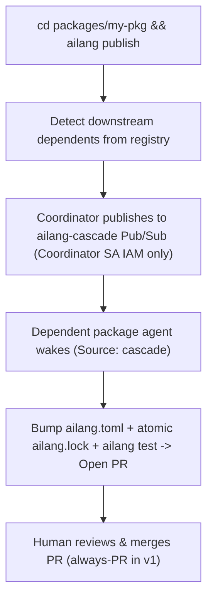
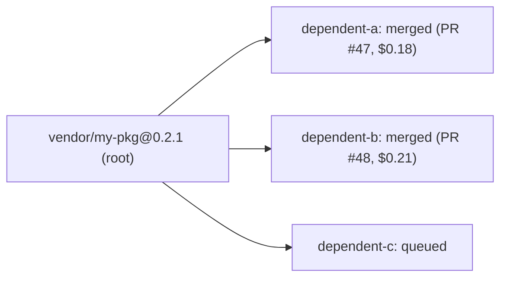

# Autonomous Package Updates

When you publish a new version of a package with `ailang publish`, AILANG can automatically open update PRs on every downstream package that depends on it. Each PR opens against `sunholo-data/ailang-packages` for human review, and you can inspect progress end-to-end via `ailang pkg cascade status`.

## How the Cascade Works



**v1 is always-PR** — no package version is auto-merged or auto-published downstream.

## Two Modes of Update Propagation

| Update kind | Path | Outcome |
|---|---|---|
| **Cascade-triggered bump** (`ailang publish`) | Coordinator -> `ailang-cascade` topic -> dependent package agent | Opens `[cascade]` bump PR |
| **Public feedback** (`mcp.ailang.sunholo.com/submit_feedback`) | MCP -> `pkg:vendor/name` inbox -> package agent | Files GitHub issue only (never bumps/publishes) |

## Running and Observing a Cascade

### Step 1 — Bump and Publish

Ensure `ailang` CLI is installed (`ailang --version`), bump `[package].version` + `CHANGELOG.md` + `[release].kind`, and run:

```bash
cd packages/my-pkg
ailang publish
```

```text
✓ Built vendor/my-pkg@0.2.1
✓ Pushed to registry: vendor/my-pkg@0.2.1
✓ Found 3 dependents: vendor/dependent-a, vendor/dependent-b, vendor/dependent-c
Cascade ID: <chain_id from provenance>
Watch with: ailang pkg cascade status vendor/my-pkg@0.2.1
```

### Step 2 — Watch Cascade Progress

```bash
ailang pkg cascade status vendor/my-pkg@0.2.1
```



### Step 3 — Review and Merge

Each cascade PR carries `[cascade] bump vendor/my-pkg -> 0.2.1 (cascade chain_...)`, bumping `ailang.toml` and regenerating `ailang.lock`. Check provenance after merge with `ailang pkg history vendor/dependent-a` or `ailang pkg provenance vendor/dependent-a@<new-version>`.

## Security Model

### IAM-Restricted Cascade Topic

| Pub/Sub Topic | Purpose | Publish IAM |
|---|---|---|
| `ailang-messages` | Public feedback & agent messages | Open |
| `ailang-cascade` | Authoritative `ailang publish` triggers | **Coordinator service account only** |

Package agents act on bump requests **only** when `Source: cascade` is present. GCP IAM enforces at the transport layer that public `submit_feedback` calls cannot publish to `ailang-cascade`:

```bash
gcloud pubsub topics get-iam-policy ailang-cascade --project=ailang-multivac
```

### Circuit Breaker, Budget Cap & Subdirectory Isolation

- **Circuit breaker:** Consecutive cascade failures abort further dispatches (`CascadeCircuitBreaker`).
- **Per-cascade budget cap:** Set `[cascade] max_cost_usd` in `ailang.toml` (default `$1.00`) to cap cumulative DAG spend.
- **Directory confinement & always-PR:** Each package agent runs scoped to its own `subdirectory` and never auto-merges.

## Configuration & Diagnostics

```toml
# ailang.toml
[package]
name = "vendor/your-pkg"
version = "0.1.0"

[dependencies]
"vendor/some-dep" = "0.5.0"

[cascade]
max_cost_usd = 0.50
```

```bash
# Inspect cascade delivery, coordinator logs, and execution chain
gcloud pubsub subscriptions pull ailang-cascade-coordinator --project=ailang-multivac --limit=5 --auto-ack=false
gcloud logging read 'resource.type="cloud_run_revision" AND resource.labels.service_name="ailang-coordinator" AND textPayload:"vendor/your-dependent"' --project=ailang-multivac --limit=20 --freshness=10m
ailang chains view <cascade-id>
```

For urgent manual fixes, open a normal PR directly — package agents only act on `ailang-cascade` events.

## References

- [M-PKG-AUTONOMOUS-CASCADE-SAFE design doc](https://github.com/sunholo-data/ailang/blob/dev/design_docs/implemented/v0_16_x/m-pkg-autonomous-cascade-safe.md)
- [Package System](./packages.md) & [Publishing Your Package](./package-publishing.md)
