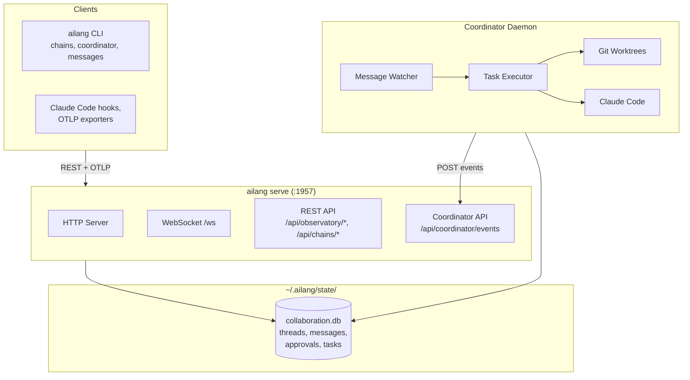

# Collaboration Hub Guide

The AILANG Collaboration Hub is the coordinator daemon plus the dashboard server (`ailang serve`).
It provides visibility into autonomous agent execution, approval workflows, and multi-agent
pipelines.

## Overview

:::note The dashboard has no web UI
Since November 2026 `ailang serve` is a **headless API**: telemetry ingest (OTLP, Claude Code
hooks, exec sessions), observatory and chains reads, secret-approval intake, the `/benchmarks/`
data the docs site reads, and `/health`. The React dashboard was removed
([design doc](https://github.com/sunholo-data/ailang/blob/dev/design_docs/planned/m-dashboard-headless-api.md)).
Use the CLI below, `ailang chains`, and `ailang chains dashboard` to inspect work.
:::

### CLI

```bash
# View pending approvals
ailang coordinator pending

# Interactive approval with diff viewer
ailang coordinator approve <task-id>

# Reject with feedback
ailang coordinator reject <task-id> -f "Needs error handling"
```


## Installation

### Building from Source

```bash
# Build ailang
make build

# Install to $GOPATH/bin (makes it available system-wide)
make install
```

After installation, verify it works:

```bash
ailang --version
ailang coordinator status
```

## Quick Start

### Using Make (Recommended)

The easiest way to start everything:

```bash
# Start both server and coordinator daemon
make services-start

# Check status
make services-status

# Stop all services
make services-stop
```

### Manual Start

#### 1. Start the Server

```bash
ailang serve
```

This starts the dashboard API on `http://127.0.0.1:1957` (no UI; `GET /health` answers when it
is up). It receives telemetry from Claude Code hooks, the coordinator and eval runs, and serves
the reads behind `ailang chains dashboard`.

#### 2. Start the Coordinator Daemon

In a separate terminal:

```bash
ailang coordinator start
```

The coordinator:
- Watches for new messages automatically
- Executes tasks in isolated git worktrees
- Streams progress to the dashboard in real-time (see [Telemetry](/docs/guides/telemetry) for Observatory integration)
- Stores results in SQLite

#### 3. Send a Task

From the CLI:
```bash
ailang messages send coordinator "Create a hello.go file" --title "New file"
```

Follow it with `ailang chains` (or `ailang coordinator status`).

## Architecture



## Approval Workflow

When a directive requires special capabilities (like network access), the agent:

1. **Detects capabilities** - Analyzes directive text for FS/Net/IO patterns
2. **Requests approval** - Creates an approval request in the database
3. **Waits for human** - `ailang coordinator pending` lists pending requests
4. **Proceeds or aborts** - After approval, executes; after rejection, cancels

Example:

```
User: "Fetch the API docs from https://api.example.com"

Agent: [Detected: Net capability required]
       [Created approval request]
       [Waiting 60s for approval...]

CLI: `ailang coordinator pending` shows the request:
    - Requested capability: Net
    - Target URL: api.example.com
    - Estimated cost: $0.05

User: ailang coordinator approve <task-id>

Agent: [Approval received]
       [Executing directive...]
       [Done! Results sent to the requester's inbox]
```

### Multi-Channel Approvals (v0.6.4+)

Approvals can come from multiple sources:

| Source | How to Use |
|--------|------------|
| **CLI** | `ailang coordinator approve/reject <task-id>` (add `--remote gcp` for the cloud plane) |
| **GitHub** | Add `ailang:approved` or `ailang:needs-revision` labels |

#### Iteration Tracking

When tasks are rejected with feedback, they're re-queued for another attempt (up to three
iterations). The harvested feedback from previous rejections is passed to the next attempt.

## CLI Reference

### Server

```bash
# Start server (default port 1957)
ailang serve

# Custom port
ailang serve --port 8080

# Custom database
ailang serve --db /path/to/collab.db

# Let a page on another origin call the API and open the WebSocket (repeatable)
ailang serve --cors-origin http://localhost:5173
```

#### Cross-origin access (v0.44.x+)

The server is **same-origin only** by default. CLIs, Claude Code hooks, OTLP exporters and
other server-to-server callers (no `Origin` header) all work with no flag.

A page on any other origin:

- gets **no `Access-Control-Allow-Origin`** on reads, so it cannot read the API;
- gets **403 before dispatch** on any other method, including preflights and `text/plain` POSTs;
- gets **403 on the WebSocket upgrade** (`/ws`), which blocks cross-site
  WebSocket hijacking. A client holding the `COORDINATOR_API_KEY` token (`?token=`) is still
  admitted from any origin, as before.

`--cors-origin ORIGIN` (exact `scheme://host[:port]`, repeatable) grants one origin both REST and
WebSocket access. `/benchmarks/*` stays readable from every origin because the docs site fetches it.
The policy is shared with `ailang serve-api` (`internal/platform/originpolicy`).

### Coordinator Daemon

```bash
# Start coordinator daemon
ailang coordinator start

# Check status
ailang coordinator status

# Stop daemon
ailang coordinator stop

# Start with options
ailang coordinator start --poll-interval 10s --max-worktrees 5
```

### Service Management (Make)

```bash
# Start both server and coordinator
make services-start

# Stop both
make services-stop

# Restart with fresh build
make services-restart

# Check status of both
make services-status
```

## Database Schema

The `collaboration.db` SQLite database contains:

```sql
-- Conversation threads
CREATE TABLE threads (
    id TEXT PRIMARY KEY,
    title TEXT,
    status TEXT,  -- 'active', 'completed', 'archived'
    created_by_type TEXT,
    created_by_id TEXT,
    created_at INTEGER,
    updated_at INTEGER
);

-- Messages (directives and results)
CREATE TABLE messages (
    id TEXT PRIMARY KEY,
    thread_id TEXT,
    message_seq INTEGER,
    from_type TEXT,   -- 'human', 'ailang_instance'
    from_id TEXT,
    to_type TEXT,
    to_id TEXT,
    kind TEXT,        -- 'directive', 'result', 'status', 'error'
    content TEXT,
    delivery_state TEXT,
    business_state TEXT,
    created_at INTEGER
);

-- Capability approval requests
CREATE TABLE approvals (
    id TEXT PRIMARY KEY,
    thread_id TEXT,
    status TEXT,      -- 'pending', 'approved', 'rejected'
    capability_token TEXT,
    proposal_text TEXT,
    impact_level TEXT,
    estimated_cost REAL,
    created_at INTEGER,
    reviewed_at INTEGER,
    reviewed_by TEXT,
    review_notes TEXT
);
```

## ID Relationships Across Databases

AILANG uses three SQLite databases that cross-reference each other through shared IDs. Understanding these relationships is essential for debugging and extending the system.

### Database Overview

| Database | Location | Purpose |
|----------|----------|---------|
| **collaboration.db** | `~/.ailang/state/collaboration.db` | Messages, threads, agents |
| **coordinator.db** | `~/.ailang/state/coordinator.db` | Task execution state, approvals, events |
| **observatory.db** | `~/.ailang/state/observatory.db` | OTEL spans, traces, task/agent hierarchy |

### ID Flow

When a message triggers task execution, IDs flow across all three databases:

```
collaboration.db                coordinator.db                    observatory.db
================                ==============                    ==============

threads.id ─────────────────────► tasks.thread_id

messages.id (UUID) ─────────────► tasks.message_id
                                       │
                                       ├── tasks.id = "task-" + first_8(message_id)
                                       │        │
                                       │        └─────────────────────► tasks.id (same)
                                       │                                     │
                                       │                                spans.task_id (FK)
```

### Key ID Formats

| ID Type | Format | Example |
|---------|--------|---------|
| `task_id` | `task-<8-char-uuid>` | `task-29404032` |
| `message_id` | Full UUID | `29404032-74b3-40c6-acc3-23d6bbe14b68` |
| `thread_id` | `thread_<ts>_<rand>` | `thread_1768064360112_5f96886d` |
| `span_id` | 16-char hex | `0f9632b58df815e4` |
| `trace_id` | 32-char hex | `0ebf5e64bb654fcc1d19256b59f05ae3` |
| `session.id` | UUID (span attribute) | `4df60536-caed-4e2f-af2c-e386c361f4e7` |

### Cross-Database Queries

```bash
# Find all data for a task
TASK_ID="task-29404032"

# 1. Task in coordinator
sqlite3 ~/.ailang/state/coordinator.db \
  "SELECT id, message_id, thread_id, session_id FROM tasks WHERE id = '$TASK_ID'"

# 2. Spans in observatory
sqlite3 ~/.ailang/state/observatory.db \
  "SELECT id, name, trace_id FROM spans WHERE task_id = '$TASK_ID'"

# 3. Original message in collaboration
MSG_ID="29404032-74b3-40c6-acc3-23d6bbe14b68"  # Full UUID
sqlite3 ~/.ailang/state/collaboration.db \
  "SELECT id, thread_id, content FROM messages WHERE id = '$MSG_ID'"
```

### Span Hierarchy

Within observatory.db, spans form a tree using `parent_span_id`:

```bash
# Use the hierarchy CLI command for visualization
ailang trace hierarchy --limit 5

# Or query directly
sqlite3 ~/.ailang/state/observatory.db \
  "SELECT name, json_extract(attributes, '\$.turn.number') as turn \
   FROM spans WHERE json_extract(attributes, '\$.session.id') = 'SESSION_UUID'"
```

:::tip Session Correlation
When spans don't have `task_id` set (common with CLI tools), use `session.id` from span attributes for correlation. This is the most reliable way to link orphan spans.
:::

## API Endpoints

The dashboard serves only routes with a caller outside it. The full table — route, method, auth
class and the client that calls it — is in the
[design doc](https://github.com/sunholo-data/ailang/blob/dev/design_docs/planned/m-dashboard-headless-api.md).
On a non-loopback bind every `/api/` read needs `Authorization: Bearer $AILANG_DASHBOARD_TOKEN`
(the server's `COORDINATOR_API_KEY`); a loopback server is exempt.

### Health Check

```bash
curl http://localhost:1957/health
# {"status":"healthy","version":"...","connections":1,"timestamp":1732888800}
```

### Task Events

```bash
# A task's recorded events (json | text | summary)
curl "http://localhost:1957/api/coordinator/tasks/task-456/events?format=summary"
```

### Coordinator Events (Internal)

```bash
# POST events from coordinator daemon (used internally; rebroadcast on /ws)
curl -X POST http://localhost:1957/api/coordinator/events \
  -H "Content-Type: application/json" \
  -d '{"task_id": "task-123", "stream_type": "text", "text": "Working..."}'
```

### Approvals

Coordinator task approvals are decided with the CLI — `ailang coordinator pending`,
`ailang coordinator approve <task-id>`, `ailang coordinator reject <task-id> -f "..."` (add
`--remote gcp` for the cloud plane). The dashboard's `/api/approvals` routes serve **secret**
approvals only: intake and status poll for cloud jobs, and the signed Approve/Deny links in the
ntfy push (see [Secret approvals](/docs/guides/secret-approvals)).

### Reads

`/api/observatory/*` (spans, traces, tasks, sessions), `/api/chains/*`, `/api/inbox`,
`/api/controlplane/exec-hierarchy` and `/api/controlplane/stats/breakdown` — the reads behind
`ailang chains dashboard`.

## Troubleshooting

### Server won't start

```bash
# Check if port is in use
lsof -i :1957

# Use different port
ailang serve --port 8080
```

### Coordinator not receiving messages

```bash
# Check coordinator status
ailang coordinator status

# Check logs
tail -f ~/.ailang/logs/coordinator.log

# Restart services
make services-restart
```

### Streaming not working

If events aren't reaching the dashboard API (`ailang chains` shows nothing new):

```bash
# 1. Verify server is running
curl http://127.0.0.1:1957/health

# 2. Check coordinator can reach server
# (Should see "HTTP broadcaster initialized" in logs)
tail ~/.ailang/logs/coordinator.log | grep broadcaster

# 3. Restart both services in correct order
make services-restart
```

**Note:** The server must start before the coordinator. Use `make services-start` to ensure correct order.

### Messages stuck as "pending"

The coordinator may have stopped. Check and restart:

```bash
ailang coordinator status
make services-restart
```

### Approval timeout

Default approval timeout is 60 seconds. If no human approves in time, the directive is cancelled.

## Multi-Agent Workflows

The Collaboration Hub supports chained agent workflows where completion of one agent triggers another.

### Agent Configuration

Agents are configured in `~/.ailang/config.yaml`:

```yaml
coordinator:
  default_provider: claude

  agents:
    - id: design-doc-creator
      label: "Design Doc Creator"
      inbox: design-doc-creator
      workspace: /path/to/project
      trigger_on_complete: [sprint-planner]
      auto_approve_handoffs: false

    - id: sprint-planner
      label: "Sprint Planner"
      inbox: sprint-planner
      workspace: /path/to/project
      trigger_on_complete: [sprint-executor]

    - id: sprint-executor
      label: "Sprint Executor"
      inbox: sprint-executor
      workspace: /path/to/project
      trigger_on_complete: []

  github_sync:
    enabled: true
    interval_secs: 300
    target_inbox: design-doc-creator
```

See [Coordinator Guide](/docs/guides/coordinator) for full configuration reference.

### Approval Gates

When `auto_approve_handoffs: false`, an approval request is created before the next agent is triggered:

1. Agent completes task → Approval request created
2. `ailang coordinator pending` lists it, and `ailang coordinator approve <task-id>` shows:
   - Worktree path
   - Git diff viewer
   - Session ID for continuity
3. Human reviews and approves/rejects
4. Approved → Next agent triggered with session context
5. Rejected → Worktree preserved, no handoff

## Current Limitations

:::info Status
The Collaboration Hub is functional with the coordinator daemon providing real-time streaming and multi-agent workflows.
:::

**Completed:**
- Task event streaming to the dashboard API
- Service management via Make targets
- Coordinator daemon with auto-retry queue
- Multi-agent workflows with approval gates
- GitHub issue sync integration
- Session continuity across agent handoffs

**Planned improvements:**
- Cloud storage backends (Firestore, DynamoDB)

## See Also

- [Telemetry & Tracing](/docs/guides/telemetry) - Observatory integration and distributed tracing
- [Coordinator Guide](/docs/guides/coordinator) - Multi-agent workflows with approval gates
- [Coordinator Setup](/docs/guides/coordinator-setup) - External project configuration
- [Agent Messaging](/docs/guides/agent-messaging) - CLI-based messaging between projects
- [Debugging Guide](/docs/guides/debugging) - Troubleshooting service issues
- [Evaluation Guide](/docs/guides/evaluation) - Running AI benchmarks
