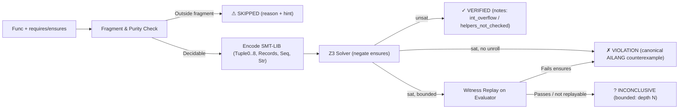

import CodeBlock from '@theme/CodeBlock';
import BasicContracts from '!!raw-loader!@site/../examples/runnable/contracts/basic.ail';
import ParkExample from '!!raw-loader!@site/../examples/runnable/contracts/park.ail';
import FinanceExample from '!!raw-loader!@site/../examples/runnable/contracts/finance.ail';
import AccessControlExample from '!!raw-loader!@site/../examples/runnable/contracts/access_control.ail';
import TemperatureExample from '!!raw-loader!@site/../examples/runnable/contracts/temperature.ail';
import InsuranceExample from '!!raw-loader!@site/../examples/runnable/contracts/insurance.ail';
import ScoringExample from '!!raw-loader!@site/../examples/runnable/contracts/scoring.ail';
import CrossFunctionExample from '!!raw-loader!@site/../examples/runnable/contracts/cross_function.ail';
import RecordVerifyExample from '!!raw-loader!@site/../examples/runnable/contracts/record_verify.ail';
import RecordDiscoveryExample from '!!raw-loader!@site/../examples/runnable/contracts/record_discovery_verify.ail';
import StringVerifyExample from '!!raw-loader!@site/../examples/runnable/contracts/string_verify.ail';
import ListVerifyExample from '!!raw-loader!@site/../examples/runnable/contracts/list_verify.ail';
import InvoiceExample from '!!raw-loader!@site/../examples/runnable/contracts/invoice.ail';
import RecursiveVerifyExample from '!!raw-loader!@site/../examples/runnable/contracts/recursive_verify.ail';
import ResultErrorGuardExample from '!!raw-loader!@site/../examples/runnable/contracts/result_error_guard.ail';

# Contracts & Verification

AILANG supports **design-by-contract** programming via `requires` (preconditions) and `ensures` (postconditions), checked at runtime with `--verify-contracts` or mathematically proved at compile time with Z3 (`ailang verify`). Grounded in the AWS ARC neurosymbolic approach ([Bayless et al., 2025](https://arxiv.org/abs/2511.09008)).




## Contract Syntax

Contracts follow the effect annotation (`! {}`) and precede the function body:

```ailang
export func safeDivide(dividend: int, divisor: int) -> int ! {}
requires { divisor != 0 }
ensures { result >= 0 }
{
  dividend / divisor
}
```

| Clause | Purpose | Scope |
|---|---|---|
| `requires { ... }` | Precondition assumed while proving `ensures`, and checked at verified call sites | Entry |
| `ensures { ... }` | Postcondition proved for all inputs satisfying `requires` | Return |
| `result` | Binds the return value inside `ensures` | Postcondition only |

## Quick Start & CLI Flags

Install Z3 (`brew install z3`, `apt install z3`, or set `AILANG_Z3_PATH`), then run:

```bash
ailang verify examples/runnable/contracts/park.ail           # Static Z3 proof
ailang verify --int-model=int64 file.ail                     # Treat int64 + - * overflow as VIOLATION
ailang verify --verify-recursive-depth 5 file.ail            # Bounded unrolling depth (default 2, max 10)
ailang verify --strict --json file.ail                       # Fail on skipped/inconclusive; JSON report
ailang verify --allow-inconclusive file.ail                  # Exit 0 on bounded-unrolling inconclusive
ailang verify --package . --json                             # Verify whole package (Schema + reason_counts)
ailang verify --verbose file.ail                             # Print generated SMT-LIB
ailang run --verify-contracts --caps IO --entry main file.ail # Runtime assertion checks (evaluator only)
```

:::note Runtime vs Static Verification
`ailang run` does **not** check contracts unless `--verify-contracts` is passed (evaluator only; combining `--verify-contracts` with `--bytecode` exits `2` with `CTR004`). Static `VERIFIED` proves `ensures` whenever `requires` holds; validate inputs crossing from unverified callers explicitly.
:::

## Reading Verification Evidence & Numeric Model

Every `ailang verify` run prints its `Scope:` line (and JSON `numeric_model` / `evidence_schema`) disclosing what the solver proved:

| Aspect | Default Model | Strict / Notes |
|---|---|---|
| `int` (`+`, `-`, `*`) | Unbounded SMT `Int` | Reports `caveats: int_overflow` with witness input (e.g. `x = 9223372036854775807`); pass `--int-model=int64` to make overflow a `VIOLATION` (`int_overflow`), or bound inputs in `requires`. |
| `int` (`/`, `%`) | Truncation toward zero (`-7 / 2 == -3`) | Zero divisor raises `RT001` at runtime; proofs are partial-correctness (not termination). |
| `float` | Mathematical `Real` (non-NaN inputs assumed) | Possible `/ 0.0`, `% 0.0`, `sqrt(< 0)`, `log(<= 0)` are `VIOLATION` (`float_nan_or_inf`). Does not model IEEE-754 rounding. |
| Call-site `requires` | Checked at every call inside verified bodies | Unsatisfied callee preconditions fail as `VIOLATION` (`requires_violation`), including inside helpers, HOF lambdas, and recursive self-calls. |
| Opaque helpers | Callee with unencodable body & no `ensures` | Represented as an uninterpreted function of its signature; proofs hold for any return value and carry `caveats: helpers_not_checked` (models are `INCONCLUSIVE`, never violations). |

### Exit Codes (`verify`, `check --verify`, `ai-check`) {#exit-codes}

| Outcome | Exit | `outcome` field |
|---|---:|---|
| Type-check failed | `1` | `not_run` |
| No obligations (`ensures` other than `true`) | `0` | `no_obligations` |
| All obligations proved | `0` | `verified` |
| Some proved, some skipped (`requires`-only rows don't fail) | `0` (`1` with `--strict`) | `partial` |
| Obligations exist, none proved | `1` | `unproved` |
| Bounded recursion model (`INCONCLUSIVE`) | `1` (`0` with `--allow-inconclusive`) | `inconclusive` |
| Any counterexample (`VIOLATION`) | `1` | `counterexample` |
| Solver error / `unknown` / timeout / missing Z3 | `1` | `error` / `unavailable` |

Each invocation verifies one module; unverified non-stdlib imports declaring contracts are listed in `imported_contracts_unverified`.

## Canonical AILANG Counterexamples & Examples

Z3 models are formatted back into **canonical AILANG syntax** (`{ x: 0, y: 100 }`, `[1, 2]`, `(a, b)`, `Some(42)`), stripping internal `$p_` prefixes and solver stub tables.

### Policy & Billing (Cross-Function Proofs)

<CodeBlock language="ailang" title="examples/runnable/contracts/park.ail">
  {ParkExample}
</CodeBlock>

<CodeBlock language="ailang" title="examples/runnable/contracts/invoice.ail">
  {InvoiceExample}
</CodeBlock>

```bash
$ ailang verify examples/runnable/contracts/invoice.ail
  ✓ VERIFIED invoiceTotal        210ms     # 4-deep cross-function chain
  ✗ VIOLATION brokenVolumePrice
    Counterexample:
      unitPrice: Int = 0
      qty: Int = 1
  11 functions: 10 verified, 1 violations
```

### Records, Strings, Lists, Tuples & Unit (`Tuple0..Tuple8`)

Unit `()` encodes as `Tuple0` (`mk_Tuple0`, enabling `Result[(), E]`) and tuples with 2–8 components encode as `Tuple2`..`Tuple8`, formatted back as `()` and `(a, b)`. Records map to SMT `declare-datatype` and display as AILANG record literals:

<CodeBlock language="ailang" title="examples/runnable/contracts/record_verify.ail">
  {RecordVerifyExample}
</CodeBlock>

```bash
$ ailang verify examples/runnable/contracts/record_verify.ail
  ✓ VERIFIED getX            5ms
  ✓ VERIFIED manhattan       7ms     # caveat: int_overflow for x = 9223372036854775807
  ✗ VIOLATION brokenDistance
    Counterexample:
      result: Bool = false
      p: Record_x_y = { x: 0, y: 100 }
```

<details>
<summary>More verified examples: basic, finance, access control, temperature, insurance, scoring, record discovery, strings, lists, typed errors</summary>

<CodeBlock language="ailang" title="examples/runnable/contracts/basic.ail">
  {BasicContracts}
</CodeBlock>

<CodeBlock language="ailang" title="examples/runnable/contracts/finance.ail">
  {FinanceExample}
</CodeBlock>

<CodeBlock language="ailang" title="examples/runnable/contracts/access_control.ail">
  {AccessControlExample}
</CodeBlock>

<CodeBlock language="ailang" title="examples/runnable/contracts/temperature.ail">
  {TemperatureExample}
</CodeBlock>

<CodeBlock language="ailang" title="examples/runnable/contracts/insurance.ail">
  {InsuranceExample}
</CodeBlock>

<CodeBlock language="ailang" title="examples/runnable/contracts/scoring.ail">
  {ScoringExample}
</CodeBlock>

<CodeBlock language="ailang" title="examples/runnable/contracts/cross_function.ail">
  {CrossFunctionExample}
</CodeBlock>

<CodeBlock language="ailang" title="examples/runnable/contracts/record_discovery_verify.ail">
  {RecordDiscoveryExample}
</CodeBlock>

<CodeBlock language="ailang" title="examples/runnable/contracts/string_verify.ail">
  {StringVerifyExample}
</CodeBlock>

<CodeBlock language="ailang" title="examples/runnable/contracts/list_verify.ail">
  {ListVerifyExample}
</CodeBlock>

<CodeBlock language="ailang" title="examples/runnable/contracts/result_error_guard.ail">
  {ResultErrorGuardExample}
</CodeBlock>

</details>

## Bounded Recursion, HOFs & Witness Replay

<CodeBlock language="ailang" title="examples/runnable/contracts/recursive_verify.ail">
  {RecursiveVerifyExample}
</CodeBlock>

- **Dafny-style unrolling:** Recursive functions unroll to `--verify-recursive-depth N` (default `2`) or per-function `@verify(depth: N)` over an uninterpreted frontier `f_0`. `VERIFIED` is sound up to depth `N`; a `sat` model is `INCONCLUSIVE` unless **witness replay** executes the real function and confirms a contract failure (`VIOLATION`).
- **Higher-order functions:** `map`, `filter`, `foldl`, `any`, and `flatMap` with literal lambdas or top-level functions specialize and unroll (depth `3`). `length(result) == length(xs)` after `map` and `length(result) <= length(xs)` after `filter` are proved for any list length.
- **Bounded quantifiers:** `forall i: 0..n => P(i)` in `ensures` encodes single-level integer quantifiers.

## The Decidable Fragment

| Category | Supported in Z3 (`ailang verify`) | Skipped / Caveat |
|---|---|---|
| **Types** | `int`, `float`, `bool`, `string`, `()`, tuples `Tuple2..Tuple8`, enums/ADTs (e.g. `Result[(), Err]`, `Option[int]`), nested records, lists | Type variables in callee signatures, function-typed params, `bytes`, shadowed `TupleN` types |
| **Operators & Control** | `+ - * /`, comparisons (`deriving (Eq)` for ADT `==`), `&& \|\| !`, `if`/`else`, `let`, exhaustive `match` (ADTs, records, tuples, lists) | Bitwise ops (`& ^ ~ << >>`), nested `forall`, unannotated params (`#2400`) |
| **Strings (`std/string`)** | Exact: `"${a}${b}"`, `concat`, `length`, `find`, `substring`, `startsWith`, `endsWith`, `contains`, `charAt`. Axiomatized: `trim`, `toLower`/`toUpper`, `split`, `chars`, `join`, `repeat`, `replace`, `stringToInt`, `charCode` | `words`, `foldChars`, `replaceMany`, `splitAny` |
| **Lists & Math** | `length`, `_list_head`, `_list_nth`, `::`, `++`, `take`/`drop`/`contains`, `nthOr`/`headOr`/`lastOr`, `std/option`, `floor`/`ceil`/`round`/`absInt`/`absFloat`; uninterpreted `reverse`, `sqrt`/`exp`/`pow`/`log`/`sin`/`cos` | Function-typed callback parameters (`map(f, xs)`) |
| **Purity** | `! {}` (`pure func`) or `! {Declassify}` (`func ... ! {Declassify}`) | Effectful functions (`IO`, `FS`, `Net`, `AI`, etc.) |

### Supported String & List SMT Encodings

```ailang
import std/list (map, length)

export pure func incrementAll(xs: [int]) -> [int]
ensures { length(result) == length(xs) }
{
  map(\x. x + 1, xs)
}

export pure func allPositive(n: int) -> int
requires { n >= 0 }
ensures { forall i: 0..n => i >= 0 }
{
  n
}
```

## Why AILANG Makes Verification Practical

| Design Property | Effect on SMT Verification |
|---|---|
| **Explicit effect rows** (`! {}`) | Purity is a type-level flag, not whole-program alias analysis |
| **Everything is an expression** | `if`, `let`, and exhaustive `match` map 1:1 to SMT-LIB `ite`, `let`, `match` |
| **Immutable bindings + Core ANF** | No heap/aliasing model; subexpressions are already A-normalized |
| **No loops** | Non-recursive functions need no loop invariants; recursion uses bounded unrolling |

## See Also

- [IFC Labels](./ifc-labels.mdx) — type-level taint tracking (`T<label>` and `T{not LABEL}`)
- [Testing Guide](./testing.md) — QuickCheck `property` tests and inline `tests [...]`
- [Effects Reference](/docs/reference/effects) — `! {}` and `! {Declassify}`
- [ARC Paper (arXiv:2511.09008)](https://arxiv.org/abs/2511.09008) ([PDF](/references/bayless-2025-neurosymbolic.pdf))
