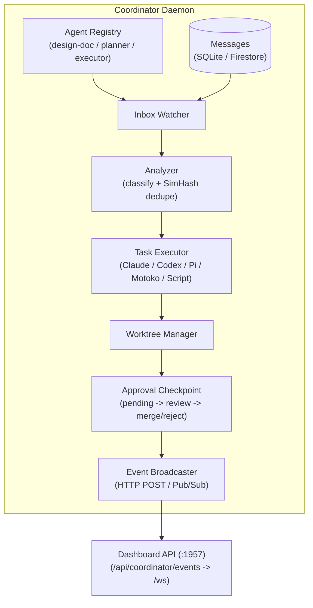
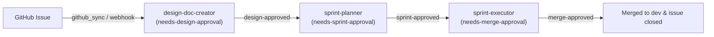
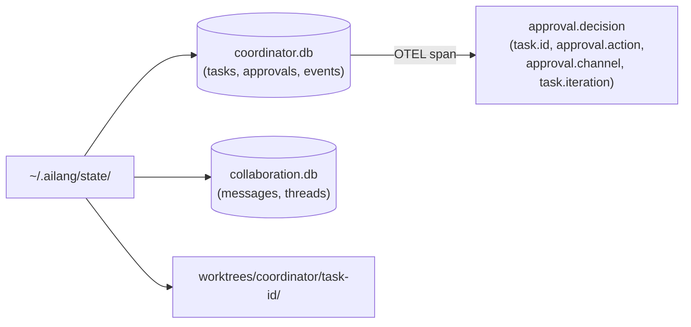
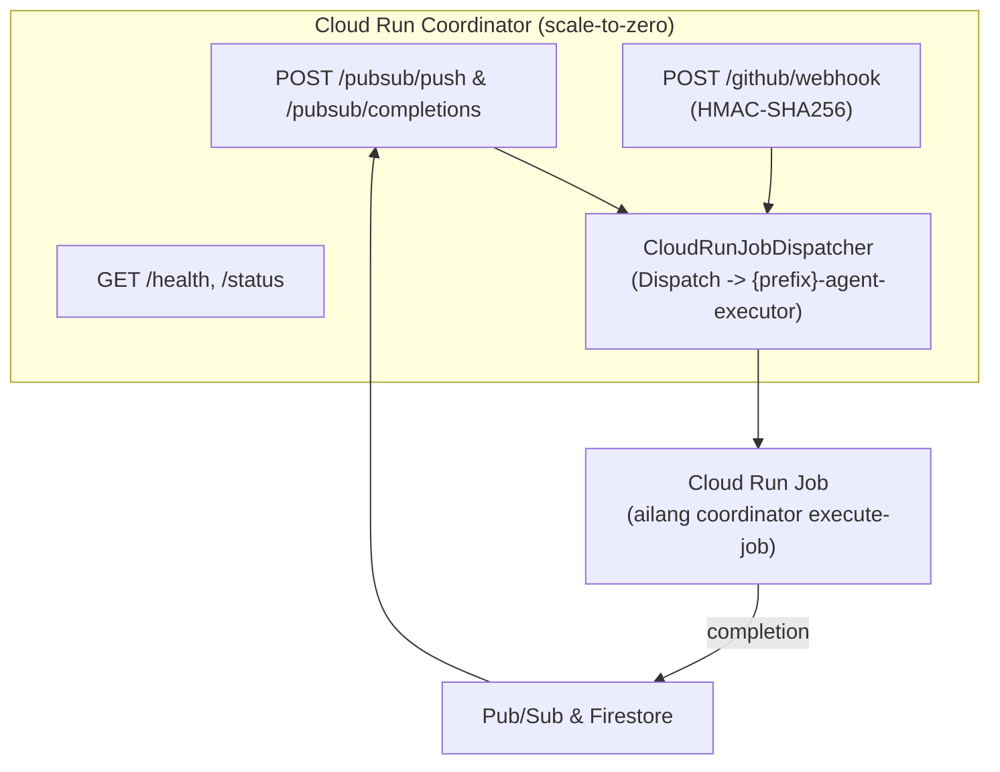

# Coordinator Daemon

The AILANG Coordinator is an always-on daemon that watches message inboxes, routes tasks to configured AI or script agents in isolated git worktrees (or Cloud Run Jobs), and enforces human-in-the-loop approval gates.

## Quick Start

```bash
make services-start   # Start dashboard API (:1957) + coordinator daemon
ailang messages send coordinator "Fix the bug in parser.go" --title "Bug: Parser error" --from "user"
ailang coordinator status
```

## Architecture



## Agent Configuration (`~/.ailang/config.yaml`)

```yaml
coordinator:
  default_provider: claude  # claude | codex | motoko | opencode | pi | managed_agents
  agents:
    - id: design-doc-creator
      inbox: design-doc-creator
      workspace: /path/to/project
      capabilities: [research, docs]
      provider: claude
      invoke:
        type: skill
        name: design-doc-creator
      output_markers: ["DESIGN_DOC_PATH:"]
      approval:
        needs_label: needs-design-approval
        approved_label: design-approved
      trigger_on_complete: [sprint-planner]
      auto_approve_handoffs: false
      auto_merge: false
      session_continuity: true
      max_concurrent_tasks: 1
```

| Field | Type | Description |
|---|---|---|
| `id` / `inbox` / `workspace` | string | Unique agent ID, inbox name, and repo path (cloud registry: `ailang-multivac/config/config.cloud.yaml`; inspect via `ailang coordinator agents`) |
| `provider` / `executor_variant` / `model` | string | Executor (`claude`, `codex`, `motoko`, `opencode`, `pi`, `managed_agents`), Cloud Run job variant, and model override |
| `tool_policy` / `policy_path` | string | `ailang_only` disables shell and limits tools to read/edit/write + `ailang_check`/`ailang_run` under operator policy TOML (see [Agent tool policy](./agent-tool-policy.md)) |
| `inputs_allow` | list | Exact `owner/repo` grants for cloud `inputs` (`--inputs-file`, max 256 MiB copied to `.incoming/`, SHA256-verified) |
| `invoke` | object | Execution mode: `skill`, `agent`, `prompt` (`{{.TaskID}}`, `{{.Content}}`), or `script` (`env_from_payload: true`) |
| `trigger_on_complete` / `output_markers` | list | Downstream agents to trigger and markers to capture from output |
| `auto_approve_handoffs` / `auto_merge` | bool | Combined `merge_handoff` gate (`false`/`false`), `merge`-only (`true`/`false`), or autonomous (`true`/`true`) |
| `auto_merge_code` / `auto_merge_required_checks` | bool/list | Opt-in code PR auto-merge gated on checks, `artifact_patterns`, and non-author approver secret |
| `session_continuity` / `timeout` / `idle_timeout` | bool/dur | Reuse worktree + `--resume` across handoffs/rejections; ceilings (default `60m` / `3m`) |
| `plugin_dirs` / `plugins` / `plugin_repo` | list/obj | Local `--plugin-dir`, marketplace installs, or cloud-cloned plugin repo |

<details>
<summary>Script agents, plugins, and declared cloud task inputs</summary>

- **Script agents (`invoke.type: script`)**: Run deterministic shell scripts (`$0.00` AI cost). With `env_from_payload: true`, JSON payload keys become uppercase env vars alongside `AILANG_TASK_ID`, `AILANG_MESSAGE_ID`, and `AILANG_WORKSPACE` (see `scripts/coordinator/echo_payload.sh`).
- **Cloud task inputs (`AILANG_TASK_INPUTS`)**: Cloud-only (`inputs_allow` must grant each repo). The job parent shallow-clones refs with its fleet credential, verifies `sha256` / `manifest.sha256`, rejects symlinks/traversal/overwrites, and stages bytes before agent startup (see [`examples/task_inputs`](https://github.com/sunholo-data/ailang/tree/dev/examples/task_inputs)).
- **Auto-merge examples** (docs-only vs check-gated code PRs):

```yaml
- id: docs-writer
  auto_merge: true
  artifact_patterns: ["documents/**/*.md"]
```

```yaml
- id: site-agent
  auto_merge: true
  auto_merge_code: true
  artifact_patterns: ["site/**"]
  auto_merge_required_checks: ["site-wellformed", "image-size"]
  auto_merge_approver_secret: site-approver-token
  auto_merge_approver_identity: sunholo-voight-approver
```

</details>

## Workflow Pipelines & Approvals



| Channel / Command | Action |
|---|---|
| `ailang coordinator pending` | List pending approvals and retry iteration (`1..3`) |
| `ailang coordinator diff <task-id>` | Inspect worktree diff before deciding |
| `ailang coordinator approve <task-id>` | Merge worktree to target branch, trigger downstream handoff, clean worktree (`--remote gcp` for cloud) |
| `ailang coordinator reject <task-id> -f "..."` | Preserve worktree, record `human_feedback`, re-queue with `--resume` |
| `ailang coordinator cancel <task-id> [--remote gcp]` | Cancel queued `pending` task |
| GitHub labels | `design-approved`, `sprint-approved`, `merge-approved`, `needs-revision`, `ailang:approved`, `ailang:needs-revision` |

<details>
<summary>Approval telemetry attributes and local SQLite layout</summary>



</details>

## Cloud Mode (Cloud Run + Pub/Sub + Firestore)

Enable cloud mode with `COORDINATOR_MODE=cloud` and `AILANG_STORAGE=gcp` (`AILANG_CLOUD_PROJECT`, `AILANG_CLOUD_REGION`, `AILANG_TOPIC_PREFIX`, `AILANG_WORKSPACE`, `GITHUB_WEBHOOK_SECRET`).



| Local vs Cloud | Local Mode | Cloud Mode (`COORDINATOR_MODE=cloud`) |
|---|---|---|
| Message & task state | SQLite (`collaboration.db`, `coordinator.db`) | Firestore |
| Task trigger & GitHub | 30s/60s/5m polling (`ailang messages import-github`) | Pub/Sub push (`/pubsub/push`) + webhook (`/github/webhook`) |
| Execution & logs | Local worktrees + file logs | Cloud Run Jobs (`AILANG_TASK_ID`, `AILANG_AGENT_ID`, `AILANG_DIRECTIVE`, `AILANG_REPO_URL`, `AILANG_BRANCH`) + stderr Cloud Logging |

<details>
<summary>Feedback Cost & Abuse Gate and Executor Shadowing (ailang_only)</summary>

- **Feedback Gate (`coordinator.feedback_gate.enabled: true`)**: Runs 4 stages in order: deterministic rules (`<1 ms`) → Firestore per-contact cooldown → Anthropic Haiku classifier (fail-closed if `ANTHROPIC_API_KEY` missing) → daily budget cap. Test first with `AILANG_FEEDBACK_GATE_DRY_RUN=1` (`feedback-gate-audit` inbox) and override via `AILANG_FEEDBACK_GATE_MODE=off|file-only|full`.
- **Executor Shadowing**: Mirrors a sample (`sample_rate`) of `ailang_only` tasks on the alternate harness (`pi ↔ motoko`) using `OPENROUTER_API_KEY_SHADOW`, never pushes/opens PRs, and grades via mechanical `check`/`test`, merged-fix diff, and optional off-Anthropic tie-breaker. Inspect via `ailang coordinator shadow report --remote gcp`.

</details>

## Cloud Tracing & Troubleshooting


Export `GOOGLE_CLOUD_PROJECT=your-project-id` before starting to emit Cloud Trace spans (see [Telemetry Guide](./telemetry.md)).

| Issue | Check / Fix |
|---|---|
| Daemon won't start | `ailang coordinator status`; remove stale `~/.ailang/state/coordinator.pid` |
| Tasks not executing | `ailang messages list --unread`, `tail -100 ~/.ailang/logs/coordinator.log`, check `provider` binary |
| Merge conflict on approve | Resolve directly inside `~/.ailang/state/worktrees/coordinator/<task-id>/` and commit |

## See Also

- [Coordinator Setup](./coordinator-setup.md) · [Collaboration Hub](./collaboration-hub.md) · [Agent Messaging](./agent-messaging.md) · [Telemetry](./telemetry.md)
