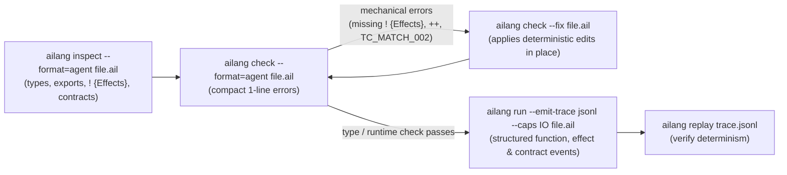

# AILANG Debugging Guide

Diagnose and repair AILANG programs using the agent inspection/repair CLI (`inspect`, `check --fix`, `--emit-trace jsonl`), ghost `Debug` logging, compiler debug flags, and `AILANG_FS_SANDBOX` diagnostics.

## Agent Inspect, Repair & Trace Workflow



| Command | Purpose | When to use |
|---|---|---|
| `ailang inspect --format=agent <path>` | Emit compact semantic X-ray (types, exports, `! {Effects}`, `requires`/`ensures`, callees) | Orient in `<100 ms` without reading full files |
| `ailang check --format=agent <file>` | Compact one-line diagnostics (`--json` includes machine `TextEdit`s) | Fast AI/CI error triage |
| `ailang check --fix <file>` | Apply deterministic edits in place (up to 4 passes): `! {Effects}` stamping, `++` → `"${...}"`, `TC_MATCH_002` `_?` stubs, `PAR017`/`PAR018`/`IMP010` | Auto-repair mechanical compiler errors |
| `ailang run --emit-trace jsonl --caps IO <file>` | Stream JSONL execution events (`stdout` = trace, `stderr` = program output) | Inspect runtime calls, effects, and [Execution Traces](./traces.md) |

## Debug Ghost Effect (In-Program Logging)

`Debug` is an invisible **ghost effect** — no `! {Debug}` is required from callers, no `--caps Debug` is needed, and output prints to **stderr** after execution.

```ailang
import std/debug (log, check)

func processData(x: int) -> int {
  log("processing ${show(x)}");       -- invisible to callers
  check(x > 0, "x must be positive"); -- recorded, doesn't throw
  x * 2
}
```

```bash
ailang run --caps IO --entry main app.ail                    # all debug output
ailang run --caps IO --log-level warn --entry main app.ail   # filter sunholo/logging JSON severity
ailang run --release --caps IO --entry main app.ail          # zero-cost erase in release
```

## Compiler & Runtime Debug Flags

| CLI Flag | Purpose |
|---|---|
| `--debug-compile` | Compilation phase timings (see [Telemetry](./telemetry.md)) |
| `--debug-types` (`--node N`) | Substitution map, type-class constraints (`Num`/`Ord`), `CoreTI` entries, and type `Origins` |
| `--trace` / `--trace-tier off\|standard\|deep` | Type-defaulting trace / execution span detail (`deep` captures per-call args & results) |
| `-cpuprofile FILE` / `-memprofile FILE` | Go CPU and heap profiles |

### Key Environment Variables

| Variable | Purpose | Failure / Output Mode |
|---|---|---|
| `DEBUG_STRICT=1` | Panic on unhandled AST/compiler cases | Fails loudly in dev/CI |
| `DEBUG_MONO_VERBOSE=1` | Monomorphization specialization trace | Prints `typeSubst` & `DictRef` cloning |
| `DEBUG_OPERATOR_LOWERING=1` | Operator lowering (`BinOp`/`DictApp` → Intrinsic) | Prints builtin selection |
| `DEBUG_PARSER=1` / `DEBUG_DELIMITERS=1` | Parser token & delimiter-stack tracing | Token consumption and balance |
| `DEBUG_LOADER=1` / `DEBUG_EFFECTS=1` | Module search-path (`LDR001`) & effect-row tracing | Probed paths / effect inference |
| `DEBUG_EVAL_APP=1` / `DEBUG_MATCH=1` | Evaluator call binding & pattern-match arm tracing | Argument values / arm choices |
| `DEBUG_CONCURRENCY=1` / `DEBUG_PROCESS=1` | `serve-api` goroutine Fork/Call/Done & `Process` exec | Lifecycle & spawn/exit events |
| `AILANG_TRACE_VALUES=off` | Record full span tree with byte sizes instead of values | `<redacted:N bytes>` (typos error loudly) |
| `AILANG_STRICT_CONFIG=1` | Refuse deprecated config defaults (`ErrDeprecatedDefault`) | Hard-fail rehearsal before rollout |
| `AILANG_STATE_DIR=/path` | Relocate `~/.ailang/state` (DBs, ledgers, pids) | Errors if unresolvable |
| `AILANG_CLOUD_PROJECT=<id>` | Override GCP project (`ailang storage status` inspects) | `ErrNoCloudProject` if missing |
| `COORDINATOR_API_KEY=<token>` | Fail-closed bearer token for daemon/dashboard HTTP & WS | `401` when missing/invalid |
| `AILANG_FS_SANDBOX_DEBUG=1` | Print rejected paths escaping `AILANG_FS_SANDBOX` | `[ailang/sandbox] REJECT ...` on stderr |

<details>
<summary>Tracing tiers, IFC redaction, and confidentiality guarantees</summary>

| Tier | Module / effect / contract spans | Per-call args & results | Notes |
|---|---|---|---|
| `off` (`AILANG_NO_TRACE=1`) | — | — | Required for latency benchmarks |
| `standard` (default) | Yes | No | ~105 MB vs 2,478 MB on 400-iter list loops |
| `deep` | Yes | Yes (bounded to 1 KB/value) | ~2–6× overhead; use `AILANG_TRACE_VALUES=off` when secrets/PII must never enter traces |

IFC-labelled values (`string<secret>`, `secret()`) redact automatically to `<redacted:secret>` across modules at all tiers (`AILANG_TRACE_VALUES=off` is the stronger blanket guarantee). Note that traced labelled programs fall back from `--bytecode` to the evaluator.

</details>

## Type Inference Troubleshooting (`--debug-types`)

Run `ailang run --debug-types --node <id> file.ail` to inspect `Origins:` (`annotation`, `literal`, `inferred`, `defaulted`, `from_use`, `from_pattern`):

| Symptom | Cause in `--debug-types` | Fix |
|---|---|---|
| Float math behaves like `int` | `defaulted: defaulted to int (Num constraint)` | Annotate: `let add: float -> float -> float = \x. \y. x + y` |
| Type mismatch with `α42` | Node `42` has only `inferred: fresh type variable` | Use expression with concrete type or add annotation |
| Unexpected `+` / `*` dispatch | `Constraint: Num → add/mul` on `NodeID` | Check operand types and explicit signature |

## Memory Controls & Live-Data Pitfalls

Run `ailang doctor memory` to inspect host limits.

| Control | Bounds | Default | Notes |
|---|---|---|---|
| `--max-memory <size\|cgroup>` / `AILANG_MEMLIMIT` | Go soft limit (`debug.SetMemoryLimit`) | none | `cgroup` reads `memory.max × 0.9`; cannot prevent OOM on live retained data |
| `GOGC` | Heap growth trigger | `500` CLI / `100` `serve-api` | Min with `--max-memory` governs GC frequency |
| `--fs-max-bytes` / `--net-max-bytes` | Per-read FS / HTTP body cap | unbounded / 5 MB | Fails with `E_FS_FILE_TOO_LARGE` / `E_NET_BODY_TOO_LARGE` |
| `--max-recursion-depth` | Call depth | `10,000` | ~6–7 KB/frame; non-tail recursion holds every frame binding live (`foldl`/`map` or tail-call avoids quadratic growth) |

Measure peak RSS with `/usr/bin/time -l ailang run ...` (macOS) or `/usr/bin/time -v` (Linux), and inspect GC vs live heap with `GODEBUG=gctrace=1`.

## Sandbox Debugging (`AILANG_FS_SANDBOX`)

Under `AILANG_FS_SANDBOX`, FS syscalls run through a single `os.Root` handle. Paths escaping the root (`..`, absolute paths, symlinks targeting outside) fail syscalls (`exists`/`isDir`/`isFile` silently return `false`; `readFile`/`writeFile` error).

```bash
AILANG_FS_SANDBOX=/tmp/task AILANG_FS_SANDBOX_DEBUG=1 ailang run app.ail
AILANG_FS_SANDBOX=/tmp/task ailang sandbox-check /outside/path   # exits 0=ALLOW, 1=REJECT
AILANG_TRACE=deep ailang run --emit-trace auto app.ail && ailang trace list --hours 1
```

## Provider & Rig Diagnostics

<details>
<summary>OpenRouter Broadcast traces, Ollama streaming/VRAM limits, and fleet memory gates</summary>

- **OpenRouter Broadcast (`LLM Generation` spans)**: Query `https://dashboard.ailang.sunholo.com/api/observatory/spans` with `Authorization: Bearer $AILANG_DASHBOARD_TOKEN` to inspect `rawRequest`, `output_tokens.reasoning`, `finish_reason`, and `cancelled` directly from the provider. (`scripts/check_pi_wire_budget.sh` verifies wire `max_tokens`.)
- **Ollama streaming timeouts**: Enable `AILANG_OLLAMA_V1_STREAM=1` so `AILANG_OLLAMA_IDLE_TIMEOUT_SEC` (`120s`), `AILANG_OLLAMA_TTFT_TIMEOUT_SEC` (`600s`), and `AILANG_OLLAMA_HTTP_TIMEOUT_SEC` (`3600s` hard deadline) replace the 300s buffered timeout. Audit `launchctl getenv AILANG_OLLAMA_HTTP_TIMEOUT_SEC` alongside plists, and filter `AILANG_OLLAMA_LOG_REQUESTS` captures by `idle_window_sec==120`.
- **Ollama & fleet memory**: Rig `dev.ollama.serve.plist` pairs `OLLAMA_GPU_OVERHEAD` (`32 GiB` admission subtraction) with `OLLAMA_CONTEXT_LENGTH` (`131072`) and `OLLAMA_MAX_LOADED_MODELS=2`; `tools/launchd/mission-control.sh` staggers boot (`MISSION_BOOT_WINDOW=900`) and checks `MISSION_MIN_AVAIL_GB=16` / `MISSION_MAX_COMPRESSED_GB=48`.

</details>

## Development & Latency Tools

```bash
make quick-install         # Update system ailang after compiler edits
make lint && make fmt      # Lint & format Go code
make bench-workloads-quick # Run latency canary probes (benchmarks/workloads/)
```

## See Also

- [Execution Traces](./traces.md) — JSONL trace capture, replay, and training export
- [Telemetry & Tracing](./telemetry.md) — OTEL spans and distributed trace linking
- [Development Workflow](./development-workflow.md) — Contributor skills & test boundaries
- [Known Limitations](/docs/reference/limitations) — Language cliffs and workarounds
