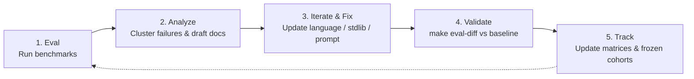

# M-EVAL-LOOP: Self-Improving AI Feedback Loop

M-EVAL-LOOP turns AILANG benchmarking into a closed cycle from failure capture to verified compiler, stdlib, and prompt improvements.



## Core Capabilities

| Capability | Command / Target | What It Produces |
|---|---|---|
| **AI self-repair** | `ailang eval --benchmark fizzbuzz --model claude-sonnet-4-5 --self-repair` | Single-shot retry guided by `PAR_001`, `TC_REC_001`, `TC_INT_001`, `EQ_001`, `CAP_001`, `MOD_001` hints |
| **Prompt A/B testing** | `make eval-prompt-ab A=baseline B=candidate` | 0-shot vs repaired success comparison; frozen prompts checked by `make check-prompt-freeze` against `cmd/ailang/prompts/` |
| **Fix validation** | `make eval-diff BASELINE=baselines/prev NEW=after_fix` | Per-benchmark delta (`Fixed`, `Broken`, `Still passing/failing`) |
| **Failure analysis** | `ailang eval-analyze -results eval_results/current -dry-run` | Categorized compile/runtime/logic clusters and design-doc proposals |
| **JSONL & matrix export** | `make eval-summary` / `make eval-matrix` | Machine-readable `summary.jsonl` and `performance_tables/*.json` |
| **Auto-improve** | `make eval-auto-improve` / `make eval-auto-improve-apply` | Generates `.eval_auto_improve_task.md`, runs tests, diffs results (dry-run by default) |

## End-to-End Validation Workflow

```bash
# 1. Capture baseline & optional prompt A/B test
make eval-baseline
make eval-prompt-ab A=baseline B=hints

# 2. Implement language/stdlib fix and test
make test

# 3. Analyze failures, diff against baseline, record performance matrix
ailang eval-analyze -results eval_results/current -dry-run
make eval-diff BASELINE=baselines/prev NEW=after_fix
make eval-matrix DIR=after_fix VERSION=current
```

<details>
<summary>All Makefile targets & jq analysis snippets</summary>

```bash
# Self-repair & suite runs
make eval                            # Single benchmark (mock)
make eval-suite                      # Full suite, all models
make eval-suite-repair               # Full suite with self-repair

# Prompt versioning
make eval-prompt-list                # Available prompt versions
make eval-prompt-hash                # Compute SHA256 hashes

# Design-doc generation & auto-improve
make eval-analyze                    # Generate design docs (deduped)
make eval-analyze-fresh              # Force new docs (no dedup)
make eval-to-design                  # eval -> analyze pipeline

# Query summary.jsonl
jq -s 'map(select(.stdout_ok == true)) | length' summary.jsonl
jq -s 'group_by(.err_code) | map({code: .[0].err_code, count: length})' summary.jsonl
jq -s 'map(select(.repair_used == true)) | {total: length, success: map(select(.repair_ok == true)) | length}' summary.jsonl
```

</details>

## Freezing a Baseline Cohort

The **cost-per-verified-success** KPI is computed over an immutable cohort frozen under one `--baseline` ID:

```bash
# 1. Freeze and run verified cohort (METERED)
ailang eval-suite --agent --langs ailang --verify \
  --models agent_suite \
  --benchmarks contract_bst_validate,contract_leap_year,contract_matrix_determinant,contract_rle_roundtrip,contract_roman_numeral,contract_sorted_merge,prompt_injection \
  --baseline v1.0 --seed 42 --no-rig-lock

# 2. Reproduce KPI from banked chains
ailang chains stats --cost-per-verified-success --baseline v1.0 --json --strict
```

| Rule | Details |
|---|---|
| `--verify` required | Prevents `zero_denominator` before spending budget |
| ID syntax | `^[A-Za-z0-9][A-Za-z0-9.-]*$` (no `_`, `%`, or `/`; stored as `<baseline>/<taskID>/<mode>[/<cond>]`) |
| Cohort manifest | Writes `<output-dir>/cohort_manifest.json` with `models[]` from [`models.yml`](https://github.com/sunholo-data/ailang/blob/dev/internal/eval_harness/models.yml), `cohort_hash`, and `chain_id`. Re-freeze under a new ID rather than mutating a published one |
| Cost-provenance caveat | Subscription `claude` CLI logs list-price equivalents while OpenRouter lanes (`opencode`, `codex`) bill real dollars; inspect `executors[]` in the manifest before quoting blended totals |

## References

- [Design Document](https://github.com/sunholo-data/ailang/blob/dev/design_docs/planned/M-EVAL-LOOP_self_improving_feedback.md)
- [CHANGELOG](https://github.com/sunholo-data/ailang/blob/dev/CHANGELOG.md)
- [Benchmarking Guide](../benchmarking.md)
