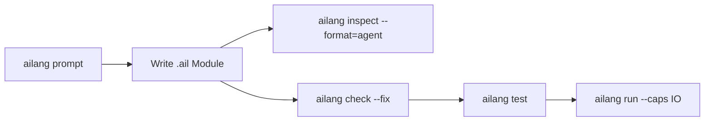

import Icon, { CheckIcon, InfoIcon, WarningIcon } from '@site/src/components/Icon';
import { STABLE_RELEASE, ACTIVE_PROMPT } from '@site/src/constants/version';
import { AddToAgentButtons } from '@site/src/components/AddToAgent';
import CodeBlock from '@theme/CodeBlock';
import HelloExample from '!!raw-loader!@site/../examples/runnable/hello.ail';
import ValuesExample from '!!raw-loader!@site/../examples/runnable/values_basic.ail';
import LambdasExample from '!!raw-loader!@site/../examples/docs/lambdas_full.ail';
import TestsExample from '!!raw-loader!@site/../examples/runnable/recursion_factorial.ail';

# Getting Started with AILANG

## <Icon name="bot" inline /> For AI Agents: Plugin Installation (Recommended)

**AILANG is designed to be used with AI coding agents.** Install the plugin for your coding harness, or attach the [hosted docs MCP](#hosted-docs-mcp--mcpailangsunholocom) with one URL.

### Claude Code & Codex CLI

```bash
# Claude Code
/plugin marketplace add sunholo-data/ailang_bootstrap
/plugin install ailang

# Codex CLI
codex plugin add https://github.com/sunholo-data/ailang_bootstrap
```

The plugin bundles the `ailang` binary, local execution MCP (`ailang_prompt`, `ailang_check`, `ailang_run`, `ailang_eval`, `ailang_builtins`), slash commands (`/ailang:prompt`, `/ailang:new`, `/ailang:run`, `/ailang:challenge`), and teaching prompts. See [ailang_bootstrap](https://github.com/sunholo-data/ailang_bootstrap) for details.



---

## <Icon name="download" inline /> Quick Install

Install the latest release binary to `/usr/local/bin`:

```bash
curl -fsSL https://ailang.sunholo.com/install.sh | bash
# Or pin a specific release:
VERSION=v0.64.1 curl -fsSL https://ailang.sunholo.com/install.sh | bash
```

### In GitHub Actions

Use [`sunholo-data/setup-ailang`](https://github.com/sunholo-data/setup-ailang) with SHA256 verification and binary caching:

```yaml
- uses: sunholo-data/setup-ailang@v1
  with:
    version: latest                     # or pin a release tag like 'v0.64.1'
    cache: true
    github-token: ${{ github.token }}
- run: ailang --version
- run: ailang lock --check && ailang test --package .
```

<details>
<summary>Manual installation (per-platform tarballs & building from source)</summary>

```bash
# macOS (Apple Silicon)
curl -L https://github.com/sunholo-data/ailang/releases/latest/download/darwin.arm64.ailang.tar.gz | tar -xz
sudo mv ailang /usr/local/bin/

# macOS (Intel)
curl -L https://github.com/sunholo-data/ailang/releases/latest/download/darwin.x64.ailang.tar.gz | tar -xz
sudo mv ailang /usr/local/bin/

# Linux
curl -L https://github.com/sunholo-data/ailang/releases/latest/download/linux.x64.ailang.tar.gz | tar -xz
sudo mv ailang /usr/local/bin/

# From source (Go toolchain required)
git clone https://github.com/sunholo-data/ailang.git && cd ailang && make install
```

</details>

---

## <Icon name="server" inline /> MCP Servers

| | Hosted docs MCP | Local execution MCP |
|---|---|---|
| **Endpoint** | `https://mcp.ailang.sunholo.com/mcp/` | local Node stdio (in `ailang_bootstrap`) |
| **Purpose** | Docs, stdlib, examples, prompts, benchmarks | Type-check, inspect, and run local `.ail` code |
| **Needs local binary?** | No | Yes |
| **Auth** | None (read-only + `submit_feedback`) | Local only |

### Hosted docs MCP — `mcp.ailang.sunholo.com`

<AddToAgentButtons />

Manual MCP config (`streamable-http`):

```json
{
  "mcpServers": {
    "ailang-docs": {
      "url": "https://mcp.ailang.sunholo.com/mcp/",
      "transport": "streamable-http"
    }
  }
}
```

See the [Agent MCP guide](/docs/guides/agent-mcp) and [For AI Agents](/docs/start-here/for-ai-agents) for the full tool catalog and task routing table.

---

## <Icon name="rocket" inline /> Quick Start

### Hello World & Values

<CodeBlock language="ailang" title="examples/runnable/hello.ail">
  {HelloExample}
</CodeBlock>

```bash
ailang run --caps IO --entry main examples/runnable/hello.ail
```

<WarningIcon inline size={14} /> **Flag order:** Pass `--caps` and `--entry` **before** the `.ail` file path on `ailang run`.

<CodeBlock language="ailang" title="examples/runnable/values_basic.ail">
  {ValuesExample}
</CodeBlock>

```bash
ailang run --caps IO examples/runnable/values_basic.ail
```

:::tip Strings vs Lists: `++` is list-only
`++` concatenates **lists** only. Build strings with interpolation (`"Hello, ${name}"`) or `concat` / `join` from `std/string`.
:::

### Lambdas & Checked Purity

<CodeBlock language="ailang" title="examples/docs/lambdas_full.ail">
  {LambdasExample}
</CodeBlock>

:::info `pure func` vs `func`
`pure func` means `! {}` (no side effects). Effectful functions must list their capabilities in `! {IO, FS, ...}` and receive matching `--caps` at runtime. See [Effects reference](/docs/reference/effects).
:::

---

## <Icon name="code" inline /> Modern AILANG Idioms

Every snippet below is verified with `ailang check`.

### Pipes (`|>`), Destructuring, `deriving (Json)`, `?` Propagation, and Unbraced Blocks

```ailang
module docs/modern_idioms

import std/json (Json, decode)
import std/list (filter, map, foldl)
import std/option (Option, Some, None)
import std/result (Result, Ok, Err)

export type Item = { name: string, qty: int, note: Option[string] } deriving (Eq, Json)

-- Pipe operator (|>) + open record destructuring `{ qty, ... }` in lambdas
export pure func totalActiveQty(items: [Item]) -> int =
  items
    |> (\xs. filter(\{ qty, ... }. qty > 0, xs))
    |> (\xs. map(\{ qty, ... }. qty, xs))
    |> (\xs. foldl(\acc n. acc + n, 0, xs))

-- Error propagation (`let x = expr?`), closed record destructuring, unbraced match/if
export pure func parseAndAdjust(raw: string, flag: bool) -> Result[int, string] {
  let j = decode(raw)?
  let item = decodeItem(j)?
  let { name: _, qty, note } = item
  let adjusted = match note {
    Some(_) =>
      let bonus = qty + 1;
      if flag then
        let doubled = bonus * 2;
        doubled
      else bonus,
    None => qty
  }
  Ok(adjusted)
}

-- Tuple destructuring in lambdas: `\(k, v).`
export pure func pairSummary(pairs: [(string, int)]) -> [string] =
  map(\(k, v). "${k}=${show(v)}", pairs)
```

- **Records use row polymorphism**, not record subsumption: closed `{ name, qty, note }` requires all fields; open `{ qty, ... }` matches any record containing `qty`.
- **`deriving (Json)`** synthesizes pure `encodeItem` and `decodeItem` codecs automatically.
- **`let x = expr?`** unwraps `Ok`/`Some` along a `Result`/`Option` return spine and early-returns `Err`/`None`.

### Inspect & Auto-Fix Workflow

```bash
# 1. X-ray types, exports, effects, contracts, and callees (<100ms)
ailang inspect --format=agent mymodule.ail

# 2. Auto-repair missing `! {Effects}`, `++` -> "${...}", `TC_MATCH_002` stubs, `= {`
ailang check --fix mymodule.ail

# 3. Query expected type & bindings at any expression with `_?` or `?name`
ailang check --format=agent mymodule.ail
```

---

## Interactive REPL

```bash
ailang repl
```

```ailang repl
λ[Debug,IO]> 1 + 2
3 :: Int

λ[Debug,IO]> "Hello World"
Hello World :: String

λ[Debug,IO]> let double = \x. x * 2 in double(21)
42 :: Int

λ[Debug,IO]> :type \x. x + x
\x. x + x :: int -> int

λ[Debug,IO]> :quit
```

---

## <Icon name="check" inline /> Testing Your Code

Add inline `tests [...]` directly to pure functions, or use `test` / `property` blocks:

<CodeBlock language="ailang" title="examples/runnable/recursion_factorial.ail">
  {TestsExample}
</CodeBlock>

```bash
ailang test examples/runnable/recursion_factorial.ail
```

```
→ Running tests in examples/runnable/recursion_factorial.ail

Test Results
Module: All Tests

Tests:
  ✓ factorial_test_1 (1.5ms)
  ✓ factorial_test_2 (800µs)
  ✓ factorial_test_3 (1.2ms)
  ✓ factorial_test_4 (900µs)

--------------------------------------------
✓ All tests passed!

4 tests: 4 passed, 0 failed, 0 skipped (4.4ms)
```

See the [Testing Guide](/docs/guides/testing) for named `test` blocks, `property` QuickCheck tests, and `--package` suites.

## Next Steps

- [Quick Start Examples](./quick-start-examples) — runnable walkthroughs and modern patterns
- [Language Syntax Reference](../reference/language-syntax.md) — complete grammar and semantics
- [Module Execution](/docs/guides/module_execution) — entrypoints, imports, and `ailang inspect`
- [LSP & Code Actions](/docs/guides/lsp) — typed holes (`_?`/`?name`) and `check --fix`
- [Contracts & Verification](/docs/guides/contracts) — `requires`/`ensures` and Z3 proofs
