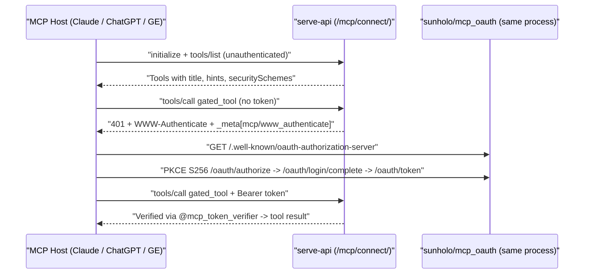

# Publish an AILANG service as an MCP connector

Prepare an AILANG `serve-api` service for **Claude** (`claude.ai`), **ChatGPT**, **Microsoft Copilot**, and **Google Gemini** directories from one `/mcp/connect/` URL using `sunholo/mcp_oauth`, `sunholo/mcp_files`, and `ailang mcp check`.



## Connector Compatibility Matrix

| Host / Surface | OAuth Client Model | AILANG Status | Reference Service |
|---|---|---|---|
| **Claude** (`claude.ai`, desktop, mobile) | CIMD (`oauth_cimd`), lazy auth | Verified; passes `ailang mcp check` | [AILANG Parse](https://docparse.ailang.sunholo.com/mcp/connect/) |
| **ChatGPT** (`chatgpt.com` plugins) | CIMD + RFC 9207 `iss` | Verified end-to-end | [Hosted Executor](./hosted-executor.md) |
| **Gemini Enterprise** (MCP data store) | IAM (`*.run.app`) or pre-registered confidential client | Verified (IAM + per-user OAuth) | [Hosted Executor](./hosted-executor.md) |
| **Gemini Enterprise** (A2A agent) | A2A v0.3 + authorization resource | Verified (`serve-api --a2a-message`) | `executor_tools/agent.ail` |
| **Google Connected Apps** (Preview) | CIMD / DCR (`dcr: true`) + stable refresh + RFC 7009 revoke | Built in `sunholo/mcp_oauth` 0.2+ | Needs Google preview admission |
| **Microsoft 365 Copilot / Studio** | Static confidential client or DCR (`dcr: true`) | Supported in `sunholo/mcp_oauth` 0.2+ | Requires `copilot` check & CORS |

## 1. Two Surfaces from One Module

When any export uses `@mcp_auth`, `@mcp_secret`, or `@mcp_agent_only`, `serve-api --mcp-http` exposes two endpoints (see [Serve API Guide](./serve-api.md#mcp-model-context-protocol) for full annotation semantics):

| Endpoint | Audience | Auth Model | Tool Surface |
|---|---|---|---|
| `/mcp/` | Agents, CLIs, MCP Registry | API key args/headers, device codes | All tools and params |
| `/mcp/connect/` | Directory listings | **OAuth 2.1** (`401` + `WWW-Authenticate` + `_meta["mcp/www_authenticate"]`) | Drops `@mcp_agent_only` tools and `@mcp_secret` params; gates `@mcp_auth("oauth2")` |

Both `/mcp/connect` and `/mcp/connect/` respond directly without 307 redirects so directory probes succeed.

## 2. Core Annotations

```ailang
module examples/notes_svc

import std/io (println)
import std/json (Json, getString)
import std/string (length, startsWith)

@mcp_title("List formats")
@mcp_hints("readOnly")
export func formats() -> string = "docx, pptx, xlsx, pdf"

@mcp_title("Delete summary")
@mcp_hints("destructive", "idempotent")
@mcp_auth("oauth2")
export func deleteSummary(id: string) -> string ! {IO} = "deleted ${id}"

@mcp_title("Summarise document")
@mcp_hints("readOnly", "openWorld")
@mcp_auth("oauth2")
@mcp_secret("apiKey")
@optional("apiKey")
export func summarise(text: string, apiKey: string, _headers: Json) -> string ! {IO} {
  let bearer = match getString(_headers, "Authorization") { Some(h) => h, None => "" }
  let who = if apiKey != "" then "argument key" else if bearer != "" then "bearer token" else "nobody"
  "summary of ${show(length(text))} characters for ${who}"
}

@mcp_token_verifier
export func verifyToken(token: string) -> bool ! {IO} = startsWith(token, "demo_") && length(token) > 5

@mcp_title("Sign in with a device code")
@mcp_hints("openWorld")
@mcp_agent_only
export func deviceLogin(label: string) -> string ! {IO} = "visit https://example.com/device for ${label}"

@nomcp
export func main() -> () ! {IO} = println("docx, pptx, xlsx, pdf")
```

- `@mcp_token_verifier` **fails closed**: `false` → `401`; error, panic, >5 s timeout, or >32 in-flight → `503` + `Retry-After`.
- Missing `--oauth-issuer` or verifier with `@mcp_auth("oauth2")` is a startup/registration error.
- Use `--no-feedback-tool` to suppress the built-in `submit_feedback` tool from directory listings.

## 3. Built-in OAuth (`sunholo/mcp_oauth`) & File Input (`sunholo/mcp_files`)

[`sunholo/mcp_oauth`](https://github.com/sunholo-data/ailang-packages/tree/main/packages/mcp-oauth) runs a PKCE-S256 OAuth 2.1 authorization server inside your `serve-api` process (CIMD, exact + RFC 8252 loopback redirects, RFC 9207 `iss`, rotating refresh families, Z3-verified predicates, and `string<secret>` IFC isolation).

```toml
[dependencies]
"sunholo/mcp_oauth" = "0.2.1"

[effects]
max = ["IO", "FS", "Net", "Env", "Rand", "Clock", "Declassify", "SharedMem"]
```

| Four `@nomcp` Routes | Package Function | Purpose |
|---|---|---|
| `GET /.well-known/oauth-authorization-server` | `core.asMetadataFor` | OAuth AS metadata (S256, CIMD/DCR) |
| `GET /oauth/authorize` | `cimd.fetchClient` + `flow.beginAuthorizeFor` | Redirect to same-origin consent page (`--static`) |
| `POST /oauth/login/complete` | `flow.completeLogin` | Issue single-use code with `iss` |
| `POST /oauth/token` | `flow.tokenRequest` | Exchange code or refresh token |

Run `ailang pkg docs sunholo/mcp_oauth` for `Hooks`, `ClientConfig`, and `routes_template.ail`. Keep `AILANG_TRACE_VALUES=off` in production so bearer tokens are never logged.

**File input across clients** (`examples/runnable/serve_api_mcp_file.ail`, `serve_api_mcp_app.ail`):
- **ChatGPT**: `@mcp_file("file")` binds a host-supplied `{download_url, file_id, mime_type, file_name}` record (`_meta["openai/fileParams"]`); fetch bytes under `Net[scope=public]`.
- **Claude / Copilot**: `@mcp_ui_resource("ui://...", "self")` + `@mcp_ui(...)` serve an MCP Apps HTML upload widget (`ui/update-model-context`).
- **`sunholo/mcp_files`**: Provides single-use upload tokens, the standard picker widget, `fetchFileParam`, and a `curl` fallback for CLI agents (`ailang pkg docs sunholo/mcp_files`).

## 4. Wire Check (`ailang mcp check`)

```bash
ailang mcp check https://your-service.example.com/mcp/connect/ --target both
```

Verifies `annotations`, `credentials`, `zero-arg`, `lazy-auth`, `authorization-server`, `file-params` (OpenAI), `security-schemes` (OpenAI), `authorization-framing` (`X-Frame-Options` / CSP `frame-ancestors` on the consent page), and `copilot-registration` (`--target copilot` or `all`). Exits `0` on pass, `1` on FAIL, `2` if unreachable.

## 5. Vendor Walkthroughs & Submission Checklist

<details>
<summary>Claude (claude.ai, desktop, mobile) — CIMD + Lazy Auth</summary>

1. Deploy over `https://` with `--oauth-issuer` set to your service's origin.
2. In claude.ai: **Settings → Connectors → Add custom connector** and paste the `/mcp/connect/` URL (with or without trailing slash).
3. Select **Sign in when needed** and **Use Claude's published identity (CIMD)** (no client ID/secret required).
   
4. Run an open tool without signing in, then trigger a gated tool to complete the **Connect** flow:
   
5. Run **every** tool once before submitting to the directory. If claude.ai cannot detect sign-in, verify `resource` in the 401 `resource_metadata` matches your pasted URL.

</details>

<details>
<summary>ChatGPT (chatgpt.com Plugins) — CIMD + RFC 9207 iss</summary>

1. Open **chatgpt.com → Plugins → Add → Add custom MCP server** and paste `/mcp/connect/`.
2. Choose **OAuth** (if all tools require sign-in) or **OAuth or no authentication** (for lazy auth with `securitySchemes`), keeping CIMD enabled. *(Use web rather than the ChatGPT desktop MCPs tab for Work tasks.)*
   
3. Connect and sign in; `sunholo/mcp_oauth` returns `iss`, so ChatGPT routes back to `https://chatgpt.com/connector_platform_oauth_redirect` automatically without pre-registration.

</details>

<details>
<summary>Google Gemini Enterprise (Custom MCP Data Store + A2A Agent)</summary>

Enable confidential/DCR/revocation options via `ClientConfig` (`{ defaultClientConfig() | confidential: true, dcr: true, revocation: true }`). For IAM-only GE, deploy on a default `*.run.app` URL and grant the GE service agent `roles/run.invoker`.

**Per-user OAuth MCP Data Store setup:**
1. Mint a confidential `mco_` client with redirect `https://vertexaisearch.cloud.google.com/oauth-redirect` and allow egress for your MCP, authorize, and token hosts in `discoveryengine.managed.allowedEgressFqdns`.
2. In Gemini Enterprise → Apps → *your app* → **Connected Data Stores → New data store → Custom MCP Server**:
   
   
3. Enter the full `/mcp/connect/` URL, OAuth endpoints, and client ID, tick **Enable PKCE Support** + **HTTP Basic**, and click **Verify Auth**:
   
   
   
4. Open **Actions → Reload custom actions → Enable actions**, then connect it inside an **Agent Designer** chat agent (`sunholo/mcp_oauth` 0.2.1+ accepts GE's 768-char `state`):
   
   

**Gemini Enterprise A2A Agent (`--a2a --a2a-message`):**
Register the A2A v0.3 card + separate authorization resource (`ailang-multivac/scripts/ge-a2a-agent.sh`), ticking **PKCE** and **HTTP Basic** and minting both `https://vertexaisearch.cloud.google.com/static/oauth/oauth.html` and `/oauth-redirect`. Note that both data stores and A2A registrations share GE's daily `CreateAgent` quota.


</details>

<details>
<summary>Microsoft 365 Copilot & Copilot Studio</summary>

| Microsoft surface | Setup path | Auth & AILANG config |
|---|---|---|
| **M365 Copilot** (declarative agent) | M365 Agents Toolkit 6.12+: Add Action → Start with an MCP Server | Static (`confidential: true`, redirects `https://teams.microsoft.com/api/platform/v1.0/oAuthRedirect` + `https://vscode.dev/redirect`) or `dcr: true` |
| **Copilot Studio** | Tools → Add a tool → Model Context Protocol | Dynamic discovery (`dcr: true`) or Manual (`mco_` confidential client with Studio's callback URL) |

**Widgets & hints in Copilot:**
- Add `serve-api --cors-origin https://<sha256-of-host>.widget-renderer.usercontent.microsoft.com` (`https://aka.ms/mcpwidgeturlgenerator`) so MCP Apps widgets can fetch your server.
- Use `sunholo/mcp_files` upload widgets rather than `openai/fileParams` (unsupported in Copilot), and verify with `ailang mcp check <url> --target copilot`.

</details>

<details>
<summary>Directory Submission Checklist (Anthropic & OpenAI)</summary>

**Both directories:**
- [ ] `ailang mcp check <url> --target both` passes on the deployed URL.
- [ ] Every tool exercised once in claude.ai and ChatGPT developer mode.
- [ ] Privacy policy, terms, support contact, and public connector docs published; sign-in page resists framing (`X-Frame-Options: DENY`, `frame-ancestors 'none'`).
- [ ] Reviewer test account uses password login with **no MFA / magic links**, seeded with data.
- [ ] Tool descriptions omit `/mcp/`-only tools, API keys, and device flows; decide on `--no-feedback-tool`.

**Anthropic** ([developer portal](https://claude.ai/directory/manage)): `oauth_cimd` lazy auth, name (≤100 chars), one-liner (≤200), description (≤2,000), 1–5 categories, permanent slug, 3+ example prompts, domain ownership. See [Anthropic connector docs](https://claude.com/docs/connectors/building/submission).

**OpenAI** ([plugins portal](https://platform.openai.com/plugins)): verified org, plain-text `/.well-known/openai-apps-challenge` `@route`, demo video URL, 5 positive + 3 negative test cases, no pricing/session IDs in tool outputs, `displayName`/`shortDescription` ≤30 chars, `longDescription` ≤4,000 chars. See [OpenAI plugin guidelines](https://developers.openai.com/plugins/plugin-guidelines).

</details>

## Reference

- [Serve API Guide](./serve-api.md) — full annotation and HTTP reference
- [Hosted Executor](./hosted-executor.md) — live sandboxed reference connector
- Examples: `examples/runnable/serve_api_mcp_{oauth,hints,file,app}.ail`
