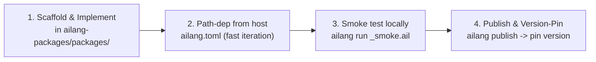

# motoko Extension Author Workflow

The end-to-end developer loop for writing a `motoko_agent` extension as a reusable AILANG package: scaffold -> iterate locally over a path-dep -> smoke test with `_smoke.ail` -> publish -> version-pin. See [Build Your First motoko Extension](./build-a-motoko-extension.md) for a step-by-step tutorial.

## When to Write an Extension

- **Write an extension** when tools are reusable across agents, need provider-portable schemas across Anthropic/OpenAI/Bedrock/Vertex/Gemini, or need independent versioning.
- **Keep in-repo** (`src/core/ext/`) when logic is ad-hoc to a single agent or encodes deployment-specific business policy.

## The Canonical 4-Step Loop



### Step 1 — Implement in `ailang-packages/`

Scaffold with `ailang init motoko-extension` so `ailang check --package .` and `ailang lock` pass immediately. Only replace the `ExtensionHooks` fields your tool needs (`provided_tools`, `on_describe_tools`, `on_tool_handle`, `on_pre_step`, etc.).

### Step 2 — Path-dep During Local Development

```toml
# host ailang.toml (dev only — swap to registry version before PR)
[dependencies]
sunholo/motoko_ext_context_mode = { path = "../ailang-packages/packages/motoko-ext-context-mode" }
```

### Step 3 — Smoke Locally with `_smoke.ail`

Every scaffolded extension includes `_smoke.ail` (executed locally and during registry publish staging):

```ailang parse
module sunholo/motoko_ext_foo/_smoke

import std/io (println)
import std/list (length)
import sunholo/motoko_ext_foo/register (register_with_config)

export func main() -> () ! {IO, Env, FS} {
  let hooks = register_with_config({});
  let count = length(hooks.provided_tools);
  if count == 0 then
    println("FAIL: no provided_tools")
  else
    println("OK: register returns ${show(count)} tools")
}
```

```bash
cd packages/motoko-ext-foo && ailang run _smoke.ail
```

### Step 4 — Publish & Pin Version

```bash
cd packages/motoko-ext-foo && ailang pkg publish
```

Update the host's `ailang.toml` to `"0.3.0"` and run `ailang lock`.

## Provider-Safe Tool Naming

Advertised tool names in `provided_tools` and `on_describe_tools` **must match `[A-Za-z0-9_]{1,128}`** (no dots, hyphens, colons, or whitespace). Bedrock and Google Vertex AI reject dotted names with HTTP 400, so the registry validator rejects non-matching names at publish time and suggests `snake_case` / `PascalCase` rewrites.

If migrating a legacy package with dotted names, rename advertised names to `snake_case`/`PascalCase`, keep dotted names only as input aliases in `canonical_tool_name`, or pass `--allow-dotted-tool-names` for a one-time deprecation release.

## `on_describe_tools` Cookbook

```ailang
let codeExecuteTool = {
  name: "CodeExecute",
  description: "Execute a code snippet in a sandboxed runtime",
  parameters: "{\"type\":\"object\",\"required\":[\"language\",\"code\"],\"properties\":{\"language\":{\"type\":\"string\",\"enum\":[\"python\",\"node\",\"go\"]},\"code\":{\"type\":\"string\"}}}"
}

let kbSearchTool = {
  name: "KBSearch",
  description: "Search the KB for relevant chunks",
  parameters: "{\"type\":\"object\",\"required\":[\"query\"],\"properties\":{\"query\":{\"type\":\"string\"},\"top_k\":{\"type\":\"integer\",\"default\":5}}}"
}
```

## Publish Checklist

- Bumped `version` and added `CHANGELOG.md` + `[release].kind`
- All tool names match `[A-Za-z0-9_]{1,128}`
- `ailang check --package .` and `ailang run _smoke.ail` exit `0`
- `[effects].max` covers every effect used by hooks
- Host `ailang.toml` swapped from `{ path = ... }` back to pinned registry version

## Canonical Examples

- [`sunholo/motoko_ext_test_dummy`](https://github.com/sunholo-data/ailang-packages/tree/main/packages/motoko-ext-test-dummy) — minimal one-tool extension
- [`sunholo/motoko_ext_context_mode`](https://github.com/sunholo-data/ailang-packages/tree/main/packages/motoko-ext-context-mode) — 18 tools, JSON schemas, `on_pre_step`
- [`sunholo/motoko_ext_mcp`](https://github.com/sunholo-data/ailang-packages/tree/main/packages/motoko-ext-mcp) — MCP server bridge (`Delegate` + `Handled`)
