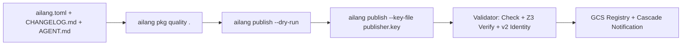

# Publishing Your Package

Share packages locally via `{ path = "../pkg" }` in `ailang.toml` during development, or publish immutable versions to the AILANG registry with `ailang publish`.

## Publish Workflow in One Screen



```bash
ailang pkg quality .                       # Local + server-equivalent quality report
ailang publish --dry-run                   # Build preview tarball & print SHA256 digests
ailang publish --key-file /private/pub.key # Upload with mode 0400/0600 scoped key file
```

## Quality Report Gates (`PUBnnn`)

`ailang publish` and `ailang pkg quality .` run the exact checks enforced by the registry validator:

| Provenance | Checks Included | Gates Publish? |
|---|---|---|
| `server` | `ailang check --package`, Z3 `ailang verify --package`, v2 interface identity, `[effects].max`, `[release].kind` + `CHANGELOG.md`, `PUBnnn` docs/style | **Yes** — validator recomputes and enforces |
| `attested` | `ailang test --package` + staged `_smoke.ail` | Locally yes (`--no-run` skips); banked as `attested_by` badge on registry |

- **Stability gates:** `experimental` blocks on compile failures, refuted contracts (`PUB006`), missing release metadata (`PUB001`/`PUB002`), and v2 skew (`PUB005`); `stable`/`frozen` also gate on tests, effect ceilings, and contract coverage.
- **Discoverability & hygiene:** `PUB008` (`license_url`), `PUB018` (`ai_summary`), `PUB021` (`[metadata].repository` for `pkg:` inbox routing), `PUB022` (`AGENT.md` mentions exports), `PUB023` (export overlap check), `PUB024` (stale `_namedtest_body_*.ail` debris), and `PUB025` (`[release].kind` vs measured A/B/C class).
- **Published-view smoke staging:** Smoke runs rewrite local `{ path = ... }` deps to exact published versions in a temporary lock (`PUB015` surfaces root setup failures within a 2048-byte excerpt) without altering your working `ailang.toml`/`ailang.lock`.

## Release Metadata, v2 Signatures & Nested Packages

Every publish requires `[release].kind` (`security | fix | feature | breaking`) and a matching `## <version>` entry in `CHANGELOG.md`:

```toml
# ailang.toml
[package]
name = "myorg/ext_foo"
version = "0.2.1"
edition = "1"
ailang = ">=0.64.0"

[release]
kind = "fix"
```

- **v2 Contract Signatures (`interface_hash_v2` & `interface_signatures`):** Exports carry type signatures, class constraints (`Eq[a]`, `Num[a]`), `literals`, and contract lines (`<module>:contract:<fn>:<clause>` + `meta:contracts:v1`). Contracts do not alter `interface_hash_v2`, so publisher/validator hashes agree, while tightening `requires` under an unchanged type classifies as breaking **Class C** (`affected_exports` listed on cascade notices). Mismatched toolchains fail with `PUB005`.
- **Nested `ailang.toml` packages:** Subdirectories containing their own `ailang.toml` are separate packages — excluded from the parent's compilation, content hash, and tarball so a monorepo can publish a dependency-free core alongside higher-level packages.
- **Path-dep rewriting:** During `ailang publish`, `{ path = "../dep" }` entries are rewritten to exact published registry versions inside the uploaded tarball (leaves must be published before dependents).
- **Consumer docs:** `ailang pkg docs <vendor/name>` prints the package's `AGENT.md` and `pkg/<vendor>/<name>/...` import paths.

## Scoped Publish Keys & CI

Prefer `--key-file PATH` (regular non-symlink file owned by you, mode `0400` or `0600`, `<= 16 KiB`, not inherited by child processes) over `AILANG_REGISTRY_API_KEY`:

| Key Kind | Scope Example | Authority |
|---|---|---|
| Scoped (`ailr_...`) | `myorg/*`, `sunholo/my_pkg` | Publish/unpublish matching globs; stamps `published_by` |
| Superuser | `*` (maintainers only) | Mint/revoke keys (`ailang pkg key create\|list\|revoke`), rebuild index |

<details>
<summary>GitHub Actions publish workflow & verifying published packages</summary>

```yaml
# .github/workflows/publish.yml
name: Publish to AILANG registry
on:
  push:
    tags: ['v*']
jobs:
  publish:
    runs-on: ubuntu-latest
    steps:
      - uses: actions/checkout@v4
      - uses: sunholo-data/setup-ailang@v1
        with: { version: latest, cache: true }
      - name: Publish
        env:
          AILANG_REGISTRY_API_KEY: ${{ secrets.AILANG_REGISTRY_API_KEY }}
        run: ailang publish
```

```bash
ailang pkg info myorg/ext_foo --refresh
ailang lock && jq '[.packages[] | select(.name=="myorg/ext_foo") | {name, version, source}]' ailang.lock
```

</details>

## Moving a Module Without Breaking Dependents

To move a module to another package (for example into a smaller core package), leave a
**facade** at the old path that re-exports it:

```ailang parse
module docparse/types/document
export import pkg/sunholo/docparse_core/types/document
  (Block, Heading, Text, Table, ParsedDocument) @deprecated("pkg/sunholo/docparse_core/types/document")
```

Dependents compile unchanged: the names keep their identity, and a dependent needs no
direct dependency on the new package. Each name they import through the line warns
`TC_DEPRECATED_001` with the new path. The facade's signature lines are the moved
module's lines, so the release measures as no removal. Removing the facade later is a
class C change.

The facade package's `[effects].max` must cover the functions it re-exports: re-exporting
a `! {Net}` function under `max = []` fails `ailang check` and names the function.

## Current Limitations

- **Central key minting:** No self-serve signup; request a scoped key from maintainers.
- **Immutable versions:** No version yanking; publish a patch bump (`x.y.(z+1)`) to supersede a broken release.
- **Single public registry:** Private packages use `{ path = ... }` or git dependencies inside a repo.

## Related Guides

- [Package System](./packages.md) — `ailang.toml`, atomic `ailang.lock`, effect ceilings
- [Autonomous Package Updates](./autonomous-package-updates.md) — downstream PR cascades
- [Extension Packages](./extension-packages.md) — `experimental` plugin registry generator
