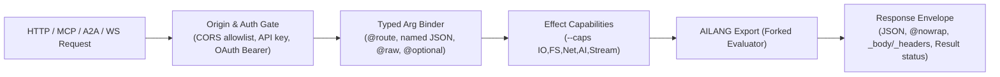

# Serve API Guide

Expose AILANG module exports as REST API endpoints, MCP tools, A2A agents, WebSocket bridges, or a React-backed web app via `ailang serve-api` and `ailang init web-app` (built on [Go Interop](./go-interop.md)).



## Quick Start

| Command | Purpose |
|---|---|
| `ailang serve-api ./api/ --port 8080` | Serve exported functions from all `.ail` modules under `./api/` |
| `ailang serve-api ./api/ --frontend ./ui` | Serve API and proxy non-`/api/` routes to Vite dev server |
| `ailang init web-app myproject` | Scaffold AILANG API + React/Vite/TypeScript full-stack project |

```bash
# Scaffold and run full-stack project
ailang init web-app myproject
cd myproject && (cd ui && npm install) && make dev
```

<details>
<summary>How <code>basePath</code> and module registration work</summary>

`serve-api` registers a module as a route only if its file lives under **basePath**. Starting from the directory of the path argument, `basePath` expands outward when a `module` header requires it (`./api/` with `module api/handlers` resolves to the parent directory), and never shrinks inward. Hosted packages (`module sunholo/<pkg>/<mod>`) must be served from a root that resolves their declared path (`cd` into the package root and run `ailang serve-api .`). Standard library modules (`std/*`) are never exposed as routes.

</details>

## Endpoints & Request/Response Format

Given `api/math.ail` and `api/greet.ail` in `examples/web_api_demo/`:

```ailang
-- api/math.ail
module api/math

export pure func add(x: int, y: int) -> int = x + y
export pure func multiply(x: int, y: int) -> int = x * y
export pure func factorial(n: int) -> int =
  if n <= 1 then 1 else n * factorial(n - 1)
export pure func fibonacci(n: int) -> int =
  if n <= 0 then 0 else if n == 1 then 1 else fibonacci(n - 1) + fibonacci(n - 2)
```

```ailang
-- api/greet.ail
module api/greet

import std/json (encode, jo, kv, js)

export pure func hello(name: string) -> string = "Hello, ${name}!"
export pure func welcome(name: string) -> string =
  encode(jo([kv("message", js("Welcome, ${name}!")), kv("name", js(name))]))
```

| Endpoint | Purpose |
|---|---|
| `POST /api/{module-path}/{func}` | Call exported function |
| `GET /api/_meta/modules` (`/_meta/modules/{path}`) | Module & export metadata |
| `GET /api/_meta/openapi.json` / `/docs` / `/redoc` | OpenAPI 3.1 spec, Swagger UI, ReDoc |
| `GET /api/_health` | Health check (`status`: `ok` \| `degraded`) |
| `GET /.well-known/agent-card.json` & `POST /a2a/` | A2A Agent Card & JSON-RPC (`--a2a`) |

### Calling Functions & Typed Parameter Binding

| Call style | Example body | Notes |
|---|---|---|
| **Named JSON** (recommended) | `{"path": "a.docx", "output_format": "blocks"}` | Matches exact or `snake_case` → `camelCase`; missing params zero-pad on `@route` |
| **Positional** | `{"args": [3, 4]}` | Takes precedence if `"args"` array is present |
| **Single / nullary** | `"Bob"` or empty body | Direct value for 1-arg functions; empty for 0-arg |
| **Multipart form** | `-F "file=@doc.pdf" -F n=21` | `bytes` for file parts; declared-type JSON parsing for fields |

<details>
<summary>Default envelope, typed-argument errors, and zero-value padding table</summary>

By default calls return `{"result": ..., "module": "...", "func": "...", "elapsed_ms": N}` (or `{"error": "...", "error_detail": {"code": ...}}` with router codes `ROUTE_NOT_FOUND`, `MODULE_NOT_LOADED`, `FUNCTION_NOT_FOUND`, `METHOD_NOT_ALLOWED`). Use `@nowrap` to omit the envelope (`X-Elapsed-Ms` stays in headers).

| Parameter Type | `@route` Zero Value | OpenAPI / MCP Schema |
|---|---|---|
| `string` | `""` | `{"type": "string"}` |
| `int` | `0` | `{"type": "integer"}` |
| `float` | `0.0` | `{"type": "number"}` |
| `bool` | `false` | `{"type": "boolean"}` |
| `[T]` / `array` | `[]` | `{"type": "array", ...}` |
| `record` / `Json` | `{}` | `{"type": "object"}` |

Fractional/out-of-range ints, non-finite floats, and mismatched record/list fields fail pre-dispatch (`HTTP 400` / MCP `isError` / JSON-RPC `-32602`). Use `--no-introspection` with `--routes-only` to return 404 on `/api/_meta/*` and `/api/_health` (paths remain reserved).

</details>

## Custom Routes, Headers & Binary Responses

| Annotation | Effect |
|---|---|
| `@route("METHOD", "/path")` | Custom path (`GET`, `POST`, `PUT`, `DELETE`, `PATCH`, `HEAD`, `OPTIONS`, `WS`) |
| `@raw` | Pass `{body, headers, method, path, query}` record instead of parsed args |
| `@nowrap` | Return raw JSON without envelope; auto-unwraps JSON object/array strings; strips `_headers` field into HTTP headers |
| `@noexpose` | Hide from HTTP/OpenAPI/A2A/MCP (re-exposed if `@route` is present) |
| `@nomcp` | Hide from MCP `tools/list` & `tools/call` only (survives `@route`) |
| `@verify(depth: N)` | Enable runtime contract checks (`requires`/`ensures`) |

```ailang
module docparse/api

import std/bytes (fromString, length as bytesLength)
import std/json (Json, encode, jo, kv, js, getString)

@nowrap
@route("GET", "/api/v1/health")
export pure func health() -> string = encode(jo([kv("status", js("healthy"))]))

@raw
@route("POST", "/webhooks/stripe")
export func handle(req: {body: string, headers: Json, method: string, path: string, query: Json}) -> string ! {IO} =
  match getString(req.headers, "Stripe-Signature") {
    Some(sig) => "verified (${sig}): ${req.body}",
    None => "missing Stripe-Signature"
  }

@route("POST", "/api/v1/upload")
export func processFile(file: bytes) -> {size: int} ! {IO} = {size: bytesLength(file)}

@route("GET", "/download")
export pure func download() -> {_body: bytes, _status: int, _headers: Json} =
  {_body: fromString("hello"), _status: 200,
   _headers: jo([kv("Content-Type", js("text/plain")),
                 kv("Content-Disposition", js("attachment; filename=hello.txt"))])}
```

Declare `_headers: Json` on non-`@raw` `@route` or MCP functions to read HTTP headers without advertising them in schemas. Return `Result[T, E]` to map `Ok(v)` → `200` (unwrapped) and `Err("msg")` → `400`, or `Err({_status: 404, message: "..."})` for custom HTTP status codes (and MCP `isError: true`).

## Capabilities & Security

By default `serve-api` runs only pure functions. Grant capabilities explicitly with `--caps`; `--caps` gates execution, not endpoint/tool discovery.

| Flag / Setting | Behavior |
|---|---|
| `--caps IO,FS,Net,AI,Clock,Env,Stream` | Capabilities granted server-wide |
| `--ai MODEL` / `--ai-stub` | Model for `AI` effect (`models.yml` or prefix) or stub handler |
| `! {Net[scope=public]}` | Blocks loopback, link-local (`169.254.169.254`), and private IPs at connect time (redirect hops are always checked) |
| `--api-key-header H --api-key-env VAR` | Require header or `Authorization: Bearer`; bypasses `/api/_health`, `/api/_meta/*`, MCP, A2A |
| `--bind ADDR` | Defaults to `127.0.0.1` (`0.0.0.0` when `PORT` env is set); binds before printing startup banner |
| `--cors` / `--cors-origin ORIGIN` | Default off; `--cors-origin` enforces allowlist and returns **403** pre-dispatch on unlisted non-GET/HEAD `Origin`s |
| `--static DIR` / `--static-cache` | Serves static assets with `X-Frame-Options: DENY`, `CSP: frame-ancestors 'none'`, `nosniff`, `no-referrer` (override via `--static-header`) |
| `AILANG_SERVE_API_ALLOW_DROPS=1` | Escape hatch for dropped `@route` modules (fatal by default; marks `/api/_health` `degraded`) |

## MCP (Model Context Protocol) & Directory Connectors

Serve exported functions as MCP tools via stdio (`--mcp`) or HTTP (`--mcp-http` → `/mcp/`).

```bash
# Stdio (IDE) or HTTP with directory-ready identity
ailang serve-api --mcp --routes-only --no-feedback-tool ./api/
ailang serve-api --mcp-http --server-info "name=parse,title=AILANG Parse,version=1.0.0" ./api/
```

| Feature / Annotation | Behavior |
|---|---|
| `@mcp_name("name")` | Override auto tool name (`^[a-zA-Z0-9_-]{1,64}$`) |
| `@mcp_title("Title")` | Display title required by Anthropic/OpenAI directories |
| `@mcp_hints("readOnly", ...)` | Explicit booleans from `readOnly`, `destructive`, `idempotent`, `openWorld` (absent = `false`; empty `! {}` infers read-only) |
| `@optional("p1", ...)` | Drops params from `required`; binds zero value when absent/null (required params otherwise error pre-call) |
| `@mcp_auth("oauth2")` | Gates `/mcp/connect/` behind Bearer token (`401` + `WWW-Authenticate` + `_meta["mcp/www_authenticate"]`); requires `--oauth-issuer` + `@mcp_token_verifier` |
| `@mcp_token_verifier` | `(token: string) -> bool` or `-> Option[{subject: string, client_id: string, scopes: [string]}]`; 5 s / 32 in-flight fail-closed (`503`) |
| `@mcp_secret("p")` / `@mcp_agent_only` | Hide param or whole tool from `/mcp/connect/` while keeping `/mcp/` intact |
| `--mcp-connect-only` | Disables `/mcp/`, gates every `/mcp/connect/` tool unless `@mcp_auth("noauth")`, restricts HTTP to `@nomcp` |
| `_auth` parameter | `{subject, client_id, scopes}` bound from verified identity; exposes tool **only** on `/mcp/connect/` (use with `--mcp-subject-rpm N`) |
| `@mcp_file("file")` | Binds ChatGPT host files (`OpenAIFile` 4-string record) via `_meta["openai/fileParams"]` |
| `@mcp_ui_resource` / `@mcp_ui` / `@mcp_app_only` | Serves `ui://` MCP Apps HTML widgets (`mimeType: "text/html;profile=mcp-app"`, CSP `connectDomains`) |

```ailang sketch
-- Key from the argument, else Authorization: Bearer, else X-API-Key
@optional("apiKey")
export func whoami(apiKey: string, _headers: Json) -> string { ... }
```

```ailang
import std/clock (now)

@mcp_title("Current time")
@mcp_hints("readOnly", "openWorld")
export func currentTime() -> int ! {Clock} = now()
```

See [MCP Connectors](./mcp-connectors.md) for end-to-end OAuth (`sunholo/mcp_oauth`), `sunholo/mcp_files`, `ailang mcp check --target both`, and directory submission.

## A2A (Agent-to-Agent Protocol)

Enable A2A with `--a2a` (`GET /.well-known/agent-card.json`, `POST /a2a/`). Add `--a2a-message <export>` for text-driven agents (`string -> string`), which exposes `message/send`, `message/stream` (SSE with 15 s heartbeats), and `tasks/get` (and inherits `--mcp-connect-only` Bearer auth).

```bash
ailang serve-api --a2a --a2a-message reply --server-info "name=echo,title=Echo agent" \
  examples/runnable/serve_api_a2a_message.ail
```

## WebSocket Routes & Bridge

`@route("WS", "/path")` upgrades to WebSocket and runs the handler once per connection (`--caps Stream`, `--ws-max-sessions`, `--ws-queue-frames`, `--stream-max-message`, `--stream-credential host=source`).

```ailang
import std/stream (connect, disconnect, StreamConn)
import std/stream/bridge (bridge, BridgeFrame, Verdict, Forward, Drop, UpBin, UpstreamClosed)
import std/result (Ok, Err)

pure func muteAudio(n: int, f: BridgeFrame) -> (int, Verdict) =
  match f { UpBin(_) => (n + 1, Drop), _ => (n, Forward) }

@route("WS", "/live")
export func live(client: StreamConn) -> unit ! {Stream} {
  match connect("wss://upstream.example/ws", { headers: [] }) {
    Ok(up) => match bridge(client, up, 0, muteAudio) {
      (_, UpstreamClosed(_, _)) => disconnect(client),
      _ => ()
    },
    Err(_) => disconnect(client)
  }
}
```

```ailang sketch
@route("WS", "/live")
export func live(client: StreamConn, req: {path: string, headers: [{name: string, value: string}]}) -> unit ! {Stream} = ...
```

Use `--ws-pass-header Name` to forward safe non-credential headers into `req.headers`, and `--ws-decision-log` for payload-free per-frame JSON logs. Full example: [`examples/serveapi_ws_bridge.ail`](https://github.com/sunholo-data/ailang/blob/dev/examples/serveapi_ws_bridge.ail).

## Embedding, Concurrency & Structured Logging

Each HTTP request receives an isolated forked evaluator (`containerConcurrency: 80` works out of the box). For hot reload during development, pass `--watch` (200 ms debounce; errors keep the previous working module live).

- **Structured stderr logs**: `Debug.log` lines containing a bare JSON object print verbatim for Cloud Logging `jsonPayload` (`--log-level` filters by `severity`); `Debug.check` failures emit `severity: "ERROR"`.
- **Testing concurrency**: `./tools/test-concurrency.sh examples/web_api_demo/api/` (redirect server output to a file with `> /tmp/server.log 2>&1 &` rather than `2>&1 | tee`).
- **Go embedding (`serveapi` / `serveapi/protocol`)**: Mount session-scoped MCP and A2A handlers onto an existing Go `http.ServeMux` via `serveapi.New(serveapi.Config{...}).Mount(mux)`, or return `protocol.JSONRPCError` from `Invoker.Invoke` for typed JSON-RPC errors.

## CLI Reference

```text
Usage: ailang serve-api [flags] <path...>   (flags must precede paths)
  --port PORT              HTTP port (default: 8080)
  --bind ADDR              Listen address (default: 127.0.0.1; 0.0.0.0 when PORT set)
  --cors / --cors-origin   CORS mode (all origins vs strict allowlist)
  --frontend PATH          Proxy non-/api/ requests to Vite dev server
  --static PATH            Serve static directory (--static-cache, --static-header)
  --watch                  Hot-reload .ail modules on save
  --caps CAPS              Capabilities (IO,FS,Net,AI,Clock,Env,Stream)
  --ai MODEL / --ai-stub   AI provider model or stub
  --verify-contracts       Runtime requires/ensures validation
  --routes-only            Expose only @route functions
  --no-introspection       Disable /api/_meta/* and /api/_health (404)
  --mcp / --mcp-http       MCP stdio or HTTP (/mcp/ & /mcp/connect/)
  --mcp-connect-only       Disable /mcp/, require Bearer on /mcp/connect/ & /a2a/
  --oauth-issuer URL       OAuth AS issuer URL for /mcp/connect/
  --mcp-subject-rpm N      Per-subject rate limit on /mcp/connect/
  --a2a / --a2a-message    A2A v0.3 endpoint and text agent handler
  --server-info S          name=N,title=T,version=V,icon=I
  --ws-pass-header H       Allowlist WS request header (repeatable)
  --stream-credential S    Bind host=gcp-key-file:P|gcp-metadata|bearer-file:P
  --no-feedback-tool       Suppress built-in submit_feedback MCP tool
```
