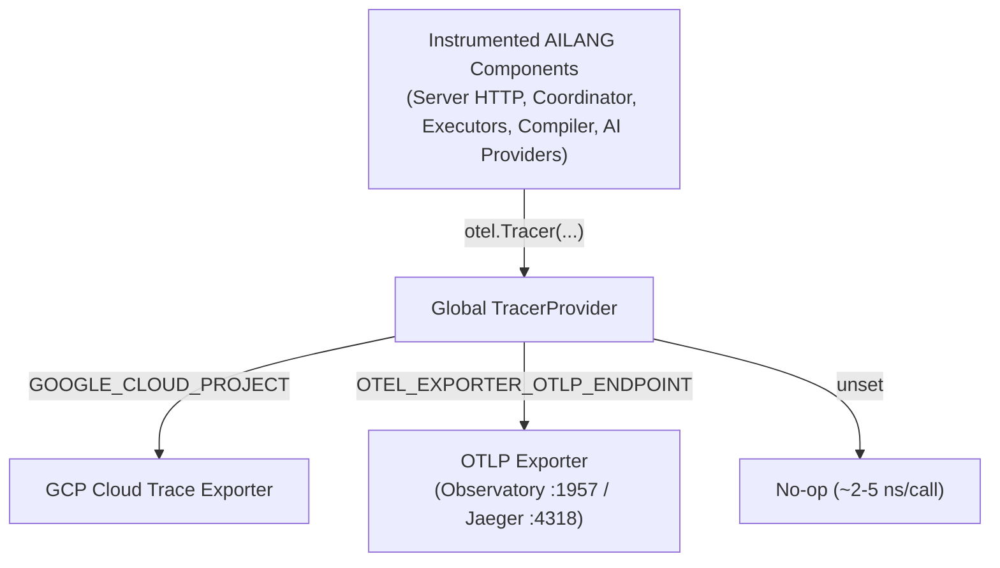
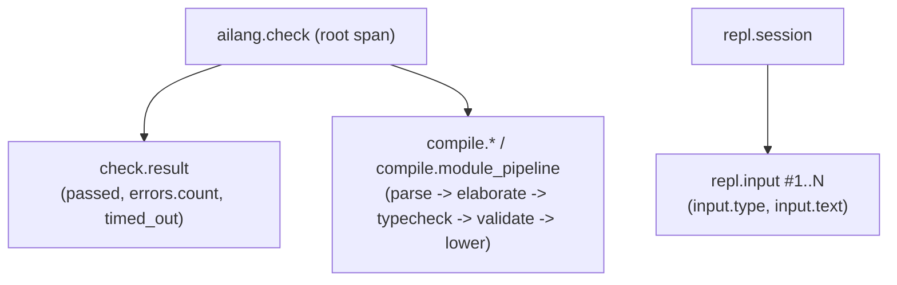
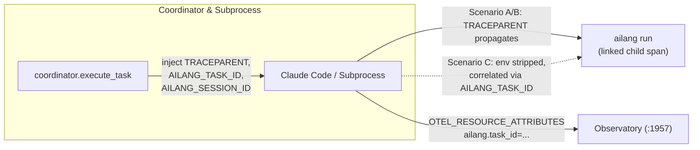
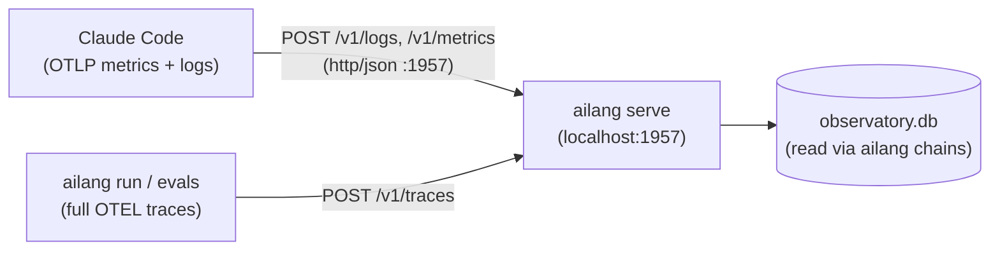

# Telemetry & Tracing

AILANG instruments compiler phases, eval suites, messaging, HTTP servers, coordinator tasks, and AI providers with OpenTelemetry (OTEL) for Google Cloud Trace, local Observatory (`ailang serve`), or any OTLP backend (Jaeger, Grafana, Honeycomb).

## Architecture



## Quick Start & CLI Trace Inspection

```bash
# Google Cloud Trace (uses ADC; OTLP_GOOGLE_CLOUD_PROJECT overrides GOOGLE_CLOUD_PROJECT)
export GOOGLE_CLOUD_PROJECT=your-project-id

# Generic OTLP / Local Observatory (:1957) or Jaeger (:4318) — both export simultaneously when both vars are set
export OTEL_EXPORTER_OTLP_ENDPOINT=http://localhost:1957
export OTEL_EXPORTER_OTLP_PROTOCOL=http/json

ailang trace status
ailang trace list --hours 2 --limit 20 --filter "ailang run"
ailang trace view <trace-id>
```

<details>
<summary>Example <code>ailang trace status</code> and <code>ailang trace view</code> output</summary>

```text
Telemetry Configuration Status
Google Cloud Project: multivac-internal-dev
OTLP Endpoint:        (not set)
Mode: Google Cloud Trace

Trace: 5d359e6d157ba7e726aca8a7600a3bfe (5 spans)
  ailang run: examples/runnable/factorial.ail (2.065ms)
    -> compile: examples/runnable/factorial.ail (1.458ms)
    -> compile.load (358us) -> compile.topo_sort (84us) -> compile.modules (859us)
```

</details>

## Tracing Tiers & Environment Variables

Precedence: `--trace-tier` flag > `AILANG_TRACE` env > `AILANG_NO_TRACE=1` > default (`standard`).

| Tier | Emits | Overhead | When to use |
|---|---|---|---|
| `off` (`AILANG_NO_TRACE=1`) | Nothing | `0` (~2–5 ns no-op) | CI, latency benchmarks |
| `standard` (default) | `eval.module.*`, top-level `eval.effect.*`, `compile.*`, `coordinator.*`, `effect.*`, chain spans | Low (~50–200 μs/compile) | Normal dev & prod |
| `deep` | `standard` + per-call `eval.function.*` + nested `eval.effect.*` (with args/results) | ~1.8–6× | Profiling hot paths, training export |

| Variable | Purpose | Example / Default |
|---|---|---|
| `AILANG_TRACE` / `AILANG_TRACE_MAX_SPANS` | Tracing tier / per-trace span cap (emits `trace.truncated` rollup) | `deep` / `500` |
| `GOOGLE_CLOUD_PROJECT` / `OTLP_GOOGLE_CLOUD_PROJECT` | GCP Cloud Trace project (`OTLP_*` wins) | `my-project-id` |
| `OTEL_EXPORTER_OTLP_ENDPOINT` / `OTEL_ENVIRONMENT` | OTLP collector URL / deployment tag | `http://localhost:1957` / `development` |

## Instrumented Components & Span Hierarchy



| Component | Root / Key Spans | Key Attributes |
|---|---|---|
| **Compiler** | `compile.pipeline`, `compile.module_pipeline`, `compile.{parse,elaborate,typecheck,validate,lower,load,topo_sort,modules}` | `file.path`, `file.size_bytes`, `ast.nodes`, `modules.count` |
| **Eval Harness** | `eval.suite`, `eval.benchmark` | `benchmark.id`, `model`, `success`, `cost_usd`, `code.preview`, `error.category`, `benchmark.repair_successful` |
| **Messaging** | `messages.{send,list,read,search,ack,unack,cleanup,github_sync}` | `message.to_inbox`, `search.result_count`, `cleanup.deleted_count` |
| **Coordinator & Executors** | `coordinator.execute_task`, `claude.execute`, `managed_agents.execute` | `task.id`, `task.type`, `task.stage`, `task.tokens_in/out`, `task.cost_usd` |
| **AI Providers** | `{anthropic,openai,gemini,ollama}.generate` | `ai.model`, `ai.tokens_*`, `ai.prompt_preview`, `ai.response_preview`, `ai.finish_reason` |
| **Errors & CLI Run** | Any span on error / `ailang run` | `error.message`, `error.category`, `error.location`, `error.snippet`, `caps.granted` |

Use `internal/telemetry` helpers (`Truncate`, `CategorizeError`, `ShortHash`, `LineSnippet`) for consistent UTF-8-safe span attributes.

## Cross-Process Trace Linking (`TRACEPARENT`)



`ailang run`, `ailang check`, `ailang eval-suite`, and `ailang repl` automatically extract `TRACEPARENT`/`TRACESTATE`, `AILANG_TASK_ID`, and `AILANG_SESSION_ID`. In Go, use `telemetry.InjectTraceContext`, `telemetry.InjectCorrelationIDs`, and `telemetry.ExtractTraceContext`.

<details>
<summary>CI/CD trace linking (GitHub Actions / Cloud Build) and local Jaeger verification</summary>

```yaml
# GitHub Actions
env:
  TRACEPARENT: "00-${{ github.run_id }}-${{ github.job }}-01"
  AILANG_TASK_ID: ${{ github.run_id }}
```

```bash
docker run -d --name jaeger -p 16686:16686 -p 4318:4318 jaegertracing/all-in-one:latest
export OTEL_EXPORTER_OTLP_ENDPOINT=http://localhost:4318
ailang run --caps IO --entry main examples/runnable/hello.ail
ailang trace list --hours 1
```

</details>

## Observatory Integration (`ailang serve`)



Configure `~/.claude/settings.json` with `CLAUDE_CODE_ENABLE_TELEMETRY=1`, `OTEL_LOGS_EXPORTER=otlp`, `OTEL_METRICS_EXPORTER=otlp`, `OTEL_EXPORTER_OTLP_PROTOCOL=http/json`, `OTEL_EXPORTER_OTLP_ENDPOINT=http://localhost:1957`, and `OTEL_RESOURCE_ATTRIBUTES="ailang.source=user"`. `ailang serve` ignores `/health`, `/ws`, `/v1/*`, and `/api/*` polling routes, and fails silently when down so CLI work is never blocked.

**Delivery & shutdown semantics**: Startup reports each exporter as `disabled`, `registered`, or `degraded` (`delivery unverified`). Export attempts use a 3s timeout, shutdown flushes within 2s (no durable disk spool on forced kill), and malformed endpoint URLs fail startup loudly. Verify Cloud Trace end-to-end with `go test -tags=integration -v -run TestGoogleCloudTrace ./internal/telemetry/...`.

## Troubleshooting

| Problem | Fix |
|---|---|
| No traces in GCP | Run `gcloud auth application-default login`, verify `gcloud config get-value project`, check Cloud Trace Agent IAM role |
| OTLP connection refused | Ensure endpoint includes `http://` and collector is listening (`curl http://localhost:4318/v1/traces`) |
| Missing AI provider spans | Verify telemetry initializes before AI calls and set `OTEL_LOG_LEVEL=debug` |

## See Also

- [Debugging Guide](./debugging) · [Collaboration Hub](./collaboration-hub) · [Coordinator Guide](./coordinator) · [Evaluation Framework](./evaluation)
