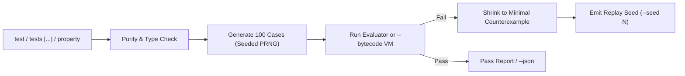

# AILANG Testing Guide

AILANG supports three deterministic testing forms — **inline `tests [...]`**, **named `test` blocks**, and **QuickCheck-style `property` blocks** — all executed by `ailang test`.



## Named-Test and Property Purity

Named-test bodies and `forall` property predicates are checked **pure**. All module-level helpers remain visible, including plain `func` and `export func` declarations without an effect annotation; an unused effectful helper is retained as a closure and does not run merely because the module is tested.

```ailang
module helper_test
export func inc(x: int) -> int { x + 1 }
test "plain export" { inc(1) == 2 }
```

Calling a helper declared with `! {FS}`, or calling `readFile` directly inside a test, fails with `Missing effects: FS`. Test bodies cannot grant capabilities; verify effectful behavior through an exported entry with `ailang run --caps FS,IO ...` (see `examples/tests/effectful_fixture_verification.ail`).

## Quick Start

```ailang
module hello_test

-- Unit test: every top-level expression must evaluate to true
test "addition works" { 1 + 1 == 2 }

-- Property test (QuickCheck-style): 100 generated cases
property "addition is commutative" {
  forall(x: int, y: int) => x + y == y + x
}
```

```bash
ailang test hello_test.ail
```

```
→ Running tests in hello_test.ail

Test Results
Module: All Tests

Tests:
  ✓ addition works (89.5µs)
      at hello_test.ail:4:1

Properties:
  ✓ addition is commutative (100 cases, 413.625µs)
      at hello_test.ail:7:1

--------------------------------------------------
✓ All tests passed!

2 tests: 2 passed, 0 failed, 0 skipped (503.125µs)
  ✓ Passed: 2
  ✗ Failed: 0

Seed:
  mode: derived
  master seed: 0
  derivation: ailang-property-seed-v1
  replay: ailang test --seed 0 hello_test.ail
```

---

## Writing Tests

### Unit Tests

A unit test is a named block whose top-level checks must all be `true`:

```ailang sketch
test "name" { expression }
```

```ailang
import std/list (map)
import std/option (Option, Some, None)

test "integers equal" { 42 == 42 }
test "string interpolation" { "hello ${"world"}" == "hello world" }
test "lists append" { [1, 2] ++ [3] == [1, 2, 3] }
test "map doubles list" { map(\x. x * 2, [1, 2, 3]) == [2, 4, 6] }
test "Some wraps value" {
  match Some(42) {
    Some(x) => x == 42,
    None => false
  }
}
```

`++` concatenates lists only; for strings use `"${…}"` interpolation, `concat`, or `join`.

#### Several Checks in One Test

A test body can hold multiple boolean checks (one per line or `;`-separated), `let` bindings, and `assert` statements. Checks run in order and stop at the first `false`:

```ailang
export pure func add_one(n: int) -> int { n + 1 }

test "add_one" {
  add_one(1) == 2;
  let y = add_one(2);
  y == 3;
  assert add_one(0) == 1
}
```

Bare checks and `assert` statements are numbered together (`check 1 failed` / `assertion 3 failed`). Non-final bare expressions must have type `bool` (bind setup values with `let`). Keep checks at the top level of the `test` block (`#614`).

### Inline Tests (`tests [...]`)

Pure **block-style** functions (`{ ... }`, not expression-style `= ...`) can embed `(input, expected)` test cases right after their signature:

| Arity | Input shape | Example |
|---|---|---|
| Nullary (0 args) | Empty tuple `()` | `tests [((), 42)]` |
| Single argument | Value directly | `tests [(0, 0), (3, 9), (-4, 16)]` |
| Multi-argument | Nested tuple `((arg1, arg2, ...), expected)` | `tests [((1, 2), 3), ((-1, 1), 0)]` |

```ailang
export pure func getAnswer() -> int
  tests [((), 42)]
{
  42
}

export pure func square(x: int) -> int
  tests [(0, 0), (3, 9), (-4, 16)]
{
  x * x
}

export pure func add(a: int, b: int) -> int
  tests [((1, 2), 3), ((-1, 1), 0)]
{
  a + b
}
```

Each case runs as `<function>_test_<n>` (e.g. `square_test_1`). When testing `float` arithmetic, prefer exact binary fractions (`0.5`, `0.25`, `1.5`) over values like `0.1 + 0.2`.

### Property Tests

```not-ailang
property "name" {
  forall(param: type, ...) => predicate
}
```

Each property compiles once and runs against **100** deterministic cases. Failing inputs shrink automatically:

```ailang
import std/list (length, reverse)

export pure func double(x: int) -> int = x * 2

property "addition commutes" {
  forall(x: int, y: int) => x + y == y + x
}

property "double is additive" {
  forall(n: int) => double(n) == n + n
}

-- Write preconditions as `if ... then true else ...` (no `where` / `==>`)
property "division by non-zero" {
  forall(x: int, y: int) => if y == 0 then true else (x / y) * y + (x % y) == x
}

property "reverse keeps length" {
  forall(xs: [int]) => length(reverse(xs)) == length(xs)
}
```

**Supported binder generators:** `int` (`-1000..1000`), `float` (`-1000.0..1000.0`), `bool`, `string` (up to 100 chars), `()`, `[T]`, `(A, B)`, records, and same-module ADTs. Types without a generator (such as imported `Option[int]` or function types) skip with `no generator for type …`.

---

## Shrinking, Seeds & Replay

- **Shrinking:** `int` shrinks toward `0`, `float` halves toward `0.0`, `string` removes characters, and lists drop/shrink elements (`forall(xs: [int]) => length(xs) < 3` reports `[[0, 0, 0]]`). `bool`, `()`, and tuples do not shrink.
- **Deterministic seeds:** Default master seed is `0` (`ailang-property-seed-v1`). Pass `--seed N` to reproduce any run, or `--random-seed` to draw and print a fresh seed.

---

## Running Tests & Output Formats

```bash
ailang test                             # All tests in current dir (recursive)
ailang test tests/                      # Directory
ailang test file1.ail file2.ail         # Multiple files
ailang test --package .                 # Every *_test.ail via ailang.toml
ailang test --bytecode .                # Run named tests on the bytecode VM
ailang test --json .                    # Pure JSON on stdout (progress on stderr)
ailang test --no-color .                # Plain output for logs
ailang test --seed -6170952522490737774 fail_test.ail
```

### Batch Compilation of Named Tests

All `test "…"` blocks in a file share one compile, then each runs on a fresh evaluator (or fresh VM under `--bytecode`). If a shared compile fails, `ailang test` falls back to compiling each test individually so only the failing test reports an error (recorded in JSON under `named_test_batch_failures`).

### Exit Codes

| Exit code | Meaning |
|---|---|
| `0` | All tests passed |
| `1` | At least one test failed, or every test was skipped (pass `--allow-skips` to exit `0` when all skip) |

---

## CI/CD Integration

```yaml
# .github/workflows/test.yml
name: Tests
on: [push, pull_request]
jobs:
  test:
    runs-on: ubuntu-latest
    steps:
      - uses: actions/checkout@v4
      - uses: sunholo-data/setup-ailang@v1
        with:
          version: latest
          github-token: ${{ github.token }}
      - name: Run tests
        run: ailang test --json . > test-results.json
      - name: Upload results
        if: always()
        uses: actions/upload-artifact@v4
        with:
          name: test-results
          path: test-results.json
```

`ailang test` exits non-zero on failure, and `jq -e '.success'` validates the JSON report (not JUnit XML).

---

## More Property Examples

<details>
<summary>Tree ADT properties, conditional properties, and algebraic laws</summary>

```ailang
import std/list (length, map)

type Tree = Leaf(int) | Node(Tree, int, Tree)

export pure func size(t: Tree) -> int {
  match t {
    Leaf(_) => 1,
    Node(l, _, r) => size(l) + 1 + size(r)
  }
}

export pure func inorder(t: Tree) -> [int] {
  match t {
    Leaf(v) => [v],
    Node(l, v, r) => inorder(l) ++ [v] ++ inorder(r)
  }
}

property "tree size is positive" {
  forall(t: Tree) => size(t) > 0
}

property "inorder traversal preserves size" {
  forall(t: Tree) => length(inorder(t)) == size(t)
}

property "map composition" {
  forall(xs: [int]) => {
    let f = \x. x + 1;
    let g = \x. x * 2;
    map(\x. f(g(x)), xs) == map(f, map(g, xs))
  }
}
```

</details>

For differential testing (fast implementation vs brute-force reference), see [`examples/runnable/property_differential_testing.ail`](https://github.com/sunholo-data/ailang/blob/dev/examples/runnable/property_differential_testing.ail).

## See Also

- [Development Workflow](/docs/guides/development-workflow)
- [Debugging Guide](/docs/guides/debugging)
- [Module Execution](/docs/guides/module_execution)
- [Contracts & Verification](/docs/guides/contracts) — Z3 static proofs
