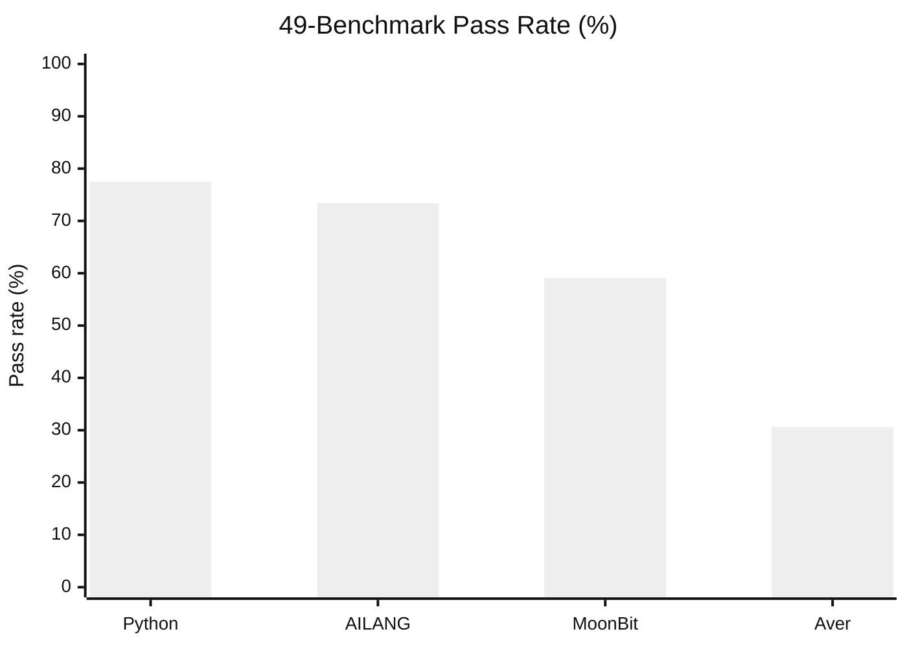

# Three Camps of AI-Native Languages

Negroni Venture Studios' [May 2026 survey](https://negroniventurestudios.com/2026/05/20/three-camps-alike-in-dignity/) grouped ~20 LLM-targeted programming languages into three camps based on where their authors think LLM codegen breaks down. AILANG's bet: **verification and orchestration are the same problem**.

## The Three Camps

| Camp | Core Hypothesis | Mechanism | Example Languages |
|---|---|---|---|
| **Syntactic** | LLMs fail on ambiguous tokens | Restructure syntax surface | [X07](https://x07lang.org), [NERD](https://www.nerd-lang.org/), [Magpie](https://magpie-lang.com/), [Laze](https://github.com/kerv/laze), [Faber Romanus](https://faberlang.dev) |
| **Verification** | LLMs fail without mechanical checks | Contracts, proof export, or constrained sampling | [Vera](https://veralang.dev), [Aver](https://averlang.dev), [Raskell](https://raskell.io/), [Prove](https://prove.botwork.se), [Pact](https://github.com/KikotVit/pact-lang), [MoonBit](https://www.moonbitlang.com), [Zero](https://github.com/vercel-labs/zerolang), **AILANG** |
| **Orchestration** | LLMs fail without coordination primitives | Runtime/type-level agent wiring | [Pel](https://arxiv.org/abs/2505.13453), [Marsha](https://github.com/alantech/marsha), [Plumbing](https://johncarlosbaez.wordpress.com/2026/03/11/a-typed-language-for-agent-coordination/), [Quasar](https://arxiv.org/abs/2506.12202), [Boruna](https://github.com/escapeboy/boruna) |

## Where AILANG Fits

| Camp | AILANG Status | Concrete Mechanism |
|---|---|---|
| **Verification** | Full member | Z3-backed `requires`/`ensures` (`ailang verify`), row-polymorphic `! {Effects}`, Hindley–Milner inference, IFC taint labels |
| **Orchestration** | Strong member | First-class `std/ai` (`callJsonResult`, `step`, `runTools`), coordinator + chain telemetry, eval harness, MCP server |
| **Syntactic** | Deliberate non-member | Conventional ML-family syntax; bets that output contracts matter more than input token compression |

- **Contracts** specify *what* generated code must produce.
- **Effect rows** specify *how* it touches the world.
- **`std/ai`** makes the LLM itself a typed citizen inside the program.

## Gap Analysis

| Benchmark | Inspired By | Hypothesis Under Test |
|---|---|---|
| `ast_patch_roundtrip` | X07 | Structural AST diffs beat free-text edits |
| `dense_operator_program` | NERD | Ambiguous operators (`<<`, `>>`, `&&`, `==`) hurt pass rate |
| `explicit_dataflow_ssa` | Magpie | SSA-shaped let-chains improve LLM reasoning |
| `shadowing_heavy_contract` | Vera | Named identifiers break under shadowing vs De Bruijn slots |
| `decision_block_capture` | Aver | Co-located rationale blocks improve auditability |
| `intent_annotated_solver` | Pact | `@intent(...)` prompts lift solve rate |
| `canonical_convergence` | Zero | Canonical syntax increases N=20 output convergence |
| `multi_agent_handoff` | Pel / Marsha | First-class `std/ai` subtask delegation without external glue |
| `typed_stream_pipeline` | Plumbing | Static types catch streaming pipeline wiring bugs |
| `parallel_independent_subtasks` | Quasar | Explicit data independence exposes parallelism |
| `audit_chain_replay` | Boruna | Bit-identical trace replay (`--emit-trace jsonl`) |
| `ai_effect_summarize` / `ai_effect_json_schema` | AILANG | Typed `std/ai` + `callJson` schema enforcement |
| `unauthorized_fs_refused` | AILANG | Explicit authority rejects ungranted `{FS}` caps |

## Self-Audit Results

We evaluated AILANG against Python, MoonBit, and Aver using the teaching-prompt methodology (`claude-haiku-4-5`, 2026-05-20).

| Suite / Subset | Python | AILANG | MoonBit | Aver | Headline Finding |
|---|---:|---:|---:|---:|---|
| **11-benchmark camp probe** *(+1 retry)* | **11/11** *(100%)* | 8/11 *(73%)* | — | — | Refuted NERD (`dense_operator_program`) & Vera (`shadowing_heavy_contract`); surfaced `PAR_001` multi-output prompt gap |
| **49-benchmark smoke+core (full)** | **38/49** *(77.5%)* | **36/49** *(73.4%)* | 29/49 *(59.1%)* | 15/49 *(30.6%)* | AILANG holds within 4pp of Python from prompt alone |
| **Language-agnostic (33)** | **27/33** *(81.8%)* | 24/33 *(72.7%)* | 22/33 *(66.6%)* | 11/33 *(33.3%)* | Python's training-corpus prior wins on general algorithms |
| **AILANG-strength (16)** | 11/16 *(68.7%)* | **12/16** *(75.0%)* | 7/16 *(43.7%)* | 4/16 *(25.0%)* | **Crossover**: AILANG beats Python (+6pp) on contracts & effect rows; MoonBit drops 23pp |

**Key takeaways:**
- **NERD & Vera refuted locally**: AILANG passed operator-heavy and shadowing-heavy code one-shot via HM inference.
- **Self-repair cost**: 3/8 AILANG probe passes needed a compile-retry (~2x tokens), pointing directly to prompt improvements (`std/json`, multi-output syntax).
- **Harness bugs caught**: Testing a zero-prior language (Aver) exposed `PromptForLanguage` and `WRONG_LANG` language-gating bugs in the eval harness.
- **Peer fit**: Vera was install-blocked on macOS arm64 (`aallan/vera#691`); Aver hit design incompatibilities (no bitwise ops/HOFs) and multi-line arm syntax errors.

## Deep Dive: Zero & Guardians

- **AILANG vs [Zero](https://github.com/vercel-labs/zerolang)**: Complementary targets — Zero targets systems code (C-family, borrow checking, C FFI), while AILANG targets agent reasoning (ML-family, row-polymorphic `! {Effects}`, Z3 contracts, `std/ai`). Both converged on explicit effects, capability-object I/O, JSON diagnostics, and compiler-as-tool workflows. (Eval inclusion of Zero 0.1.1 was blocked by incomplete string lowering and `zero run` availability.)
- **Guardians (Prompt Injection)**: Erik Meijer's [*Guardians of the Agents*](https://cacm.acm.org/practice/guardians-of-the-agents/) ([Python reference](https://github.com/metareflection/guardians)) splits defense into taint analysis, sequence automata, and SMT over arguments. AILANG encodes two at compile/verify time: Z3 contracts (`ailang verify`) and IFC taint labels (`string<email>` source, `string{not email}` sink, `! {Declassify}` gate). See the [IFC Labels Guide](./ifc-labels.mdx) and [prompt-injection benchmark](https://github.com/sunholo-data/ailang/tree/dev/benchmarks/prompt_injection).

## See Also

- [AILANG vs Agent Frameworks](./ailang-vs-agents) — why AILANG sits below agents in the stack
- [AI Effect Guide](./ai-effect) — `std/ai` (`callJsonResult`, `step`, `runTools`)
- [Design Axioms](/docs/references/axioms) — the A1–A12 framework
