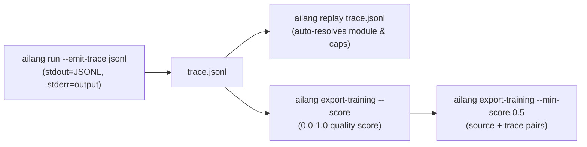

# Execution Traces

AILANG captures structured execution traces when programs run — every function call, effect invocation, contract check, and budget delta — enabling determinism proofs, debugging, and AI training export.



## Quick Start

```bash
# 1. Capture a trace
ailang run --emit-trace jsonl --caps IO --entry main program.ail > trace.jsonl

# 2. Inspect the trace
cat trace.jsonl | jq .

# 3. Verify determinism (re-runs and compares)
ailang replay trace.jsonl

# 4. Score and export as training data
ailang export-training --score trace.jsonl
ailang export-training --min-score 0.5 traces/
```

## Capturing Traces

Add `--emit-trace jsonl` to `ailang run`. **All status messages and program output go to stderr**, keeping stdout as pure JSONL:

```bash
ailang run --emit-trace jsonl --caps IO --entry main module.ail > trace.jsonl 2> output.txt
ailang run --emit-trace jsonl,otel --caps IO --entry main module.ail > trace.jsonl
```

### Trace Event Types

| Event | When | Key Fields |
|---|---|---|
| `module_start` | Program begins | module name, granted capabilities |
| `function_enter` | Function called | function name, arguments, call depth |
| `function_exit` | Function returns | function name, result, duration |
| `effect` | Side effect invoked | effect name, operation, args (`"deterministic": false` for `Net`/`Clock`/`IO.readLine`) |
| `contract_check` | Pre/postcondition tested | kind, passed/failed, message |
| `budget_delta` | Resource consumed | used, limit, remaining |
| `error` | Runtime error | message, position |
| `module_end` | Program ends | module name, error count |

<details>
<summary>Example JSONL trace output</summary>

```json
{"version":"1.0","event":"module_start","timestamp_ns":750,"module":{"name":"examples/runnable/hello","caps":["IO"]}}
{"version":"1.0","event":"function_enter","timestamp_ns":24375,"depth":1,"function":{"name":"std/io.print","args":["Hello, AILANG!"]}}
{"version":"1.0","event":"effect","timestamp_ns":30000,"depth":1,"effect":{"effect_name":"IO","op_name":"print","args":["Hello, AILANG!"],"result":"()"}}
{"version":"1.0","event":"function_exit","timestamp_ns":39167,"depth":1,"function":{"name":"std/io.print","result":"()","duration_ns":15000}}
{"version":"1.0","event":"module_end","timestamp_ns":39375,"module":{"name":"examples/runnable/hello","duration_ns":38625}}
```

</details>

## Replaying Traces (Determinism Verification)

`ailang replay` reads `module_start` to auto-resolve source path and `--caps`, re-runs the program, and compares event types/order, function args, effect ops, and contract results (ignoring timestamps and durations):

```bash
ailang replay trace.jsonl
ailang replay --json trace.jsonl
ailang replay --file modified.ail trace.jsonl
```

| Exit Code | Meaning |
|---|---|
| `0` | Traces match — deterministic |
| `1` | Traces differ — non-deterministic behavior detected |
| `2` | Error (file not found, parse error, etc.) |

## Scoring & Exporting Training Data

```bash
ailang export-training --score --json trace.jsonl
ailang export-training --min-score 0.5 --source-dir examples/runnable/ --output training.jsonl traces/
```

| Scoring Component | Weight | What It Measures |
|---|---|---|
| **Completion** | 30% | `1.0` if clean `module_end`, `0.0` if errors |
| **Complexity** | 25% | Function count, call depth, total calls (log scale) |
| **Contracts** | 20% | Pass rate of pre/postconditions (`0.5` neutral if none) |
| **Budget efficiency** | 15% | `1.0` if 20–80% of budget used |
| **Effect diversity** | 10% | More distinct effect types = higher score |

Each output JSONL line pairs `"source"`, `"trace"`, `"score"`, and `"metadata"`. Source files resolve via `--source-dir`, then the trace directory, then the working directory.

## Two Levels of Traces & WASM Streaming

| Aspect | Program Traces (`--emit-trace`) | Agent Traces (`ailang chains`) |
|---|---|---|
| **Scope** | Inside AILANG execution (functions, effects, contracts) | Around it (agent sessions, turns, tool calls) |
| **Storage** | Standalone JSONL files | `observatory.db` (SQLite) |
| **Guide** | This page | [Telemetry & Tracing](telemetry.md) & [Coordinator](coordinator.md) |

In browser WASM, `ailangSetTraceHandler((event) => ...)` streams W3C-compatible trace events (`trace_id`, `span_id`, `parent_span_id`) in real time, including custom spans from `std/trace` (`spanStart`, `spanEnd`, `event`):

```ailang
import std/net (httpGet)
import std/trace (spanStart, spanEnd, event)

func fetchData(url: string) -> string ! {Trace, Net} {
    spanStart("fetchData");
    event("url", url);
    let result = httpGet(url);
    spanEnd("fetchData");
    result
}
```

## Known Limitations

- **Module files required**: Tracing requires a `module` declaration and `--entry main` (single-expression files are not yet supported).
- **No interactive step-through**: Replay is batch comparison only.
