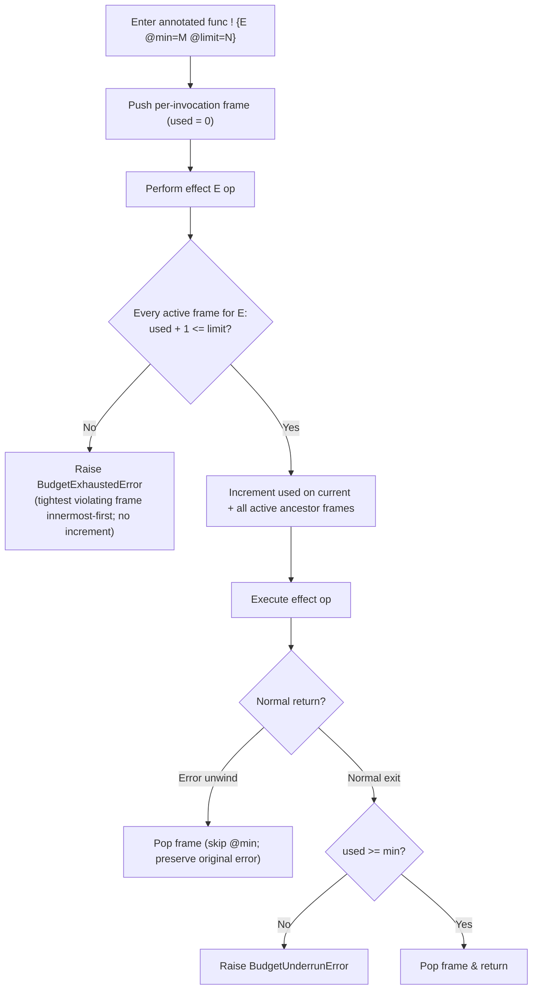

import CodeBlock from '@theme/CodeBlock';
import BudgetBasic from '!!raw-loader!@site/../examples/reference/budget_basic.ail';
import BudgetPerInvocation from '!!raw-loader!@site/../examples/reference/budget_per_invocation.ail';
import BudgetExhausted from '!!raw-loader!@site/../examples/reference/budget_exhausted.ail';
import CapabilityBudgets from '!!raw-loader!@site/../examples/reference/capability_budgets.ail';
import BudgetMinimum from '!!raw-loader!@site/../examples/reference/budget_minimum.ail';

# Capability Budgets

Capability budgets **bound how many times a function can perform an effect per invocation** (`@limit=N` maximum, `@min=N` minimum), preventing runaway loops, enforcing API rate limits, and verifying audit/non-cached execution.


| Scenario | Without Budgets | With Budgets |
|----------|-----------------|--------------|
| API rate limiting | Manual counters | `! {Net @limit=100}` |
| Logging control | Global config | `! {IO @limit=5}` |
| Audit / cache bypass check | Manual assertions | `! {IO @min=1}` / `! {Net @min=1}` |

## Basic Syntax

<CodeBlock language="ailang" title="examples/reference/budget_basic.ail">
  {BudgetBasic}
</CodeBlock>

```bash
ailang run --caps IO --entry main examples/reference/budget_basic.ail
```

```ailang sketch
-- Maximum limit: can use at most 5 IO operations
func f() -> () ! {IO @limit=5} { ... }

-- Minimum requirement: must use at least 1 IO operation
func g() -> () ! {IO @min=1} { ... }

-- Combined: between 1 and 5 IO operations (inclusive)
func h() -> () ! {IO @min=1 @limit=5} { ... }

-- Multiple effects with different budgets
func i() -> () ! {IO @limit=5, Net @min=1 @limit=3} { ... }

-- No budget = unlimited, no minimum
func unlimited() -> () ! {IO} { ... }
```

| Annotation | Meaning |
|---|---|
| `@limit=N` | Max `N` operations per call (`BudgetExhaustedError` if exceeded) |
| `@min=N` | Min `N` operations required on normal return (`BudgetUnderrunError` if unmet) |
| `@min=M @limit=N` | Inclusive range `[M, N]` |

## Budget-Charging Flow & Per-Invocation Semantics



- **Per-invocation isolation:** Each call pushes a fresh frame (`used = 0`); a caller's prior ops do not consume the callee's `@limit`.
- **Bubbling charge:** Every op increments the innermost frame **and** every active ancestor frame for that effect (unannotated helpers charge their caller's frame).

<CodeBlock language="ailang" title="examples/reference/budget_per_invocation.ail">
  {BudgetPerInvocation}
</CodeBlock>

## Budget Exhaustion (`@limit=N`)

<CodeBlock language="ailang" title="examples/reference/budget_exhausted.ail">
  {BudgetExhausted}
</CodeBlock>

```text
Error: effect 'IO' budget exhausted: limit=2, used=2
Hint: Increase the budget with @limit=N or refactor to use fewer IO operations
```

## Minimum Budgets (`@min=N`)

<CodeBlock language="ailang" title="examples/reference/budget_minimum.ail">
  {BudgetMinimum}
</CodeBlock>

```text
Error: effect 'IO' budget underrun: min=1, actual=0
Hint: Ensure the function actually performs at least 1 IO operation(s)
```

Combined `@min` and `@limit` for bounded retries:

```ailang
import std/net (httpRequest)
import std/result (Ok, Err)

func fetchWithRetry(url: string, attemptsLeft: int) -> string ! {Net @min=1 @limit=5} {
  match httpRequest("GET", url, [], "") {
    Ok(resp) => resp.body,
    Err(_) =>
      if attemptsLeft > 1 then fetchWithRetry(url, attemptsLeft - 1)
      else "request failed"
  }
}
```

## Complete Example & CLI Flags

<CodeBlock language="ailang" title="examples/reference/capability_budgets.ail">
  {CapabilityBudgets}
</CodeBlock>

Budgets are enforced by default whenever `--caps` grants the effect; pass `--no-budgets` during debugging to bypass `@limit`/`@min` checks.

| Concept | Purpose | Checked At |
|---|---|---|
| Capability Grant | Permission to use effect | Runtime (`--caps`) |
| Budget Limit | Per-invocation usage bounds (`@limit` / `@min`) | Runtime (effect ops & return) |

```ailang error=PAR_EFF005_BUDGET
-- Hypothetical global budget (NOT how AILANG works)
func a() -> () ! {IO @global=5} { println("A"); () }
func b() -> () ! {IO @global=5} { println("B"); () }

-- This would be confusing:
a(); a(); a();  -- Uses 3 of 5 global budget
b(); b(); b();  -- Fails on 3rd call? Hard to predict!
```

## Best Practices

```ailang sketch
-- Start with unlimited
func process() -> () ! {IO} { ... }

-- Add budget when needed
func process() -> () ! {IO @limit=100} { ... }
```

```ailang sketch
-- Too restrictive
func fetchAll() -> () ! {Net @limit=1} { ... }  -- Only 1 request?

-- More reasonable
func fetchAll() -> () ! {Net @limit=50} { ... }  -- Batch of 50
```

```ailang sketch
-- Rate limited to respect API quota (100 requests/minute)
func apiCall() -> () ! {Net @limit=100} { ... }
```

## Related Resources

- [Effect System](/docs/reference/effects) — Overview of AILANG's effect system
- [Security Model](/docs/reference/security-model) — Capabilities and `--policy` confinement
- [Known Limitations](/docs/reference/limitations) — Known limitations
