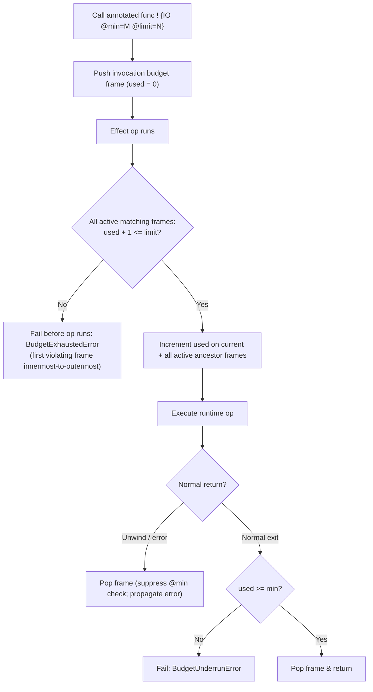

# Effect System

AILANG uses an **algebraic effect system** with capability-based security. Every side effect must be declared in function signatures (`! {IO, FS}`) and explicitly granted at runtime (`--caps IO,FS`).


:::info Academic Foundation
Based on Plotkin & Pretnar (2009) [Algebraic Effects](/references/plotkin-pretnar-2009.pdf), Leijen (2014) [Koka Row Polymorphism](/references/leijen-koka-2014-arxiv.pdf), and Lucassen & Gifford (1988) [Polymorphic Effect Systems](/references/lucassen-gifford-1988.pdf). See [Citations & Bibliography](/docs/references).
:::

## Why Explicit Effects?

```ailang
-- Effects declared in signature, checked statically, granted at runtime
import std/io (println)
import std/fs (readFile)
import std/string (toUpper)

func processData() -> string ! {IO, FS} {
  println("Processing...");
  let data = readFile("input.txt");
  toUpper(data)
}
```

- **Reasoning**: Function signatures state every allowed side effect.
- **Security**: Grant only required capabilities via `--caps` or `--policy`.
- **Testing & AI Safety**: Keep core logic `pure func`; audit effects at boundaries.

## Available Effects

### IO Effect (`std/io`, `std/terminal`)

Console input/output and scoped native TTY events:

```ailang
import std/io (println, print)

func greet(name: string) -> () ! {IO} {
  print("Hello, ");
  println("${name}!")
}
```

| Function | Type | Description |
|----------|------|-------------|
| `println` / `print` | `string -> () ! {IO}` | Print with / without newline (`println` is in prelude for entry modules) |
| `readLine` / `readLineOpt` | `() -> string ! {IO}` / `() -> Option[string] ! {IO}` | Line input (`readLineOpt` distinguishes blank `Some("")` from sticky EOF `None`) |
| `exit` | `int -> () ! {IO}` | Terminate with exit code (`0` = ok, `n != 0` = fail after flushing traces) |
| `std/terminal.withTerminal` | `(options, body) -> Result[a, TerminalError] ! {IO, e}` | Scoped raw-mode TTY input + `readEvent` on macOS/Linux (Windows/WASM return `Unsupported`) |

```ailang
module docs/exit_demo

import std/io (println, exit)
import std/env (getArgs)

func validate(args: [string]) -> Result[(), string] = match args {
  [] => Err("expected at least one argument"),
  _ => Ok(())
}

export func main() -> () ! {IO, Env} {
  match validate(getArgs()) {
    Ok(_)    => println("ok"),
    Err(msg) => {
      println("error: ${msg}");
      exit(1)
    }
  }
}
```

| Surface | `exit(0)` | `exit(n != 0)` |
|---|---|---|
| `ailang run` / `--batch` | Process or item succeeds | Process exits `n`; batch item fails (`program called exit(n)`), others continue |
| `serve-api` / A2A / MCP | Request succeeds | HTTP 500 / task `failed` / MCP error; server keeps running |

### FS Effect (`std/fs`, `std/zip`)

File system operations, optionally jailed via `AILANG_FS_SANDBOX=/tmp/sandbox` (also applies to `std/zip` and `std/process` working directory):

```ailang
import std/fs (readFile, writeFile, fileExists)

func copyFile(src: string, dst: string) -> () ! {FS} {
  if fileExists(src) then {
    let content = readFile(src);
    writeFile(dst, content)
  } else ()
}
```

| Function | Type | Description |
|----------|------|-------------|
| `readFile` / `writeFile` | `string -> string ! {FS}` / `(string, string) -> () ! {FS}` | Read or write text file |
| `fileExists` / `isDir` / `isFile` | `string -> bool ! {FS}` | Path predicates |
| `listDir` / `mkdir` / `mkdirAll` / `removeFile` | `... ! {FS}` | Directory listing (sorted), creation, removal |
| `std/zip` (`listEntries`, `readEntry`, `readEntryBytes`) | `... ! {FS}` | Read ZIP archive entries |

### Clock Effect (`std/clock`)

Monotonic timestamps and sleep, with deterministic virtual time (`--clock-mode fixed --clock-start 1000`):

```ailang
import std/clock (now, sleep)
import std/io (println)

func timedOperation() -> int ! {Clock, IO} {
  let start = now();
  sleep(1000);
  let end = now();
  println("Elapsed: ${show(end - start)}ms");
  end - start
}
```

### Net Effect (`std/net`)

HTTP client with DNS-rebinding prevention, private-IP blocking, HTTPS enforcement by default, 30 s default timeout (`--net-timeout`), and 5 MB default body cap (`--net-max-bytes`):

```ailang
import std/net (httpRequest)
import std/json (decode)

func fetchJson(url: string) -> Result[Json, string] ! {Net} =
  match httpRequest("GET", url, [], "") {
    Ok(resp) => decode(resp.body),   -- HttpResponse has body (UTF-8) and bodyBytes (raw)
    Err(Transport(msg)) => Err("network error: ${msg}"),
    Err(_) => Err("request failed")
  }
```

| Function / Flag | Purpose |
|---|---|
| `httpGet` / `httpPost` | `string -> string ! {Net}` / `(string, string) -> string ! {Net}` |
| `httpRequest` / `httpRequestBytes` | Full HTTP with headers, status codes, `Result[HttpResponse, NetError]` |
| `--net-allow-domains <list>` | Domain allowlist |
| `--net-allow-http` / `--net-allow-localhost` / `--net-allow-metadata` | Relax HTTPS-only, loopback (local Ollama), or cloud metadata restrictions |
| `HTTP_PROXY` / `HTTPS_PROXY` / `NO_PROXY` | Honoured per request (no pinned-IP guarantee for hostnames behind a proxy; `--policy` refuses proxies with `E_NET_PROXY_REFUSED`) |

### Env Effect (`std/env`)

Read environment variable snapshots (`getEnv(name) -> Result[string, EnvError] ! {Env}`, `getEnvOr(name, default)`, `getArgs`).

```ailang
import std/env (getEnv)

func getConfig() -> string ! {Env} {
  match getEnv("CONFIG_PATH") {
    Ok(path) => path,
    Err(_) => "/etc/default.conf"
  }
}
```

### Process Effect (`std/process`)

Execute external commands without shell expansion (`exec`, `spawnProcessResult`, `writeProcessStdin`, `closeProcessStdin`, `cancelProcess`). Use `std/io.exit` to set *this* program's exit code.

```ailang
import std/io (println)
import std/process (exec, NotFound, NotAllowed, Timeout)
import std/bytes (toString)

func runCommand(cmd: string, args: [string]) -> () ! {IO, Process} {
  match exec(cmd, args) {
    Ok(out) => {
      println("stdout: ${toString(out.stdout)}");
      println("exit code: ${show(out.exitCode)}")
    },
    Err(NotFound(cmd))  => println("not found: ${cmd}"),
    Err(NotAllowed(cmd)) => println("blocked: ${cmd}"),
    Err(Timeout(ms))    => println("timed out after ${show(ms)}ms"),
    Err(_)              => println("other error")
  }
}
```

| Flag / Field | Semantics |
|---|---|
| `--process-allowlist <bins>` | Exact binary allowlist resolved once via `PATH` at startup; supports subcommand narrowing (`git:status,git:log,gh:pr:list`) |
| `--process-timeout <dur>` / `--process-max-output <bytes>` | Per-exec wall-clock cap (default `30s`) and output cap (default `10MB`) |
| `Ok(out)` vs `Err(...)` | `Ok` = process exited (check `out.exitCode`); `Err` = launch failure (`NotFound`, `NotAllowed`, `Timeout`, `OutputLimitExceeded`, `SpawnFailed`) |
| Worker lifetime | CLI/REPL/engine owners reap child process groups on exit or `cancelProcess` (`ProcessHandle` is owner-scoped) |

### Stream Effect (`std/stream`)

Bidirectional WebSocket, SSE (`sseConnect`, `ssePost`), and multi-source multiplexing (`asyncReadStdinLines`, `asyncExecProcess`, `selectEvents`):

```ailang
module docs/stream_demo

import std/io (println)
import std/stream (asyncReadStdinLines, selectEvents, SourceText)

export func main() -> () ! {Stream, IO} {
  let stdin = asyncReadStdinLines("stdin", 10);
  selectEvents([stdin], \event. match event {
    SourceText(source, text) => { println("[${source}] ${text}"); true },
    _ => true
  })
}
```

See [Streaming & Real-Time I/O Guide](/docs/guides/streaming) for the full API.

## Effect Syntax & Capability Grants

```ailang sketch
-- Single effect
func greet() -> () ! {IO} { ... }

-- Multiple effects
func process() -> Data ! {IO, FS, Net} { ... }

-- Pure function (no effects)
func add(x: int, y: int) -> int { x + y }

-- Explicit pure annotation
pure func factorial(n: int) -> int { ... }
```

`pure` means exactly `! {}` — combining `pure func` with a non-empty or open row (`! {IO}`, `! {e}`) is a type error. In callback types, omission and `! {}` differ:

| Callback Type | Contract |
|---|---|
| `T -> U` | Implicit open callback effects, charged at hand-off |
| `T -> U ! {}` | Closed pure callback; rejects effectful values even in effectful callers |
| `T -> U ! {IO}` | Concrete `IO` contract; callee pays `IO` when invoking |
| `T -> U ! {e}` | Effect polymorphism shared with the enclosing row |

Effects from called helpers combine into the caller's row, while pure functions can be called in any effectful context:

```ailang
module docs/combine_effects

import std/io (println)
import std/fs (readFile)

func pureCalc(x: int) -> int { x * 2 }

func helper() -> () ! {IO} {
  println("Helper called")
}

export func main() -> () ! {IO, FS} {
  helper();                      -- IO flows up
  let x = readFile("data.txt");  -- FS
  let n = pureCalc(21);          -- Pure in effectful context
  println("${x} (${show(n)})")
}
```

### Runtime Grants & Stdlib Mapping

```bash
ailang run --caps IO,FS,Net --entry main program.ail
ailang run --caps ALL --entry main program.ail   # development only
```

| stdlib module | Capability | Notes |
|---|---|---|
| `std/io`, `std/terminal` | `IO` | Console I/O, `exit`, native TTY |
| `std/fs`, `std/zip` | `FS` | File read/write/walk (sandboxed via `AILANG_FS_SANDBOX`) |
| `std/clock`, `std/datetime` (`now`), `std/game` | `Clock` | `std/datetime` formatting/arithmetic are pure |
| `std/net`, `std/web` | `Net` | Requires `--net-allow-*` flags for HTTP/localhost/metadata |
| `std/stream` | `Stream` | WebSocket / SSE / multiplexed sources |
| `std/rand` | `Rand` | Seeded PRNG, `uuid4` |
| `std/env` | `Env` | Environment variables and args |
| `std/process` | `Process` | External commands (`--process-allowlist`) |
| `std/ai`, `std/secret`, `std/trace` | `AI`, `Secret`, `Trace` | LLM calls, gated secrets (`<secret>`), custom spans |
| `std/list`, `std/string`, `std/option`, `std/result`, `std/map`, `std/set`, `std/array`, `std/bytes`, `std/json`, … | _(none)_ | Pure — usable from `pure func` without `--caps` |

## Capability Budgets

Limit or require effect operations per invocation with `@limit=N` and `@min=N`:

```ailang
import std/io (println)

func rateLimited() -> () ! {IO @limit=5} {
  println("Call 1");
  println("Call 2");
  ()
}

func auditRequired() -> () ! {IO @min=1} {
  println("Audit log entry");
  ()
}

func bounded() -> () ! {IO @min=1 @limit=3} {
  println("Required");
  println("Optional");
  ()
}
```



- **Per-invocation isolation:** Each call pushes a fresh frame; a caller's prior ops do not shrink a callee's `@limit`.
- **Bubbling charge:** Every op charges the innermost frame **and** all active ancestor frames for that effect (unannotated helpers still spend their caller's budget).
- **Bypass for debugging:** `ailang run --caps IO --no-budgets program.ail`. See [Capability Budgets](/docs/reference/capability-budgets).

## Effect Patterns & Testing

```ailang
import std/io (println)
import std/fs (readFile)
import std/string (stringToFloat)

-- Effect-polymorphic combinator
func twice[e](f: () -> () ! {e}) -> () ! {e} {
  f();
  f()
}

-- Pure business logic tested with inline tests
pure func calculateTax(amount: float) -> float
  tests [ (100.0, 20.0), (0.0, 0.0) ]
{
  amount * 0.2
}

-- Effectful boundary
func processInvoice(id: string) -> () ! {IO, FS} {
  let data = readFile("invoices/${id}.json");
  let amount = match stringToFloat(data) {
    Some(v) => v,
    None => 0.0
  };
  println("Tax: ${show(calculateTax(amount))}")
}
```

## Related Resources

- [Capability Budgets](/docs/reference/capability-budgets) — Full `@limit` / `@min` reference
- [Security Model](/docs/reference/security-model) — Capabilities, `--policy` confinement, and IFC labels
- [AI Effect Guide](/docs/guides/ai-effect) · [Streaming Guide](/docs/guides/streaming) · [Module Execution](/docs/guides/module_execution)
