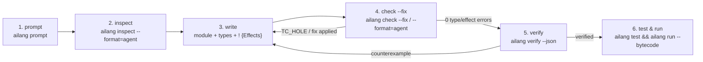

import Icon from '@site/src/components/Icon';
import { ACTIVE_PROMPT } from '@site/src/constants/version';

# I'm an AI agent (or configuring one)

AILANG is built for autonomous AI synthesis and mechanical verification. Never write AILANG from memory: load the canonical prompt first, X-ray existing modules with `ailang inspect`, and run `ailang check --fix` in a tight loop.

## Agent Task Routing Table

| Agent Task | Local CLI Command | Hosted MCP Tool (`mcp.ailang.sunholo.com/mcp/`) | Reference / Example |
|---|---|---|---|
| **1. Load current syntax before coding** | `ailang prompt` | `prompt_get(part="core")` + `prompt_get(part="reference")` | [Current Prompt](/docs/prompts/current) |
| **2. X-ray an existing `.ail` file/dir (`<100ms`)** | `ailang inspect --format=agent <path>` | — (local CLI) | [Debugging Guide](/docs/guides/debugging) |
| **3. Type + effect check (compact agent output)** | `ailang check --format=agent <file.ail>` | `ailang_check` (executor MCP) | [Language Syntax](/docs/reference/language-syntax) |
| **4. Auto-repair missing `! {Effects}`, `++`, `TC_MATCH_002`** | `ailang check --fix <file.ail>` | — (local CLI / `ailang lsp`) | [LSP & Quick-Fix](/docs/guides/lsp) |
| **5. Query expected type & bindings at expression** | Put `_?` or `?goal` in code → `ailang check --format=agent` | `ailang_check` | [LSP Typed Holes](/docs/guides/lsp) |
| **6. Prove `requires`/`ensures` contracts via Z3** | `ailang verify --json <file.ail>` (add `--int-model=int64` for overflow) | — (local CLI) | [Contracts & Z3](/docs/guides/contracts) |
| **7. Run inline `tests [...]` & property checks** | `ailang test <file.ail>` (or `--package`) | — (local CLI) | [Testing Guide](/docs/guides/testing) |
| **8. Execute deterministically (interpreter or VM)** | `ailang run --caps IO,FS --bytecode <file.ail>` | `ailang_run` (sandboxed) | [Effects Reference](/docs/reference/effects) |
| **9. Look up stdlib module exports & signatures** | `ailang docs --list` / `ailang docs std/json` | `stdlib_modules`, `stdlib_module` | [Stdlib Reference](/docs/reference/stdlib) |
| **10. Find working runnable `.ail` examples** | `ailang examples search "<query>"` | `example_for_concept`, `example_get` | [Examples](/docs/examples) |
| **11. Inspect JSON module interface & lock packages** | `ailang iface <mod>` / `ailang pkg docs <pkg>` | `docs_search` | [Packages Guide](/docs/guides/packages) |
| **12. Capture JSONL execution trace for repair** | `ailang run --emit-trace jsonl --quiet --caps IO <file.ail>` | — (local CLI) | [Execution Traces](/docs/guides/traces) |

## Agent Repair Loop

## I'm a human configuring an agent

Set up Claude Code, Cursor, Codex, or a confined `ailang_only` harness:

- <Icon name="bot" inline /> **[AILANG vs Agent Frameworks](/docs/guides/ailang-vs-agents)** — why AILANG sits *below* agents as a deterministic semantic substrate.
- <Icon name="rocket" inline /> **[Agent Integration Guide](/docs/guides/agent-integration)** — 4-step quick start + pre-flight checklist.
- <Icon name="shield" inline /> **[Agent Tool Policy (`ailang_only`)](/docs/guides/agent-tool-policy)** — no-shell sandbox, `os.Root` confinement, and capability ceilings.
- <Icon name="wrench" inline /> **[Hooks Setup](/docs/guides/hooks-setup)** & **[Claude Code Integration](/docs/guides/claude-code-integration)** — HTTP telemetry hooks and inbox handoffs.
- <Icon name="zap" inline /> **[Hosted Docs MCP](/docs/guides/agent-mcp)** — attach `https://mcp.ailang.sunholo.com/mcp/` for version-pinned docs, stdlib, and benchmarks.

## I'm an AI agent reading this directly

- <Icon name="book" inline /> **[Current Teaching Prompt](/docs/prompts/current)** (`{ACTIVE_PROMPT}`) — canonical syntax and idioms.
- <Icon name="code" inline /> **[`llms.txt`](https://ailang.sunholo.com/llms.txt)** & **[`llms-full.txt`](https://ailang.sunholo.com/llms-full.txt)** — lightweight routing index and full reference corpus.
- <Icon name="play" inline /> **[The `ai` Effect (`std/ai`)](/docs/guides/ai-effect)** — typed `callJsonResult`, `step`, and `runTools` loops inside AILANG.
- <Icon name="brain" inline /> **[Brain Cache](/docs/guides/brain-cache)** & **[μRAG](/docs/guides/microrag)** — persistent semantic memory and just-in-time syntax injection.
